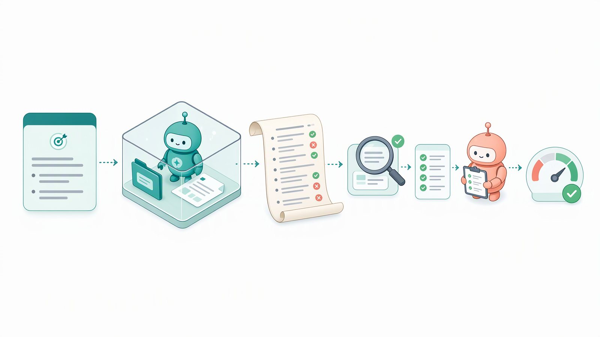

import { LinkCard } from '@astrojs/starlight/components';
import Pieces from '../../../components/Pieces.astro';
import RunDiagram from '../../../components/RunDiagram.astro';

<figure class="illustration">
  
  <figcaption>One trial, from the task to the score.</figcaption>
</figure>

Every eval, whatever tool runs it, has the same parts. Learn them once, and Vally's YAML, the GitHub Copilot Evals screens and other eval tools all start to read the same. This page is the reference the labs point back to.

## One trial, step by step

A **trial** is one run of one task. Here's what happens in every trial:

<RunDiagram
  title={'What happens in one trial'}
  actors={[
    { id: 'vally', name: 'Vally', icon: 'setting', tone: 'runner', note: 'the eval runner' },
    { id: 'agent', name: 'Agent under test', icon: 'laptop', tone: 'agent', note: 'started by the executor' },
    { id: 'graders', name: 'Graders', icon: 'approve-check', tone: 'check', note: 'checks and judges' },
    { id: 'record', name: 'Trial record', icon: 'analytics', tone: 'files', note: '<code>results.jsonl</code>' },
  ]}
  steps={[
    { from: 'vally', text: 'Takes one task', detail: 'In Vally, a stimulus: the prompt and its inputs.' },
    { from: 'vally', text: 'Prepares the environment', detail: 'A fresh workspace with the skills and files the task needs.' },
    { from: 'vally', to: 'agent', text: 'The executor starts the agent', detail: 'And sends the prompt. <code>copilot-sdk</code> runs GitHub Copilot.' },
    { from: 'agent', text: 'Works', detail: 'Turns, tool calls, skill use: the transcript records each one.' },
    { from: 'agent', to: 'vally', text: 'Finishes', detail: 'With an answer, and a workspace it may have changed.' },
    { from: 'vally', to: 'graders', text: 'Hands over the evidence', detail: 'Each grader reads the answer, the transcript or the workspace.' },
    { from: 'graders', to: 'vally', text: 'Pass or fail, a score, evidence', detail: 'One result per grader.' },
    { from: 'vally', to: 'record', text: 'Records the verdict', detail: 'The score against the threshold: the trial passes or fails.' },
  ]}
/>

Then the same task runs again, several times, and the eval reports the **pass rate**: how many trials passed.

## The parts

### What you give the agent

<Pieces
  items={[
    { term: 'Eval (eval spec)', def: 'One file that describes a complete test: the tasks, the environment, the checks and the settings.', analogy: 'a test file with several test cases', where: 'a <code>*.eval.yaml</code> file in <code>evals/</code>' },
    { term: 'Task (stimulus)', def: 'One request to the agent: the prompt, plus everything specific to that request. Vally calls it a <strong>stimulus</strong>; other tools say task or test case.', analogy: 'one test case', where: '<code>stimuli:</code>, each with a <code>name</code> and a <code>prompt</code>' },
    { term: 'Environment', def: 'What the agent finds when it starts: skills, files, settings. Vally builds a fresh, isolated workspace for every trial, so one trial can\'t affect the next, and nothing else from your repository reaches the agent.', analogy: 'a clean test fixture', where: '<code>agent_environment:</code> with <code>skills</code> and <code>files</code>' },
    { term: 'Agent under test', def: 'The AI agent whose behavior you measure: a model, plus its instructions and tools. In the labs: GitHub Copilot with the release-notes skill.', analogy: 'the system under test', where: '<code>defaults.model</code>, and the skill in <code>agent_environment.skills</code>' },
    { term: 'Executor (harness)', def: 'The part of Vally that starts and drives the agent. <code>copilot-sdk</code> runs GitHub Copilot. <code>mock</code> runs no model at all: it returns the prompt as the answer, to test the checks.', analogy: 'the test runner\'s driver', where: '<code>defaults.executor</code>' },
  ]}
/>

### What comes out of a trial

<Pieces
  items={[
    { term: 'Trial', def: 'One run of one task. Agents vary, so you run several trials of each task.', analogy: 'one roll of the dice', where: '<code>defaults.runs</code>, or <code>--runs</code> on the command line' },
    { term: 'Transcript (trajectory)', def: 'The full record of a trial: messages, tool calls and their results, tokens and timing. It tells you <em>how</em> the agent got its answer.', analogy: 'a flight recorder', where: '<code>results.jsonl</code> and the trial folders under <code>vally-results/</code>' },
    { term: 'Outcome', def: 'What the trial produced: the final answer, plus the state of the workspace afterwards (for example, whether a file changed).', analogy: 'the end state you assert on', where: 'the answer in the transcript; files in the trial\'s workspace' },
  ]}
/>

### How it's judged

<Pieces
  items={[
    { term: 'Grader (check)', def: 'One test of the outcome or the transcript. It returns pass or fail, a score from 0 to 1, and <strong>evidence</strong>: why it decided that. Vally says grader; the GitHub Copilot Evals screens say check.', analogy: 'one assertion', where: '<code>graders:</code> under each stimulus; each has a <code>type</code>, a <code>name</code> and a <code>config</code>' },
    { term: 'Code grader', def: 'A grader that checks something exactly, without a model: does the answer contain a text, does a file contain a value, was a skill used. Fast, free and the same every time.', analogy: 'assertEquals', where: '<code>output-contains</code>, <code>file-contains</code>, <code>skill-invocation</code>' },
    { term: 'LLM judge', def: 'A grader that asks a second model to read the answer and decide against written criteria. For qualities code can\'t check, such as tone. Slower, costs tokens, and needs checking itself.', analogy: 'a reviewer with a checklist', where: 'a grader with <code>type: prompt</code>' },
    { term: 'Rubric', def: 'The written criteria an LLM judge applies, one per line. It\'s the specification for the judge: vague criteria give inconsistent judgments.', analogy: 'the reviewer\'s checklist', where: '<code>rubric:</code> under a stimulus' },
    { term: 'Score and threshold', def: 'A trial\'s score is the average of its graders\' scores. The threshold is the score a trial needs to pass. With <code>threshold: 1</code>, every check must pass.', analogy: 'the pass mark of an exam', where: '<code>scoring.threshold</code>' },
    { term: 'Pass rate', def: 'How many trials passed, such as 2 of 3. With several trials, Vally also reports pass@k and pass^k.', analogy: 'a batting average', where: 'the <strong>Pass Rate</strong> column in <code>eval-results.md</code>' },
  ]}
/>

### How you organize and compare

<Pieces
  items={[
    { term: 'Suite', def: 'A named group of evals you run together, for example everything tagged for CI.', analogy: 'a test suite', where: '<code>suites:</code> in <code>.vally.yaml</code>; run with <code>--suite</code>' },
    { term: 'Baseline and variant', def: 'To compare a change, you run the same eval twice: the baseline (before) and a variant (after), with exactly one thing different.', analogy: 'the control group and the test group', where: 'an experiment file in <code>experiments/</code>' },
  ]}
/>

## The parts in a real file

This is the eval you'll run in Lab 3, with each part marked:

```yaml title="evals/release-notes.eval.yaml"
name: release-notes-completed-only                    # the eval
description: The release-notes skill announces completed work only and leaves the in-progress status in backlog.json alone.
type: capability                                      # intent: "can the agent do this yet?"
defaults:
  executor: copilot-sdk                               # executor: runs GitHub Copilot
  model: claude-sonnet-5.5                            # the agent's model
  runs: 3                                             # trials per task
  timeout: 120s
agent_environment:                                    # environment, rebuilt for every trial
  skills:
    - ../.github/skills/release-notes                 # the skill under test
  files:
    - src: ../backlog.json
      dest: backlog.json
scoring:
  threshold: 1                                        # every check must pass
stimuli:
  - name: completed-work-only                         # the task (stimulus)
    prompt: Write the release notes for this release from backlog.json.
    graders:                                          # the checks
      - type: output-contains                         # code grader on the answer
        name: leaves-out-unfinished-export
        config: { substring: CT-102, negate: true }
      - type: output-contains
        name: includes-done-search
        config: { substring: CT-101 }
      - type: output-contains
        name: includes-done-dark-mode
        config: { substring: CT-103 }
      - type: skill-invocation                        # code grader on the transcript
        name: release-notes-skill-used
        config:
          required:
            - release-notes
      - type: file-contains                           # code grader on the workspace
        name: backlog-still-in-progress
        config:
          path: backlog.json
          value: '"status": "in-progress"'
```

Notice the three things the graders look at: the **answer** (`output-contains`), the **transcript** (`skill-invocation`: did the agent use the skill?), and the **workspace** (`file-contains`). A complete eval checks all three where it matters.

:::note[What a check proves, and what it doesn't]
The `backlog-still-in-progress` check proves only that `backlog.json` still contains the text `"status": "in-progress"`. In this backlog, only CT-102 has that status, so the check catches an agent that marks CT-102 as done. It doesn't prove which item has the status, and it doesn't prove that the agent edited no file at all: for that, look at the trial's `workspace.patch`, which records every change the agent made. When an agent writes "I didn't edit any files", that's its claim, not evidence. Name each check after exactly what it tests, as this one does.
:::

## The same parts in other tools

| This workshop | Vally YAML | GitHub Copilot Evals screens | Other tools often say |
| --- | --- | --- | --- |
| Task | `stimuli` | Task, case | Test case, sample |
| Grader | `graders` | Check | Evaluator, metric, scorer |
| Transcript | Trajectory | Transcript, evidence | Trace, log |
| Trial | Run (`runs`) | Attempt | Epoch, repetition |

<LinkCard title="Next: Graders" description="Code checks, LLM judges and people, and how to check your checks." href="../graders/" />
