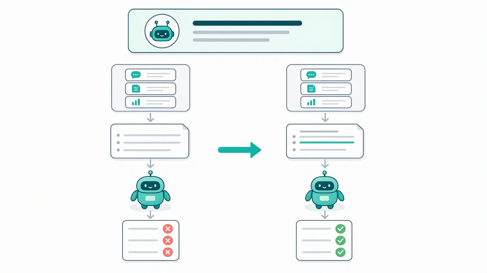

import { LinkCard } from '@astrojs/starlight/components';
import Flow from '../../../components/Flow.astro';

<figure class="illustration">
  
  <figcaption>Same eval, same model, one change: a controlled comparison.</figcaption>
</figure>

You changed a skill, and the eval passes now. Was it your change, or luck, or something else that changed at the same time, like the model? To know, you compare a **baseline** with a **variant** that differs in **exactly one thing**.

## Baseline and variant

- The **baseline** is the "before": the version you compare against.
- A **variant** is an "after": the same eval with one deliberate change, such as a fixed skill, another model or a reworded prompt.
- Everything else stays identical: the tasks, the graders, the model, the settings and the number of trials.

<Flow
  label="A controlled experiment"
  steps={[
    { label: 'Same eval', detail: 'Same tasks, graders and settings', tone: 'input' },
    { label: 'Baseline', detail: 'The original skill', tone: 'muted' },
    { label: 'Variant', detail: 'The fixed skill: the only difference', tone: 'agent' },
    { label: 'Report', detail: 'Pass rates side by side, with the difference', tone: 'result' },
  ]}
/>

## Experiments in Vally

A Vally **experiment file** declares the comparison. This is the one you'll run in Lab 4:

```yaml title="experiments/skill-fix.experiment.yaml"
name: release-notes-skill-fix
evals:
  - ../evals/release-notes.eval.yaml        # the eval to run for every variant
vary: [/environment/skills]                 # the ONLY setting allowed to differ
baseline: before                            # which variant is the "before"
variants:
  before:
    environment:
      skills: ["../skill-versions/before/release-notes"]   # the original skill
  after:
    environment:
      skills: ["../.github/skills/release-notes"]          # your fixed skill
```

- **`vary`** lists what may differ between variants, as a path into the eval's settings. Here it's the skills. If anything *else* differs between the variants, Vally refuses to run: a result can't come from a change you didn't declare.
- **`variants`** says what each variant changes. Each one can override the environment (skills, files) and settings such as `model`, `executor` or `runs`.
- **`baseline`** names the variant the others are compared with.

Run it with `vally experiment run <file>`. To see the plan without calling any model, add `--dry-run`. Both variants run in the same experiment, side by side, so a model update or a slow service affects both alike.

## Reading the report

The experiment ends with a summary like this one, from our test run:

```text
Experiment  release-notes-skill-fix   varying /environment/skills · baseline before

  → after beat baseline — 1/1 vs 0/1 stimuli.
    after used ±0% tokens, −7% trial time.

  eval                          before (baseline)         after                      Δ
  release-notes-completed-only  ✘ 0/1 (score 80% < 100%)  ✓ 1/1 (score 100% ≥ 100%)  +1
  stimuli                       0/1                       1/1                        +1
  tokens                        186.8k                    186.3k                     ±0%
  trial time                    27.4s                     25.4s                      −7%
```

- **Stimuli 0/1 → 1/1**: the one task failed with the baseline and passes with the variant.
- **Score 80% → 100%**: before, four of the five checks passed in each trial; after, all five.
- **Tokens and trial time**: the cost side. A fix that doubles the tokens may not be worth it.
- **`report.md`** in the output folder has the details per variant, including the pass rate per check and pass@k and pass^k.

## Comparing with a judge: `vally compare`

Pass rates compare *verdicts*. Sometimes you want to know which answers are *better*, even when both pass. `vally compare` asks an LLM judge to compare the baseline's and the variant's answers pair by pair, and reports the difference with a 95% confidence interval. With `--fail-on-regression`, it exits with an error when the variant is clearly worse, which makes it useful in CI. It spends tokens on the judge, so you'll find it under **Go further** in Lab 4.

## Comparing in GitHub Copilot Evals

GitHub Copilot Evals compares saved runs without calling any model, and sorts the differences into fixed, persistent and new failures. In VS Code it's **Compare saved runs (no AI calls)**. You'll try comparing with Copilot in [Lab 6](../../labs/lab-6-copilot-evals/).

<LinkCard title="Next: Vally and GitHub Copilot Evals" description="What each tool does, and how they fit together." href="../tools/" />
