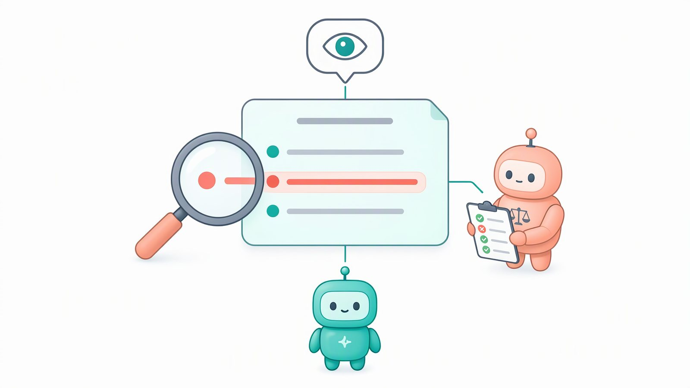

import { LinkCard } from '@astrojs/starlight/components';
import Flow from '../../../components/Flow.astro';

<figure class="illustration">
  
  <figcaption>One answer, three kinds of graders.</figcaption>
</figure>

A **grader** decides whether a trial did what you wanted. It looks at the answer, the transcript or the workspace, and returns three things: **pass or fail**, a **score** from 0 to 1, and **evidence**, the reason for its decision. An eval is only as good as its graders: a grader that can't tell a good answer from a bad one makes every score meaningless.

## Three kinds of graders

| | Code grader | LLM judge | Human review |
| --- | --- | --- | --- |
| **How it decides** | Checks something exactly: text, a file, a tool call | A second model applies a written rubric | A person reads and decides |
| **Good for** | Facts: "CT-102 isn't announced", "the backlog wasn't changed" | Qualities: tone, completeness, "a summary sentence comes first" | Calibrating the other two; unclear cases |
| **Speed and cost** | Instant, free | Seconds, costs tokens | Slow, costs people's time |
| **Same result every time?** | Yes | Not always | Not always |
| **Weak spot** | Brittle: misses a good answer phrased differently, or a bad answer that avoids the exact text | Can be lenient, biased or inconsistent | Doesn't scale |
| **In Vally** | `output-contains`, `file-contains`, `skill-invocation`, `run-command`, and more | `prompt` (one judge), `panel` (several) | Reading `eval-results.md` and transcripts |

**Use code graders wherever you can**, and an LLM judge for what code can't check. Use people to check both, especially at the start. In the labs you'll start with code graders and add a judge in Lab 5.

## What to check

An agent's work leaves three kinds of evidence, and a good eval checks each where it matters:

- **The answer**: does it contain what it must, and leave out what it must not? (`output-contains`)
- **The transcript**: did the agent do something it should, such as using the skill? (`skill-invocation`)
- **The workspace**: did the agent change, create or leave alone the right files? (`file-contains`)

Mostly, grade the **outcome**, not the path: an agent may reach a good answer in a way you didn't expect, and that's fine. Check the path only where the path itself matters, for example "the skill was used" or "no file was deleted".

## Positive and negative checks

A **positive check** passes when something is present: "the answer contains CT-101". A **negative check** passes when something is absent: "the answer doesn't contain CT-102". In Vally, you turn a check into a negative one with `negate: true`:

```yaml
- type: output-contains
  name: leaves-out-unfinished-export
  config: { substring: CT-102, negate: true }   # passes when CT-102 is NOT in the answer
```

Bugs often show up as something that *shouldn't* be there: an unfinished feature, a leaked secret, an edited file. An eval with only positive checks can't see them. You'll experience exactly that in [Lab 2](../../labs/lab-2-check-your-checks/).

## Check your checks

Before you trust a grader's score, prove that the grader works. Give it answers you already know are good or bad, and see whether it agrees:

- A **known-good answer** must pass. If it fails, your check is too strict or simply wrong.
- An **acceptable alternative** (different order, different wording) must pass too. If it fails, your check depends on formatting instead of meaning.
- A **known-bad answer** must fail. If it passes, your check is blind to the bug you care about.

These known answers are called **controls**, after the control samples in a lab experiment.

### Why the mock executor

To feed known answers to your graders, you don't want a real agent: it would write its own answer, not yours. Vally's **mock executor** calls no model at all. It simply returns the task's prompt text as the agent's answer. So you put your known answer into the prompt, and the graders grade exactly that text.

<Flow
  label="A normal trial compared with a control trial"
  steps={[
    { label: 'Normal trial', detail: 'executor: copilot-sdk', tone: 'muted' },
    { label: 'Prompt', detail: '"Write the release notes …"', tone: 'input' },
    { label: 'Agent works', detail: 'Copilot reads files and writes an answer', tone: 'agent' },
    { label: 'Graders', detail: 'Grade the agent\'s answer', tone: 'grader' },
  ]}
/>

<Flow
  label="A control trial with the mock executor"
  steps={[
    { label: 'Control trial', detail: 'executor: mock', tone: 'muted' },
    { label: 'Prompt', detail: 'Your known answer, word for word', tone: 'input' },
    { label: 'No model', detail: 'The prompt text becomes the answer', tone: 'muted' },
    { label: 'Graders', detail: 'Grade your known answer', tone: 'grader' },
  ]}
/>

That has four advantages:

- **It isolates the grader.** When a control fails, the grader is wrong, because nothing else was involved. Later, when a real trial fails, you know the agent failed, not your check.
- **It's free and fast.** No model, no tokens, no Copilot requests. A control run takes a few seconds, so you can change a check and rerun it as often as you like.
- **It's deterministic.** The same controls give the same result every time.
- **It calibrates LLM judges too.** Mock answers plus a real judge show how the judge decides on answers you understand, before you let it grade real ones. You'll do that in [Lab 5](../../labs/lab-5-llm-judge/).

What the mock executor does **not** tell you is anything about the agent. A control run proves your measuring instrument, nothing more. From Lab 3 on, the real agent runs with the `copilot-sdk` executor.

### Best practice, not a workshop trick

Checking checks with known answers is standard practice:

- **GitHub Copilot Evals** publishes a [no-model control eval](https://github.github.io/evals/examples/release-note-control.eval.yaml) for release notes and a [GitHub Actions workflow](https://github.github.io/evals/examples/eval-controls.yml) that runs it on demand with `--require-pass`.
- **Vally** has a separate command, [`vally oracle`](https://microsoft.github.io/vally/reference/cli/oracle/), that grades a stored reference solution for tasks that change files: "If a grader doesn't pass on the correct answer, the grader is wrong."
- **Anthropic** recommends [writing a reference solution for every task](https://www.anthropic.com/research/demystifying-evals-for-ai-agents), so you know the task can be passed and the graders are configured correctly.

In a real project, keep your controls next to your evals:

- **Run the known-good controls whenever you change an eval**, and gate on them with `--require-pass`, as the GitHub Copilot Evals example does. They must always pass.
- **Rerun the known-bad controls when you change a grader.** They're *meant* to fail, so look at them rather than gating on them.
- **Turn real failures into new controls.** When you find a bad answer in a transcript, add it as a known-bad control, so the check that should catch it stays honest.
- **Keep the copies in sync.** Controls test copies of your checks. When you change a check in the real eval, change its copy too. A mock run makes no tool calls, so controls can test checks on the answer, but not checks on the transcript such as `skill-invocation`.

## Changing a check changes the measurement

If an eval fails and you loosen its check, the pass rate goes up, but the agent didn't get any better. Change a grader only when the grader is wrong (your controls show you), and change the agent when the agent is wrong (the transcripts show you).

<LinkCard title="Next: Trials and metrics" description="Why several runs, and what pass rate, pass@k and pass^k tell you." href="../trials-and-metrics/" />
