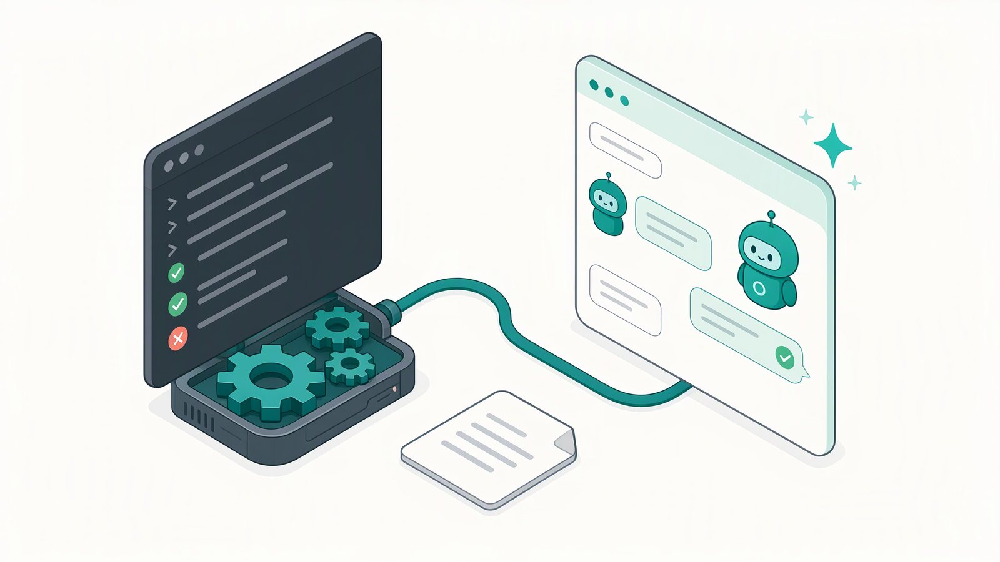

import { LinkCard } from '@astrojs/starlight/components';

<figure class="illustration">
  
  <figcaption>Vally is the engine; GitHub Copilot Evals is the assistant that works with it, on the same files.</figcaption>
</figure>

The workshop uses two tools that work together. **Vally** is the engine that runs evals. **GitHub Copilot Evals** is an assistant on top: Copilot helps you create, review, improve, run and compare evals, and every run still happens in Vally.

## Vally: the engine

[Vally](https://microsoft.github.io/vally/) is Microsoft's platform for AI evals, published on npm as `@microsoft/vally-cli`. You describe evals in YAML files and run them from the command line.

| Command | What it does | Lab |
| --- | --- | --- |
| `vally lint` | Checks eval files for mistakes, without running anything | 2 |
| `vally eval` | Runs evals: trials, graders, results | 0, 2, 3, 5 |
| `vally experiment run` | Runs a controlled comparison of variants | 4, 8 |
| `vally serve` | Opens a dashboard for your results in the browser | 3 |
| `vally grade` | Grades saved transcripts again, without rerunning the agent | Reference |
| `vally compare` | Compares two runs pair by pair with an LLM judge | 4 (Go further) |

Vally runs the agent through an **executor**. The default, `copilot-sdk`, runs GitHub Copilot; `mock` runs no model, for testing checks. An LLM judge runs on the model named in `judge_model`: by default a Copilot model, or, with a `judge_provider` block, a model on your own endpoint. Results land in `vally-results/`, as Markdown for people and JSONL for tools.

## GitHub Copilot Evals: the assistant

[GitHub Copilot Evals](https://github.github.io/evals/) is in preview. It adds six skills to Copilot that you use in plain language:

| Skill | You ask, for example |
| --- | --- |
| **create** | "Create an eval for the release-notes skill." |
| **review** | "Review this eval and its saved results." |
| **improve** | "Add a failure case to this eval and save a revised copy." |
| **run** | "Run this eval." |
| **compare** | "Compare these two saved runs." |
| **setup** | "Set up eval paths and test suites for this project." |

It works in several apps: Copilot CLI (as a plugin), VS Code (an extension with a visual Canvas), Visual Studio and the GitHub Copilot App. In this workshop you use the Copilot CLI plugin, because it works in a Codespace.

### You stay in control

- **Saving isn't running.** Copilot shows you full files before it saves them, and you approve each run separately, with its model, tools and limits shown first. Installing or opening Evals never starts a run.
- **Reading and comparing are free.** Validating files, reading saved results and comparing saved runs make no model calls. Asking Copilot to draft or review an eval does use your Copilot plan.
- **Two runners.** Copilot hands every run to Vally. Small evals, with one trial per case, at most 10 cases with 10 checks each, and no LLM judges, setup commands or command checks, run on the **bounded runner**, which adds a fresh home folder, a tool policy and a short list of allowed programs, so a run that Copilot starts for you stays small and predictable. It isn't a sandbox, though, and nothing caps the cost. Evals that need more, such as several trials or a judge, run on Vally's **full engine** (up to 100 trials, judges, and time limits of up to a day). It has no tool policy and no sandbox, so it asks for its own, more detailed approval. The eval file decides which runner is used; [Lab 6](../../labs/lab-6-copilot-evals/#how-copilot-runs-an-eval) shows both.

## Same files, two ways in

Both tools read the same files: `.vally.yaml` at the project root, and the `*.eval.yaml` files it points to. An eval you write by hand, Copilot can review; an eval Copilot drafts, you can run with `vally eval`. That's why the workshop starts with Vally: once you know the parts of an eval file, you can judge what Copilot drafts.

## When to use which

| Use Vally directly when you want… | Use GitHub Copilot Evals when you want… |
| --- | --- |
| Full control over every setting | A first draft from a plain-language description |
| Many trials, and LLM judges on Copilot or on your own endpoint | A review that finds gaps in an existing eval |
| Experiments that vary models or skills | Guided runs, with costs and effects shown before you approve |
| Scripts and automation | Comparing saved runs without writing commands |

For CI, both meet in the same place: the [GitHub Action `github/evals-action`](https://github.com/github/evals-action) runs your Vally evals on pull requests. You'll set it up in [Lab 7](../../labs/lab-7-ci/).

<LinkCard title="Glossary" description="Every term from the workshop, in one place." href="../glossary/" />
