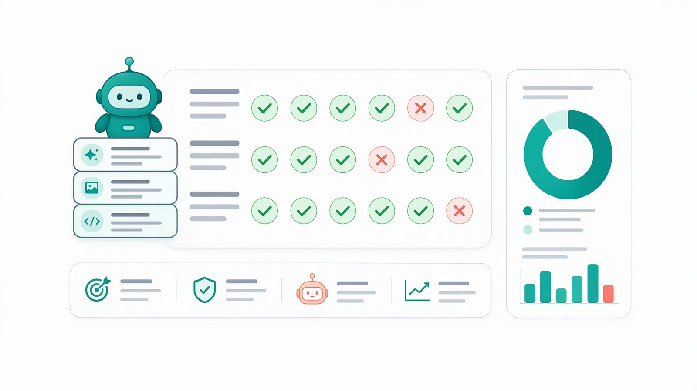

import { LinkCard } from '@astrojs/starlight/components';

<figure class="illustration">
  
  <figcaption>Run the same task again and again, and count how often it passes.</figcaption>
</figure>

An agent can give a different answer every time you ask it the same thing. So a single run tells you only what *can* happen, not what *usually* happens. That's why evals run each task several times. Each run is a **trial**.

## Why one run isn't enough

In our test runs of the release-notes skill with its bug, the trials gave two different kinds of answer:

- In some, the agent listed CT-102 as a new feature, following the skill's buggy rule.
- In others, the agent noticed CT-102 was unfinished, left it out of the list, but mentioned it in a note: "I left out CT-102 because it's still in progress."

The mix changed from run to run: in one run of three trials, two listed CT-102; in another, none did.

If you had run it once and got the second kind of answer, you might have thought the agent handled the bug well. But the note still announces CT-102, and the first kind of answer shows the bug does reach the list. Only several trials show the range of what the agent does.

:::note[One result is an observation, not proof]
Every number in these labs comes from a few trials. That's enough to see a pattern and to learn the method, not to prove reliability. For decisions that matter, run more trials and more tasks.
:::

## Pass rate

The **pass rate** is the fraction of trials that passed: 2 of 3 trials is a pass rate of 67%. It's the first number to look at. Vally shows it per task in the **Pass Rate** column of `eval-results.md`.

## pass@k and pass^k

With two or more trials, Vally adds two metrics that answer two different questions. In both, *k* is the number of trials.

| Metric | Say it as | Question it answers | Vally's formula |
| --- | --- | --- | --- |
| **pass@k** | "pass at k" | Can the agent do this **at all**, given k tries? | 1 if any trial passed, else 0 (with k = the number of trials) |
| **pass^k** | "pass hat k" | Can I **rely** on it every time, k times in a row? | pk, where p is the pass rate |

For three trials:

| Trials passed | Pass rate | pass@3 | pass^3 |
| --- | --- | --- | --- |
| 0 of 3 | 0% | 0% | 0% |
| 1 of 3 | 33% | 100% | 4% |
| 2 of 3 | 67% | 100% | 30% |
| 3 of 3 | 100% | 100% | 100% |

The gap between them is the point. An agent that passes 2 of 3 trials *can* do the task (pass@3 is 100%), but the chance that it gets three requests in a row right is only about 30%. Which metric you care about depends on the job:

- **pass@k** fits tasks where a person picks the best of several attempts, or where retrying is cheap.
- **pass^k** fits tasks where every single run must be right, such as an agent that publishes release notes without review.

## How many trials?

- **For learning and quick checks**: 3 trials, as in the labs.
- **For decisions** (shipping a change, choosing a model): more trials and more tasks. With 3 trials, a difference of one passing trial is easily luck.
- **When results alternate** between pass and fail across trials, Vally labels the task **FLAKY**. That's information, not an error: the agent is unreliable on that task. Read the passing and the failing transcripts side by side.

## Other numbers in a run

Vally's results also show, per task:

- **Duration**: how long each trial took.
- **Tokens**: how much text the model read and wrote, which drives cost.
- **Turns** and **Tool calls**: how many steps the agent took. A fix that makes an agent pass but triples its tool calls might not be the fix you want.

## Is anything deterministic?

Yes: the **code graders** always give the same verdict for the same answer, and the **mock executor** always returns the same answer. What varies is the agent's answer and, to a smaller degree, an LLM judge's verdict. Pinning the model, as the labs do, makes runs comparable, but not identical. See [Model access and costs](../../start/model-access/#pinned-models-comparable-not-deterministic).

<LinkCard title="Next: LLM judges" description="How a model grades with a rubric, where judges go wrong, and how to calibrate one." href="../llm-judges/" />
