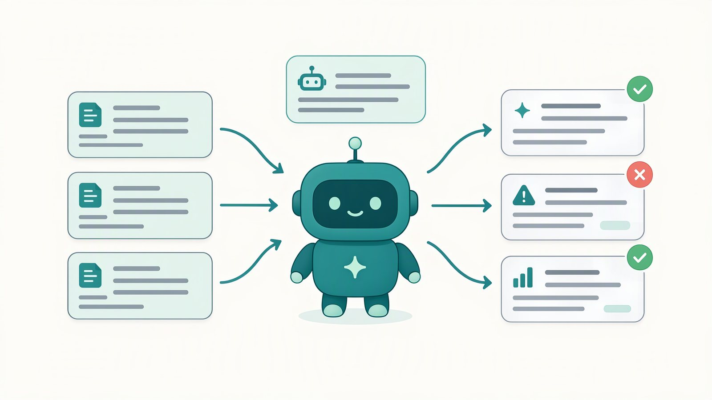

import { LinkCard } from '@astrojs/starlight/components';
import Flow from '../../../components/Flow.astro';
import RunDiagram from '../../../components/RunDiagram.astro';

<figure class="illustration">
  
  <figcaption>Same request, different answers: the reason agents need evals.</figcaption>
</figure>

**Evals turn "looks good" into a check you can repeat.**

An **eval** (short for *evaluation*) is a repeatable test for output that can change. You give an AI agent a task in a known starting situation, let it work, and then check what it did and what it produced against criteria you wrote down beforehand. Because the agent's output varies from run to run, you run the same task several times and report **how often** it succeeds.

<RunDiagram
  actors={[
    { id: 'you', name: 'You', icon: 'pencil', tone: 'you' },
    { id: 'runner', name: 'Eval runner', icon: 'setting', tone: 'runner', note: 'Vally, in the labs' },
    { id: 'agent', name: 'Agent', icon: 'laptop', tone: 'agent', note: 'model, instructions, tools' },
    { id: 'checks', name: 'Graders', icon: 'approve-check', tone: 'check', note: 'code checks or an LLM judge' },
  ]}
  steps={[
    { from: 'you', to: 'runner', text: 'Starts the eval', detail: 'A task, a starting situation, and what good looks like.' },
    { from: 'runner', to: 'agent', text: 'Gives it the task', detail: 'Each time in a fresh copy of the starting situation.' },
    { from: 'agent', to: 'runner', text: 'Answers', detail: 'Possibly differently from the trial before.' },
    { from: 'runner', to: 'checks', text: 'Hands over the evidence', detail: 'The answer, what the agent did and what it changed.' },
    { from: 'checks', to: 'runner', text: 'Pass or fail', detail: 'With evidence for the verdict.' },
    { from: 'runner', to: 'you', text: 'Reports a pass rate', detail: 'Not one verdict, but how often the agent succeeds.' },
  ]}
  repeat={{ first: 2, last: 5, label: 'Several trials of the same task' }}
/>

## Why agents need evals

Traditional code is deterministic: the same input gives the same output, so one passing test means something. An AI agent is different:

- **It isn't deterministic.** The same prompt can produce different answers, different tool calls and different results. One good answer proves only that a good answer is *possible*.
- **It has many moving parts.** The model, its instructions (such as a skill), its tools, and the files it can see all shape what it does. Change any one of them, and its behavior can change somewhere you didn't look.
- **"Looks good to me" doesn't scale.** Trying a prompt by hand a few times catches obvious problems, not the one-in-five failure that reaches a customer.
- **Models change.** When a new model comes out, an eval tells you within minutes whether it's better *for your tasks*, not on someone else's benchmark.

## Evals and unit tests

Evals borrow the idea of a test, but the details differ:

| | Unit test | Eval |
| --- | --- | --- |
| **What runs** | Your code | An AI agent: a model with instructions and tools |
| **Same input twice** | Same output | Often a different output |
| **How often you run it** | Once | Several **trials**, then a pass rate |
| **What you check** | Exact values | The answer, what the agent did, and what it changed, sometimes with judgment |
| **The result** | Pass or fail | A pass rate, plus evidence for each trial |
| **When it fails** | Your code is wrong | The agent, its instructions, the task or the check may be wrong; you read the transcript to find out which |

So an eval isn't "a unit test for AI". It's a test for output that can change.

## What you can evaluate

Anything that steers an agent's behavior:

- **Skills**: `SKILL.md` instructions an agent loads for a kind of task. That's what you'll evaluate in the labs.
- **Agent instructions and prompts**: custom instructions, system prompts and prompt files.
- **Tools**: for example, MCP servers. Does the agent pick the right tool, with the right arguments?
- **Models**: the same tasks on two models, to choose between them.
- **Whole agents**: an agent with all of its instructions and tools.

## The eval loop

Evals aren't a one-off. You'll follow this loop through the labs:

<Flow
  label="The eval loop"
  steps={[
    { label: 'Define good', detail: 'Write the criteria before any run', tone: 'input' },
    { label: 'Check the checks', detail: 'Known answers, no model', tone: 'grader' },
    { label: 'Run trials', detail: 'Several runs of each task', tone: 'agent' },
    { label: 'Read transcripts', detail: 'Find out why it failed', tone: 'agent' },
    { label: 'Change one thing', detail: 'Then compare with the baseline', tone: 'grader' },
    { label: 'Guard it', detail: 'Run the eval on every change', tone: 'result' },
  ]}
/>

1. **Define good** before you run anything. If two people can't agree whether an answer passes, the task or the criteria are unclear. ([Lab 1](../../labs/lab-1-define-good/))
2. **Check the checks** with answers you already know are good or bad. ([Lab 2](../../labs/lab-2-check-your-checks/))
3. **Run trials** and look at the pass rate, not one run. ([Lab 3](../../labs/lab-3-run-the-agent/))
4. **Read the transcripts.** A pass rate tells you *that* something fails; the transcript tells you *why*.
5. **Change one thing** and compare it with the baseline, so you know what made the difference. ([Lab 4](../../labs/lab-4-fix-and-prove/))
6. **Guard it**: once the agent passes, run the eval on every change, so it keeps passing. ([Lab 7](../../labs/lab-7-ci/))

## Capability evals and regression evals

Evals serve two purposes, and the same eval can move from one to the other:

- A **capability eval** asks "can the agent do this yet?" It may start with a low pass rate, and you work to raise it. The release-notes eval starts here: the skill has a bug, so it fails.
- A **regression eval** asks "does the agent still do what it used to?" It should pass close to 100% of the time, and a drop means something broke. Once you've fixed the skill, the release-notes eval becomes this kind: you run it on every pull request.

<LinkCard title="Next: Anatomy of an eval" description="The parts every eval has, and what each one is called in Vally." href="../anatomy/" />
