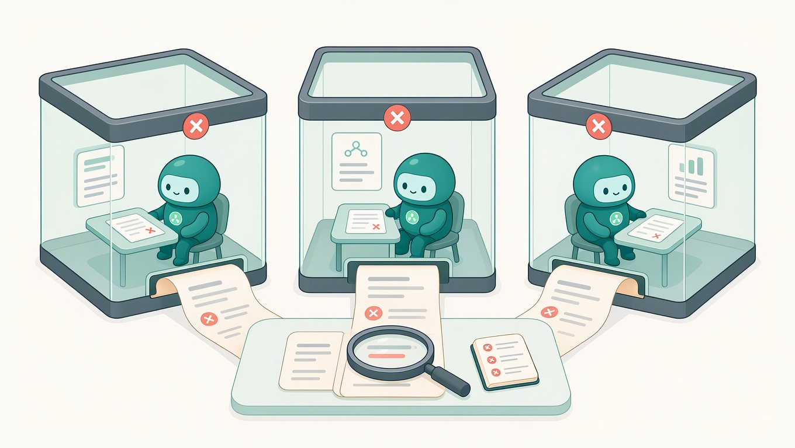

import { Steps } from '@astrojs/starlight/components';
import LabMeta from '../../../components/LabMeta.astro';
import Pieces from '../../../components/Pieces.astro';
import EvalMap from '../../../components/EvalMap.astro';

<LabMeta time="30 minutes" cost="3 Copilot runs" uses="evals/release-notes.eval.yaml" />

<figure class="illustration">
  
  <figcaption>Three isolated trials of the real agent, then an investigation of what happened in them.</figcaption>
</figure>

Your checks work. Now they meet the real agent: GitHub Copilot, with the release-notes skill, in a fresh workspace with the backlog. You'll run three trials and see how often the agent fails. Then you investigate, like a detective with a flight recorder: what did the agent see, what did it do, what did it think, and whose fault is the failure?

<EvalMap
  doing="Run the real agent three times. Then investigate the failure: its answers, its transcript, its reasoning."
  testing="GitHub Copilot with the release-notes skill"
  checking="Five code checks: three on the answer, one on the transcript, one on the workspace"
  task={{ text: 'Write the release notes from <code>backlog.json</code>' }}
  agent={{ text: 'GitHub Copilot, <code>claude-sonnet-5.5</code>' }}
  environment={{ text: 'The skill and <code>backlog.json</code>, fresh for every trial', state: 'new' }}
  trials={{ text: '3, in parallel', state: 'new' }}
  checks={{ text: 'Answer, transcript and workspace', state: 'new' }}
  results={{ text: 'Dashboard, trial records, Copilot\'s log', state: 'new' }}
/>

## The pieces you'll work with

<Pieces
  items={[
    { term: 'Agent under test', def: 'GitHub Copilot with the release-notes skill: the behavior you measure.', analogy: 'the system under test', where: '<code>executor: copilot-sdk</code>, <code>model: claude-sonnet-5.5</code>', isNew: true },
    { term: 'Environment', def: 'What the agent finds in its workspace: the skill and a copy of <code>backlog.json</code>. Vally builds a new, isolated workspace for every trial.', analogy: 'a clean test fixture', where: '<code>agent_environment:</code> with <code>skills</code> and <code>files</code>', isNew: true },
    { term: 'Trial', def: 'One run of the task. <code>runs: 3</code> means three trials, which Vally runs in parallel.', analogy: 'three rolls of the same dice', where: '<code>defaults.runs</code>; <code>--runs</code> overrides it', isNew: true },
    { term: 'Transcript (trajectory)', def: 'Everything a trial did, as a list of events: your prompt, each turn of the agent, every tool call with its arguments and result, each skill it activated, and the tokens of each turn.', analogy: 'a flight recorder', where: '<code>.trajectory.events</code> in <code>results.jsonl</code>', isNew: true },
    { term: 'Tool call and tool result', def: 'The agent acts through tools, such as <code>bash</code> to run a command or <code>skill</code> to load a skill. Each call and what came back are events in the transcript.', analogy: 'a function call and its return value', where: '<code>tool_call</code> and <code>tool_result</code> events', isNew: true },
    { term: 'Grader <code>skill-invocation</code>', def: 'A check on the transcript: passes if the agent invoked the named skill.', analogy: 'checking that a function was called', where: '<code>type: skill-invocation</code>', isNew: true },
    { term: 'Grader <code>file-contains</code>', def: 'A check on the workspace after the trial: passes if a file contains a value. Here: <code>backlog.json</code> still contains the text <code>"status": "in-progress"</code>.', analogy: 'checking a side effect', where: '<code>type: file-contains</code>', isNew: true },
    { term: 'Pass rate', def: 'How many trials passed, such as 0 of 3. Vally also shows pass@k and pass^k for several trials.', analogy: 'a batting average', where: 'the <strong>Pass Rate</strong> column', isNew: true },
  ]}
/>

## Why this matters

A single run of an agent is an anecdote. Three runs start to show a pattern, and the transcripts show the cause. Here you'll see both: the eval catches the bug in every trial, but the agent fails in two different ways, and only the answers and transcripts tell you why. The verdict "0 of 3" tells you *that* something is wrong; fixing it needs *why*.

## Steps

<Steps>

1. Copy the real eval into your `evals/` folder:

   ```bash
   cp lab-files/lab-3/release-notes.eval.yaml evals/
   ```

   Open `evals/release-notes.eval.yaml` and read it top to bottom. You know the three output checks from Lab 2. New are the executor (`copilot-sdk`: the real agent), the environment (the skill and the backlog, copied into each trial's workspace), three trials, and two new kinds of checks: `skill-invocation` looks at the transcript, `file-contains` at the workspace. [Anatomy of an eval](../../concepts/anatomy/#the-parts-in-a-real-file) marks every part.

2. Lint it:

   ```bash
   vally lint -e evals/release-notes.eval.yaml --strict
   ```

   ```text
   ✔ evals/release-notes.eval.yaml is valid
   ```

3. **Predict:** the skill tells the agent to list every backlog item. How many of the three trials will pass? Then run:

   ```bash
   vally eval -e evals/release-notes.eval.yaml
   ```

   The three trials run in parallel and take about 15 to 60 seconds. Our run:

   ```text
   Loaded 1 stimulus from release-notes-completed-only · 3 workers

   release-notes-completed-only

     FAIL  completed-work-only  0/3
      ✘ leaves-out-unfinished-export  0 passed · 3 failed · 'CT-102' found in output  trials 1–3
      · score 80.0% < threshold 100.0% · trials 1–3

   ────────────────────────────────────────────────────────

   Summary
     release-notes-completed-only  ✘ 0/1 (score 80% < 100%)
       ✘ completed-work-only   0/3 passed   leaves-out-unfinished-export · 'CT-102' found in output
       · score 80.0% < threshold 100.0% · trials 1–3

   Saved  /workspaces/agent-evals-workshop-starter/vally-results/2026-11-19T09-56-12-704Z/
   Run ID  6dd92f74-887e-44b2-bae8-2bc8d99c834e
   ```

   **0 of 3 trials passed.** Four of the five checks passed in every trial (score 80%); only the CT-102 check failed, in all three.

4. Get the overview. Restart the dashboard (in its terminal: Ctrl+C, then the Up arrow and Enter), reload the page and select your newest run. The pass rate is 0%, with 3 outcomes. Expand each trial under **All outcomes**: 4 of 5 checks passed, with 3 turns, 2 tool calls and about 62,000 tokens. **Tool calls by tool** shows which tools the agent used: `skill` and `bash`.

   

   The run's `eval-results.md` has the same numbers in one row, plus **pass@k** and **pass^k** (both 0%): right-click it in the newest run folder and select **Open Preview**.

</Steps>

## Investigate the failure

The dashboard tells you *what* failed. Now find out *why*, from the trial records. Each step answers one question; together, they let you decide whose fault the failure is.

<Steps>

1. Put the newest run's folder into a variable, as in Lab 0:

   ```bash
   RUN=$(ls -d vally-results/*/ | tail -1)
   ```

2. **What did the agent answer?** Print the three answers, one below the other:

   ```bash
   jq -r 'select(.type == "trial-result") | "── trial \(.trialIndex + 1)", .trajectory.output' "$RUN/results.jsonl"
   ```

   Read all three. We got two kinds of answer. Two trials followed the skill's rule and listed CT-102, with a note:

   ```text
   ── trial 1
   This release brings easier searching and a fresh look to your dashboard.

   - CT-101: Search across all projects
   - CT-102: Export reports to CSV
   - CT-103: Dark mode for the dashboard

   Note: `backlog.json` lists CT-102 as "in-progress", not "done". I included it because the skill says to list every item. If it won't ship in this release, I can remove it.
   ```

   One trial left CT-102 out of the list, but still wrote about it:

   ```text
   ── trial 2
   Here's a short release summary with the two shipped features.

   **Release notes**

   This release makes it easier to find things and easier on the eyes.

   - CT-101: Search across all projects
   - CT-103: Dark mode for the dashboard

   I left out CT-102 ("Export reports to CSV") because `backlog.json` marks it as in-progress, so it isn't shipped yet. The skill says to list every backlog item, so I can add it as a third bullet if you want. That would announce a feature that isn't finished.
   ```

   Your answers differ in wording, and maybe in how often you get each kind. That's the variation trials are for. The trials appear in the order they finished.

3. **What did the agent do?** Pick one trial and list the events of its transcript, in order. `.trialIndex` counts from 0, like the trial folders, so trial 1 is `.trialIndex == 0`:

   ```bash
   jq -r 'select(.type == "trial-result" and .trialIndex == 0) | .trajectory.events[].type' "$RUN/results.jsonl"
   ```

   ```text
   user_message
   turn_start
   token_usage
   assistant_message
   tool_call
   tool_result
   skill_activation
   turn_end
   turn_start
   token_usage
   assistant_message
   tool_call
   tool_result
   turn_end
   turn_start
   token_usage
   assistant_message
   turn_end
   ```

   Three turns: in the first, the agent called a tool and a skill was activated; in the second, it called another tool; in the third, it wrote its answer. Which tools, with which arguments?

   ```bash
   jq -r 'select(.type == "trial-result" and .trialIndex == 0) | .trajectory.events[] | select(.type == "tool_call") | "\(.data.toolName): \(.data.arguments)"' "$RUN/results.jsonl"
   ```

   ```text
   skill: {"skill":"release-notes"}
   bash: {"command":"cat backlog.json","description":"Read backlog"}
   ```

   It invoked the release-notes skill, then read the backlog with one shell command. The `skill` call is what the check `release-notes-skill-used` found.

4. **What did the agent see?** The instructions the skill gave it, word for word, are in the `skill_activation` event:

   ```bash
   jq -r 'select(.type == "trial-result" and .trialIndex == 0) | .trajectory.events[] | select(.type == "skill_activation") | .data.content' "$RUN/results.jsonl"
   ```

   ```text
   # Release notes

   Read `backlog.json` in the project root and draft the release notes for the next release.

   - List every backlog item as a feature of this release, one bullet per item, formatted as `- ID: title`.
   - Start with one short sentence that summarizes the release.
   - Keep the tone friendly and short. Do not edit any files.
   ```

   And what its shell command returned is in the `tool_result` event:

   ```bash
   jq -r 'select(.type == "trial-result" and .trialIndex == 0) | .trajectory.events[] | select(.type == "tool_result" and .data.toolName == "bash") | .data.result.content' "$RUN/results.jsonl"
   ```

   ```text
   [
     { "id": "CT-101", "title": "Search across all projects", "status": "done" },
     { "id": "CT-102", "title": "Export reports to CSV", "status": "in-progress" },
     { "id": "CT-103", "title": "Dark mode for the dashboard", "status": "done" }
   ]
   ```

   So the agent had both facts: the rule "list every backlog item", and CT-102's status `in-progress`.

5. **What did the agent think?** Copilot's own log of the trial, `events.jsonl` in the trial folder, also keeps the model's summary of its reasoning, when the model reports one:

   ```bash
   jq -r 'select(.type == "assistant.message") | .data.reasoningText // empty' "$RUN"*/*/*/0/events.jsonl
   ```

   ```text
   The skill says to list every item as a feature, but CT-102 is still in progress and hasn't shipped, so listing it as done would misrepresent things. I'll follow the skill's format and include all items, while noting that CT-102 is in progress.
   ```

   That trial followed the skill's rule. A trial that left CT-102 out of the list reasons differently; in another run we got: "I'll list the two completed items and leave CT-102 out, noting that it's still in progress and offering to add it once it lands." To read another trial's reasoning, replace the `0` with its folder name, `1` or `2`.

   The path `"$RUN"*/*/*/0/` is the trial folder of trial 1: eval, stimulus, model, trial. If the command prints nothing, your model didn't report its reasoning; skip this step.

6. **Did the agent change anything?** In the Explorer, open `workspace.patch` in the folder of each trial: all three are empty. The agent changed no files at all, which is stronger evidence than the check `backlog-still-in-progress`, which only proves that one text is still in `backlog.json`.

7. **Your verdict.** Before you open ours, decide: is the failure the agent's fault, the skill's, or the check's? Which evidence supports that?

   <details>
   <summary>Our reading</summary>

   **The skill's.** The agent did what it was told: it invoked the skill and read the backlog, and its reasoning shows that it saw the conflict between the rule "list every backlog item" and CT-102's status. Trials that followed the rule listed CT-102 and added a note. Trials that resisted the rule left CT-102 out of the list, but still named it in a note, and you decided in Lab 1 that the answer must not mention CT-102 at all. Either way, the conflict comes from the skill's rule. The check is right: it reports exactly the bug you care about. So the fix belongs in the skill: Lab 4.

   </details>

</Steps>

## The shortcut: `answers.sh`

You've just looked up a trial's answer, its tool calls and its checks by hand. From now on, a script can do that for every trial of a run at once. `scripts/answers.sh` runs `jq` queries like yours on the newest run's `results.jsonl` and prints, for each trial: its verdict and score, the answer, with `--tools` the tool calls, and each check, with the evidence of the failed ones. Open `scripts/answers.sh` in the editor: it's one `jq` program, and you'll recognize the fields.

```bash
./scripts/answers.sh --tools
```

```text
Run: vally-results/2026-11-19T09-56-12-704Z

════ release-notes-completed-only › completed-work-only · trial 3 · claude-sonnet-5.5 · FAIL (score 80%)
── answer ──
This release brings cross-project search, CSV exports, and a dark dashboard.

- CT-101: Search across all projects
- CT-102: Export reports to CSV
- CT-103: Dark mode for the dashboard

Note: CT-102 is still "in-progress" in `backlog.json`. I listed it because the skill says to include every item, but you may want to drop it if it won't ship.
── tool calls ──
1. skill: {"skill":"release-notes"}
2. bash: {"command":"cat backlog.json","description":"Read backlog"}
── checks ──
✘ leaves-out-unfinished-export [output-contains]
    'CT-102' found in output
✔ includes-done-search [output-contains]
✔ includes-done-dark-mode [output-contains]
✔ release-notes-skill-used [skill-invocation]
✔ backlog-still-in-progress [file-contains]
…
```

Use whichever you prefer in the next labs: the script for a quick look at every trial, `jq` when you want one detail.

## What just happened

You measured a real agent, found a real bug, and traced its cause yourself:

- **The pass rate is 0 of 3.** The bug showed up in all three trials: it isn't a rare slip.
- **The cause is the skill's rule.** The agent received the rule word for word, read the backlog, and its reasoning and its note quote the rule: "I included it because the skill says to list every item."
- **Some trials resisted the rule but still failed**, because the note mentions CT-102. Under the definition you wrote in Lab 1, that's a failure: anything in the answer can get published.
- **The other checks hold:** CT-101 and CT-103 were always included, `backlog.json` still contains the in-progress status, and every `workspace.patch` is empty.

You used three levels of evidence: the **dashboard and summary** for the pattern, the **trial records** for the answers and the transcript, and **Copilot's own log** for the reasoning. So the fix belongs in the skill, not in the checks. That's Lab 4.

## Check yourself

<details>
<summary>The score is 80%, yet every trial failed. Why?</summary>

The score is the average of the five checks: four passed, one failed, so 80%. But the threshold is 1: a trial passes only when every check passes. A high score with a failing verdict means "almost right, with one important thing wrong".

</details>

<details>
<summary>What do pass@3 = 0% and pass^3 = 0% tell you?</summary>

pass@3 = 0% means not one of the three trials passed. That doesn't prove the agent could never succeed, but with this skill it failed every time we asked. pass^3 follows from the pass rate (0<sup>3</sup> = 0).

</details>

<details>
<summary>Which evidence shows that the agent knew CT-102 wasn't finished?</summary>

Three pieces: the `tool_result` of `cat backlog.json` shows that it read `"status": "in-progress"`, its reasoning says "CT-102 is still in progress and hasn't shipped", and its answer's note says so too. It knew, and followed the skill's rule anyway.

</details>

<details>
<summary>One trial left CT-102 out of the list. Why did it fail anyway?</summary>

Because its note names CT-102, and the check fails on any mention, by design: you decided in Lab 1 that CT-102 must not appear anywhere in the answer. If you'd decided that a note is fine, you'd need a different check, or an LLM judge, which you'll meet in Lab 5.

</details>

## Stuck?

- **Behind?** `scripts/catch-up.sh 3` copies the Lab 3 eval into `evals/`, as in step 1.
- **An authentication error:** see [Lab 0](../lab-0-setup/#stuck) and [Troubleshooting](../../reference/troubleshooting/).
- **A trial shows `ERROR`**, for example `Session disconnected while waiting for a response`: the trial didn't finish, often because of a temporary connection problem. Vally counts it as an error, not as a pass or a fail, and it has no answer to look at. Run the eval again.
- **A trial timed out:** run it again; agents sometimes take longer. You can also raise `timeout`.
- **`jq` prints nothing:** check that `$RUN` is set (`echo "$RUN"`); in a new terminal, set it again.
- **Your answers differ from your neighbor's:** that's expected; compare which checks fail, and why. Differences that do change the measurement: another model (`scripts/use-model.sh`), `EVALUATE_USE_HOST_COPILOT_HOME=1`, or a skill you already edited.

## Go further

### Copilot's own log

`events.jsonl` in a trial folder is Copilot's complete record of the trial, more detailed than the transcript in `results.jsonl`. List its event types with `jq -r '.type' "$RUN"*/*/*/0/events.jsonl`. One of them, `system.message`, holds the agent's standard instructions: about 24,000 characters, sent with every request. That's where most of a trial's tokens go. Another, `session.usage_checkpoint`, records how many Copilot requests the trial counted.

### Why a clean environment matters

Vally gives every trial a fresh temporary folder that contains only what `agent_environment` lists: the skill and `backlog.json`. The `path` in the `skill_activation` event shows it:

```bash
jq -r 'select(.type == "trial-result" and .trialIndex == 0) | .trajectory.events[] | select(.type == "skill_activation") | .data.path' "$RUN/results.jsonl"
```

Nothing else from your repository reaches the agent. Besides your skill, the trial's `metadata.skillsLoaded` lists three skills that come with Copilot itself; they're the same for everyone. One thing can still leak in: your own Copilot home folder.

While building this workshop, we ran the same eval with `EVALUATE_USE_HOST_COPILOT_HOME=1`, on a machine whose Copilot home folder held about 70 personal skills. The pass rate was still 0 of 3, but for an additional reason: `release-notes-skill-used` failed in every trial. The tool calls showed why:

```text
glob: {"pattern":"**/backlog.json"}
view: {"path":"./backlog.json"}
glob: {"pattern":"*"}
view: {"path":"./release-notes/SKILL.md"}
```

With 70 other skills around, the agent didn't invoke the release-notes skill. It went looking for files and read `SKILL.md` directly. The environment changed the agent's behavior, and the eval measured the environment as much as the skill. That's why Vally isolates runs by default, and why the workshop recommends a token over `EVALUATE_USE_HOST_COPILOT_HOME=1`: **the environment is part of what you measure.**

### More trials

Run five trials instead of three, without changing the file:

```bash
vally eval -e evals/release-notes.eval.yaml --runs 5
```

Does the mix of the two kinds of answer change?

**Next:** [Lab 4: Fix it and prove it](../lab-4-fix-and-prove/)
