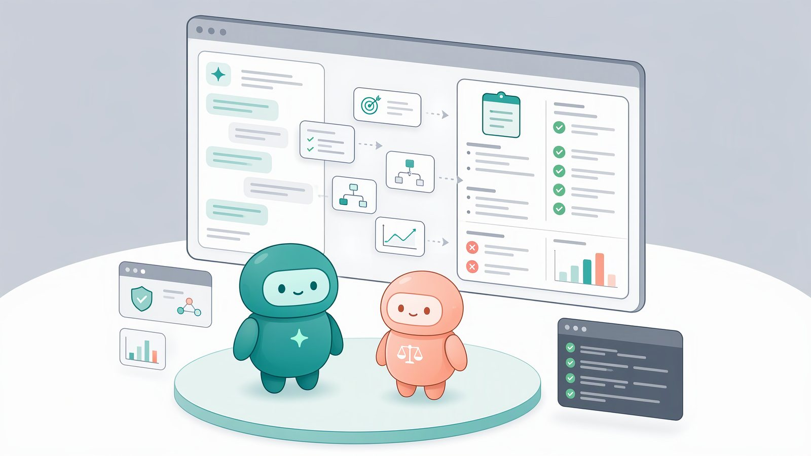

import { Steps } from '@astrojs/starlight/components';
import LabMeta from '../../../components/LabMeta.astro';
import EvalMap from '../../../components/EvalMap.astro';
import Pieces from '../../../components/Pieces.astro';
import RunDiagram from '../../../components/RunDiagram.astro';

<LabMeta time="15 minutes, more at home" cost="Several Copilot prompts and two short runs" uses="Copilot CLI with the Evals plugin" />

<figure class="illustration">
  
  <figcaption>GitHub Copilot drafts, reviews and runs evals with you, in plain language.</figcaption>
</figure>

You've written, checked, run, fixed and judged evals by hand. Now Copilot helps. GitHub Copilot Evals, in preview, adds skills to Copilot that review, create, improve, run and compare evals in plain language. The files it writes are the same Vally YAML you know, so you can judge every draft it makes.

<EvalMap
  doing="Ask GitHub Copilot, in plain language, to review your eval, draft a new one from your criteria, and run it."
  testing="The release-notes skill, through evals that Copilot drafts and you review"
  checking="Checks that Copilot proposes and you accept, change or reject"
  task={{ text: 'Drafted by Copilot from your criteria', state: 'changed' }}
  agent={{ text: 'GitHub Copilot, as before' }}
  environment={{ text: 'The skill and <code>backlog.json</code>' }}
  trials={{ text: '3, as your draft says; 1 on the bounded runner', state: 'changed' }}
  checks={{ text: 'Drafted by Copilot, reviewed by you', state: 'changed' }}
  results={{ text: 'Copilot\'s summary, Vally\'s files and the plugin\'s record', state: 'changed' }}
/>

<RunDiagram
  actors={[
    { id: 'you', name: 'You', icon: 'pencil', tone: 'you' },
    { id: 'copilot', name: 'Copilot CLI', icon: 'comment-alt', tone: 'runner', note: 'with the Evals plugin' },
    { id: 'vally', name: 'Vally', icon: 'setting', tone: 'runner', note: 'the full engine' },
    { id: 'agent', name: 'Agent under test', icon: 'laptop', tone: 'agent', note: 'GitHub Copilot' },
    { id: 'results', name: 'Results', icon: 'analytics', tone: 'files', note: '<code>vally-results/</code>' },
  ]}
  steps={[
    { from: 'you', to: 'copilot', text: 'Asks in plain language', detail: '"Run the eval you just created."' },
    { from: 'copilot', text: 'Prepares the run', detail: 'The run skill reads your eval file. Three trials and a judge mean the full engine.', state: 'new' },
    { from: 'copilot', to: 'you', text: 'Shows the review', detail: 'The runner, the trials, the models, the cost, and what isn\'t restricted.', state: 'new' },
    { from: 'you', to: 'copilot', text: 'Approves the run', detail: 'Each run needs its own approval.' },
    { from: 'copilot', to: 'vally', text: 'Starts Vally', detail: 'With the runner you set up and your stored GitHub CLI sign-in.' },
    { from: 'vally', to: 'agent', text: 'Sends the prompt', detail: 'In a fresh workspace, built from the plugin\'s copy of your files.' },
    { from: 'agent', to: 'vally', text: 'Answers, then gets graded', detail: 'By the checks and the judge in your draft.' },
    { from: 'vally', to: 'results', text: 'Writes the results', detail: '<code>vally-results/eval-run-&lt;id&gt;/</code>, without <code>results.jsonl</code>.' },
    { from: 'copilot', to: 'you', text: 'Explains the result', detail: 'From its own record in <code>.copilot/evals/results/</code>.', state: 'new' },
  ]}
  repeat={{ first: 6, last: 7, label: 'For each of the 3 trials' }}
  caption='A small eval, with one trial and no judge, runs on the bounded runner instead, with a shorter review.'
/>

## The pieces you'll work with

<Pieces
  items={[
    { term: 'Plugin', def: 'A package that adds skills and tools to Copilot CLI. The Evals plugin is called <code>eval</code> and comes from the <code>github-copilot-evals</code> marketplace.', analogy: 'an extension for your editor', where: '<code>copilot plugin install eval@github-copilot-evals</code>', isNew: true },
    { term: 'Marketplace', def: 'A catalog of plugins that Copilot CLI can install from. You add GitHub\'s Evals marketplace once.', analogy: 'a package registry', where: '<code>copilot plugin marketplace add github/evals</code>', isNew: true },
    { term: 'Evals skills', def: 'Six skills Copilot uses when your request matches: <strong>create</strong>, <strong>review</strong>, <strong>improve</strong>, <strong>run</strong>, <strong>compare</strong> and <strong>setup</strong>. You just ask in plain language.', analogy: 'specialists Copilot can call in', where: 'Copilot shows <code>skill(review)</code> when it uses one', isNew: true },
    { term: 'Approval', def: 'Before Copilot saves a file or runs an eval, you approve twice: Copilot CLI asks whether Copilot may use a tool, then the Evals plugin shows a review of exactly what will happen. Saving isn\'t running; every run needs its own approval.', analogy: 'a confirmation dialog before a payment', where: '<code>Do you want to use this tool?</code>, then <code>copilot-evals needs information</code>', isNew: true },
    { term: 'Eval runner setup', def: 'Which Node.js and which Vally Copilot Evals runs evals with. You set it once per conversation, without a Copilot path, so Vally uses the Copilot runtime it comes with.', analogy: 'choosing the toolchain for a build', where: 'the <strong>Configure Eval Runner</strong> tool', isNew: true },
    { term: 'Bounded runner', def: 'Copilot Evals\' runner for small evals: one trial per case, at most 10 cases with 10 checks each, and no LLM judges, setup commands or command checks. It adds a tool policy and a short list of allowed programs, but it\'s not a sandbox.', analogy: 'the express lane: small baskets only', where: '<code>Compatibility: vally-bounded</code> in the run review', isNew: true },
    { term: 'Full-engine runner', def: 'More of Vally\'s features: several trials, LLM judges, setup commands, time limits of up to a day. It has no tool policy and no sandbox, so it needs its own approval, with a detailed review.', analogy: 'the regular checkout, with an itemized bill', where: '<code>TRUSTED FULL EVAL RUN</code> and <code>vally-full-engine-v1</code> in the run review', isNew: true },
  ]}
/>

## Why this matters

Copilot can draft an eval in a minute. Whether that eval measures the right thing is still your call, and you now know what to look for: a clear task, the right environment, negative checks, checks on the transcript and the workspace, enough trials. This lab ends the workshop where you'll work from now on: with Copilot doing the typing and you doing the judging.

## How Copilot runs an eval

Copilot doesn't run evals itself: it hands them to Vally, through one of two runners.

- **The bounded runner** is for small evals that Copilot can start for you without surprises: one trial per case, at most 10 cases with 10 checks each, at most two minutes per case, and no LLM judges, setup commands or command checks ([the full list](https://github.github.io/evals/reference/checks-and-profiles/)). Like every Vally run, each trial works on copies of the eval's files in a fresh workspace; the bounded runner adds a fresh home folder, a tool policy and a short list of allowed programs. It isn't a sandbox, though: the agent's tools can still reach files outside the workspace, including your originals, and the network, and nothing caps the cost.
- **The full engine** supports more of Vally's features: several trials (up to 100 per run), LLM judges, setup commands and time limits of up to a day. It has no tool policy and no sandbox, so it needs its own approval, with a review that lists the trials, the models, the credential and everything that isn't restricted.

You don't pick the runner in your request; the eval file does. One trial and simple checks run on the bounded runner; several trials or a judge need the full engine. In this lab, you see both. A few Vally features work with neither runner, such as a custom model provider (your own model endpoint) and remote MCP servers: run those evals with `vally eval`.

## Steps

<Steps>

1. In your terminal, add GitHub's Evals marketplace and install the plugin, one command at a time:

   ```bash
   copilot plugin marketplace add github/evals
   copilot plugin install eval@github-copilot-evals
   ```

   ```text
   Marketplace "github-copilot-evals" added successfully.
   Plugin "eval" installed successfully. Installed 6 skills.
   ```

   Check that it's enabled:

   ```bash
   copilot plugin list --json
   ```

   Look for `"name": "eval"`, `"marketplace": "github-copilot-evals"` and `"enabled": true`. The version changes often during the preview.

   :::caution[Using `EVALUATE_USE_HOST_COPILOT_HOME=1`?]
   The plugin now lives in your Copilot home folder. If Vally reuses that folder, the plugin's skills join every eval run from now on. When you're done with this lab, switch back to the GitHub CLI sign-in, as described in [Sign in with Copilot CLI instead](../../start/local/#sign-in-with-copilot-cli-instead). Or turn the plugin off with `copilot plugin disable eval@github-copilot-evals`. See [Lab 3: why a clean environment matters](../lab-3-run-the-agent/#why-a-clean-environment-matters).
   :::

2. **In a Codespace only:** give Copilot Evals a GitHub CLI sign-in. Copilot Evals starts its runs with the sign-in that the GitHub CLI has *stored*, and Copilot CLI hides token variables such as `GITHUB_TOKEN` from plugins. In a Codespace, the GitHub CLI has nothing stored: it signs in with that variable. So store the Codespace's token as the GitHub CLI's sign-in:

   ```bash
   echo "$GITHUB_TOKEN" | env -u GITHUB_TOKEN gh auth login --with-token
   ```

   `env -u GITHUB_TOKEN` hides the variable from this one command, because the GitHub CLI won't store a sign-in while the variable is set. Check the result the way Copilot Evals sees it:

   ```bash
   env -u GITHUB_TOKEN gh auth status
   ```

   ```text
   github.com
     ✓ Logged in to github.com account <you> (/home/node/.config/gh/hosts.yml)
   ```

   The GitHub CLI keeps the token in that file, in your Codespace's home folder. The Codespace gets a new token each time it starts, so run the first command again after a restart. On your computer, skip this step: you stored a sign-in with `gh auth login` during setup. Signed in with a personal access token in Lab 0? See **Stuck?** below.

3. Start a fresh Copilot conversation in the repository's root folder:

   ```bash
   copilot
   ```

   If Copilot asks whether you trust the files in this folder, confirm. Copilot CLI signs in with the same token as Vally, your Codespace's `GITHUB_TOKEN` or the `COPILOT_GITHUB_TOKEN` from `.env`, so you don't need `copilot login`. Copilot may tell you which model it uses; an organization can manage that for you.

   Then tell Copilot Evals which programs to run evals with:

   ```text
   Set up the eval runner for this project with Node and Vally only, without a Copilot executable path.
   ```

   Copilot uses the **setup** skill and asks twice. First, Copilot CLI asks whether it may use the **Configure Eval Runner** tool. Then the plugin shows its own review, which ends with `Execute selected version and compatibility checks only. No installation or model run.` Approve both. Copilot confirms that it configured the runner with Node and Vally 0.21.0, without a Copilot executable path.

   **Why without a Copilot path?** Vally 0.21.0 comes with its own Copilot runtime, the one `vally eval` uses. The Copilot CLI you installed can be newer: Copilot CLI 1.0.114, for example, speaks a newer protocol than Vally 0.21.0, and a run that uses it fails with `SDK protocol version mismatch`. If a later conversation asks to configure the eval runner again, use this prompt again.

   :::tip[Two prompts for every action]
   Copilot CLI asks whether Copilot may use a tool; the Evals plugin then shows a review of exactly what will happen and asks you to approve that action only. The review waits about three minutes for your answer. If it times out, ask Copilot to try again.
   :::

4. **Review.** Ask Copilot to review the eval you wrote:

   ```text
   Review the eval in evals/release-notes.eval.yaml. What does it check, what does it miss, and how would you improve it? Don't change any files yet.
   ```

   Copilot uses the **review** skill. It may ask for approval to run an Evals review tool on the file: read what it will do, then allow it. Compare Copilot's findings with what you know. Did it notice the negative check? The limits of the backlog check? The number of trials? Is there a suggestion you'd act on?

5. **Create.** Ask Copilot to draft a new eval from scratch, and give it your criteria from Lab 1:

   ```text
   Create an eval for the release-notes skill in .github/skills/release-notes. Good release notes announce only backlog items whose status is done, never mention unfinished items anywhere, start with one short summary sentence, and leave backlog.json unchanged.
   ```

   Copilot uses the **create** skill. It proposes what to test and may ask you questions first; answer them. In our test, it noticed that the skill says to list every item, which contradicts your criteria, and asked whether to save the eval as a regression test anyway. Yes: the eval describes what *should* happen, so it fails until the skill is fixed. Before it saves anything, it shows you the full file, as the `content` in the approval of the **Validate and Save Eval Draft** tool. **Review the draft before you approve it**, with this checklist:

   | Look for | Why |
   | --- | --- |
   | A prompt that sounds like a real request, without naming the skill or the expected answer | Otherwise the eval tests the prompt, not the skill |
   | The skill and `backlog.json` in the environment | Without them, the agent can't do the task |
   | A **negative** check for CT-102 | The bug you care about is something extra (Lab 2) |
   | A check that the skill was used, and one on `backlog.json` | The transcript and the workspace matter too (Lab 3) |
   | Check names that say exactly what they test | So a failure tells you what went wrong |
   | Several trials, and a sensible threshold | One run is an anecdote |
   | A pinned `model` for the agent, and a `judge_model` if the draft has an LLM judge (`type: prompt`) | Without them, Vally falls back to its defaults. In our tests, Copilot's drafts had a judge but neither `model` nor `judge_model`, and one trial. Vally's default judge model wasn't on our plan, so every judge grade came back invalid |

   To ask for changes, choose **No, and tell Copilot what to do differently**, type what to change, and press Enter. For example: `Before saving: under defaults, pin the agent model with model: claude-sonnet-5.5, add judge_model: gpt-5.6-luna for the prompt check, and use runs: 3 so we get several trials.` Copilot shows the revised file; approve it once it passes the checklist.

6. **Run.** Ask Copilot to run the new eval:

   ```text
   Run the eval you just created.
   ```

   Copilot uses the **run** skill, summarizes the plan, and asks twice, as before. The plugin's review is long. Read these parts before you approve:

   - **The runner:** it says `TRUSTED FULL EVAL RUN` and `Compatibility: vally-full-engine-v1`. Your draft has three trials and an LLM judge, and only the full engine runs those.
   - **What it costs:** `1 cases x 3 trials = 3 trials`, the agent's model and the judge's model, and `Internal requests, retries and total cost are not capped`.
   - **What isn't restricted:** `A trusted full eval run has no tool-use restrictions and no OS, filesystem or network sandbox`, and the GitHub credential it uses is visible to every process the run starts.
   - **Where the results go:** `vally-results/<run>/<timestamp>`.

   If that's what you expect, approve. If the review then asks for an **Approval scope**, choose **Allow once**. The run takes a minute or two; then Copilot summarizes it. Ours: `The run completed: 0/3 trials passed.` Every trial mentioned CT-102, and two started with a heading or a preamble instead of a summary sentence. That's the bug from Lab 3: the eval catches it, and the starter's skill still has it.

7. **Read the run.** Ask Copilot to explain the result; it reads the run's record, with each trial's answer and the evidence of every check. Then check it yourself. The run saved Vally's files in a new folder, `vally-results/eval-run-<id>/<date-and-time>/`:

   - `eval-results.md`: the summary table you know from Lab 0. Right-click it and select **Open Preview**.
   - One folder per trial, under `release-notes-regression/completed-work-only/claude-sonnet-5.5/`, with `events.jsonl`, `workspace.patch` and `metadata.json`, as in Lab 3. The folder names follow your eval's name, its stimulus and the model.

   There's no `results.jsonl`: Copilot Evals keeps its own record of the run in `.copilot/evals/results/`. That's why the dashboard and `./scripts/answers.sh`, which read `results.jsonl`, don't show this run. To get a run they can read, start a separate run with Vally: open a second terminal (**Terminal** > **New Terminal**; on your computer, load `.env` there first) and run the file there. It's a new run, with new answers, and it uses Copilot requests like any other:

   ```bash
   vally eval -e evals/<the-file-copilot-saved>.eval.yaml
   ```

8. Optional: **see the bounded runner.** Ask Copilot to run Lab 0's eval:

   ```text
   Run the eval in lab-files/lab-0/setup-check.eval.yaml.
   ```

   One trial and no judge: this time, the review says `Compatibility: vally-bounded` and `Copilot executable: default SDK runtime`, and it lists what the bounded runner refuses: `Setup/git-clone commands, model-based or command checks, dynamic parameter substitution, and multiple trials are rejected before approval.` It also says what the bounded runner isn't: `Separate files and fresh home directories are not an OS sandbox or network restriction.` Approve, and the run passes within seconds: `1 passed, 0 failed. The response was READY`.

9. Optional: **improve** or **compare**:

   ```text
   Add a failure case to this eval: an answer that mentions CT-102 in a note. Save a revised copy.
   ```

   ```text
   Compare the last two saved runs of this eval.
   ```

10. Leave the conversation with `/exit`.

</Steps>

## What just happened

- Copilot **reviewed** an eval, **drafted** one, and **ran** one, each time by picking the matching Evals skill from your plain-language request.
- It ran your draft on Vally's **full engine**, because the draft needs three trials and a judge. Small evals, with one trial and no judge, setup commands or command checks, run on the **bounded runner**.
- Every file it wrote is ordinary **Vally YAML**: you can lint it, run it with `vally eval`, put it in an experiment or in CI.
- You stayed in control: Copilot showed full files before saving, and before each run, the plugin's review told you what the run would cost and what it wouldn't restrict.
- And you could **judge its drafts**, because you know what an eval needs. That's the reason the workshop started with Vally by hand.

## Commands instead of plain language

Copilot CLI also has `/eval` commands, such as `/eval review`, `/eval create` and `/eval run`. They're behind Copilot CLI's experimental mode: type `/experimental` in Copilot CLI, start a fresh conversation, then type `/eval help`. Plain-language requests work without experimental mode.

## On your computer: VS Code

On your own computer, you can use the GitHub Copilot Evals extension for VS Code instead. It adds a visual **Evals Canvas**: open your project, then run **GitHub Copilot Evals: Open Evals Canvas** from the Command Palette. It needs desktop VS Code 1.138.0 or later and a trusted local project. See [Getting started](https://github.github.io/evals/getting-started/) in the GitHub Copilot Evals docs.

## Check yourself

<details>
<summary>Copilot's draft has only positive checks. What do you do?</summary>

Ask it to add a negative check: "Add a check that fails when the answer mentions CT-102." Then test the checks with known answers, as in Lab 2, before you trust a single run.

</details>

<details>
<summary>Why does every run need your approval?</summary>

A run starts an agent that can use tools and costs Copilot usage. Saving a file never starts a run, and approving one run doesn't approve the next. That way, nothing runs that you haven't seen and agreed to.

</details>

<details>
<summary>What actually runs the eval when Copilot runs it?</summary>

Vally. GitHub Copilot Evals prepares, explains and approves the run, and picks one of two runners: the bounded runner or Vally's full engine. Either way, Vally executes the trials and the graders, the same engine you used in Labs 0 to 5, and saves its files in `vally-results/`.

</details>

<details>
<summary>Why did your draft run on the full engine, and Lab 0's eval on the bounded runner?</summary>

The eval file decides. The bounded runner takes one trial per case, and no LLM judges, setup commands or command checks. Your draft has three trials and an LLM judge, so it needs the full engine, with its own, more detailed approval.

</details>

<details>
<summary>Is the bounded runner a sandbox?</summary>

No. Like every Vally run, each trial works on copies of the eval's files in a fresh workspace, and the bounded runner adds a fresh home folder, a tool policy and a short list of allowed programs. But the agent's tools can still reach files outside the workspace, including your originals, and the network, and nothing caps the cost. The review says so itself. What the bounded runner does give you is a small, predictable run that's easy to check before you approve it.

</details>

## Stuck?

- **`copilot plugin` isn't recognized:** update Copilot CLI with `npm install -g @github/copilot`, then try again.
- **Copilot doesn't use the Evals skills:** start a fresh conversation (`/exit`, then `copilot`), and check `copilot plugin list --json`.
- **A run fails with `GitHub CLI sign-in is unavailable for github.com`:** in a Codespace, store the sign-in as in step 2; on your computer, run `gh auth login`. Then ask Copilot to run again.
- **You signed in with a personal access token in Lab 0, and a Copilot Evals run can't sign in:** Copilot Evals doesn't use `COPILOT_GITHUB_TOKEN`; it uses the GitHub CLI's stored sign-in. Store your token there: `echo "$COPILOT_GITHUB_TOKEN" | env -u GITHUB_TOKEN gh auth login --with-token`. On your computer, this replaces your GitHub CLI sign-in, so run `gh auth login` again before Lab 7.
- **A run fails with `SDK protocol version mismatch`:** the runner uses your Copilot CLI instead of Vally's own runtime. Ask Copilot to set up the runner without a Copilot executable path, as in step 3, then run again.
- **An approval timed out:** the plugin's review waits about three minutes. Ask Copilot to try again.
- **The dashboard says `No runs found` for Copilot's run:** Copilot Evals doesn't write `results.jsonl`. Read `eval-results.md`, or run the file with `vally eval`.
- **Your organization blocks plugins or marketplaces:** follow along with a neighbor, or try the VS Code extension at home.
- More in [Troubleshooting](../../reference/troubleshooting/) and in the GitHub Copilot Evals [support page](https://github.github.io/evals/support/).

## Wrap-up

That's the guided part. You can now define good, check your checks, run trials, read transcripts, prove a fix, calibrate a judge, and let Copilot help with all of it. Continue at your own pace:

- [Lab 7: Evals in CI](../lab-7-ci/): run your eval on every pull request.
- [Lab 8: Compare models](../lab-8-compare-models/): the same eval on two models.
- [Lab 9: Your own agent](../lab-9-your-own/): write an eval for something you build.
