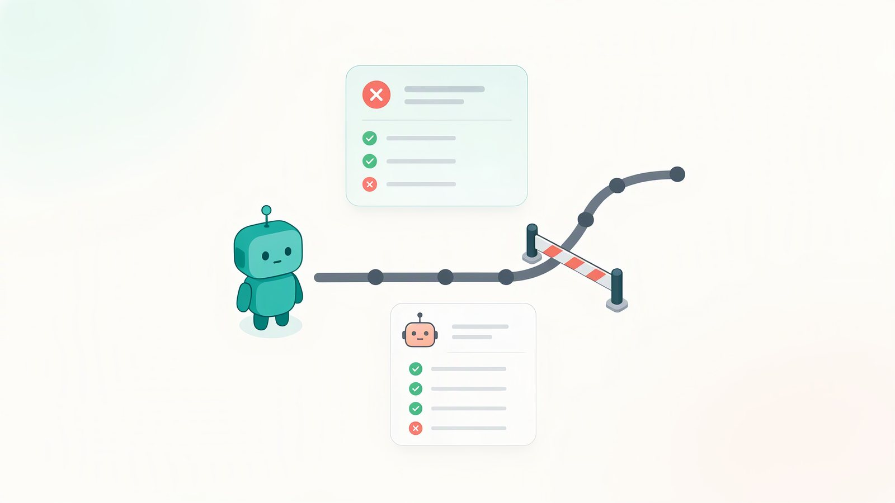

import { Steps } from '@astrojs/starlight/components';
import LabMeta from '../../../components/LabMeta.astro';
import EvalMap from '../../../components/EvalMap.astro';
import Pieces from '../../../components/Pieces.astro';
import RunDiagram from '../../../components/RunDiagram.astro';

<LabMeta time="30 minutes, self-paced" cost="3 Copilot runs per pull request, in GitHub Actions" uses="Your own copy of the repository" />

<figure class="illustration">
  
  <figcaption>The eval runs on every pull request and flags a change that brings the bug back.</figcaption>
</figure>

Your skill passes now. The eval's job changes: from "can the agent do this yet?" to "does it **still** do it?" In this lab, GitHub Actions runs the eval on every pull request that touches the skill, and posts the result as a comment. Then you try to bring the bug back, and watch the eval catch it.

<EvalMap
  doing="Run the eval on every pull request with GitHub Actions, then bring the bug back and watch CI flag it."
  testing="Every change to the skill, automatically"
  checking="The smoke suite: the code checks from Lab 3"
  task={{ text: 'Write the release notes from <code>backlog.json</code>' }}
  agent={{ text: 'GitHub Copilot, in GitHub Actions', state: 'changed' }}
  environment={{ text: 'The skill from the pull request', state: 'changed' }}
  trials={{ text: '3 per pull request' }}
  checks={{ text: 'Answer, transcript and workspace, as in Lab 3' }}
  results={{ text: 'A check and a comment on the pull request', state: 'changed' }}
/>

<RunDiagram
  command="gh pr create --fill"
  actors={[
    { id: 'you', name: 'You', icon: 'pencil', tone: 'you' },
    { id: 'pr', name: 'Pull request', icon: 'code-branch', tone: 'you', note: 'on GitHub' },
    { id: 'actions', name: 'GitHub Actions', icon: 'server', tone: 'runner', note: 'the Evals workflow' },
    { id: 'vally', name: 'Vally', icon: 'setting', tone: 'runner', note: 'with GitHub Copilot' },
  ]}
  steps={[
    { from: 'you', to: 'pr', text: 'Opens a pull request', detail: 'It changes the skill, so the workflow\'s paths match.' },
    { from: 'pr', to: 'actions', text: 'Starts the Evals workflow', detail: 'For every pull request that changes the skill or the evals.' },
    { from: 'actions', text: 'Signs in and installs Vally', detail: 'With the job\'s own token and <code>copilot-requests: write</code>: no secret needed.', state: 'new' },
    { from: 'actions', to: 'vally', text: 'Runs the smoke suite', detail: 'Lint first, then every eval tagged <code>lane: ci</code>, with <code>--require-pass</code>.', state: 'new' },
    { from: 'vally', text: 'Runs the trials and the checks', detail: 'Three trials of the agent, five checks each, as in Lab 3.' },
    { from: 'vally', to: 'actions', text: 'Verdicts and evidence', detail: 'A failed eval fails the job.' },
    { from: 'actions', to: 'pr', text: 'Posts a check and one comment', detail: 'The comment shows the score, the threshold and the tokens.', state: 'new' },
    { from: 'pr', to: 'you', text: 'Shows the result', detail: 'Merge when it\'s green; otherwise read the evidence and fix.' },
  ]}
/>

## The pieces you'll work with

<Pieces
  items={[
    { term: 'Regression eval', def: 'An eval that guards behavior that already works. It should pass close to 100% of the time; a failure means something broke.', analogy: 'a regression test suite', where: 'your release-notes eval, now in CI', isNew: true },
    { term: 'Tag', def: 'A key-value label on an eval, used to select evals for a suite.', analogy: 'a test category', where: '<code>tags: { lane: ci }</code>', isNew: true },
    { term: 'Suite', def: 'A named group of evals. The <code>smoke</code> suite runs every eval tagged <code>lane: ci</code>.', analogy: 'a test suite', where: '<code>.vally.yaml</code>; <code>vally eval --suite smoke</code>', isNew: true },
    { term: '<code>github/evals-action</code>', def: 'A GitHub Action that installs Vally, lints your project, runs a suite and posts one sticky comment on the pull request with the results.', analogy: 'your test runner, in CI', where: '<code>.github/workflows/evals.yml</code>', isNew: true },
    { term: '<code>copilot-requests: write</code>', def: 'A workflow permission that lets the job\'s own token run Copilot as the agent under test. No secret or personal token is needed.', analogy: 'a permission slip for the job', where: '<code>permissions:</code> in the workflow', isNew: true },
  ]}
/>

## Before you start

- You need **your own copy** of the starter repository ([Use this template](../../start/codespaces/#1-make-your-own-copy-of-the-repository)) with GitHub Actions enabled, and a Codespace or clone of it.
- You need the **GitHub CLI**, `gh`, signed in to your account. A Codespace has it ready. On your computer, you signed in during setup; `gh auth status` shows your account.
- **Who pays:** in a personal repository, the runs use the repository owner's Copilot plan. In an organization's repository, an organization owner must allow **Copilot CLI billed to the organization**, and each pull request from within the repository can start runs that the organization pays for.
- Labs 3 and 4 should be done: `scripts/catch-up.sh 4` if not.

## Steps

<Steps>

1. Tag the eval for the CI suite. In `evals/release-notes.eval.yaml`, add these two lines below the `type: capability` line, at the same indentation as `type`:

   ```yaml
   tags:
     lane: ci                  # selected by the smoke suite in .vally.yaml
   ```

   `.vally.yaml`, in the repository root, defines the suite: `smoke` runs every eval tagged `lane: ci`.

2. Run the suite locally first, so you know what CI will see:

   ```bash
   vally eval --suite smoke
   ```

   Only the tagged eval runs: three trials, all passing with the fixed skill.

3. Add the workflow:

   ```bash
   mkdir -p .github/workflows
   cp lab-files/lab-7/evals.yml .github/workflows/evals.yml
   ```

   Read it. The important parts:

   ```yaml title=".github/workflows/evals.yml (excerpt)"
   on:
     pull_request:
       paths:
         - .github/skills/**      # run when the skill changes …
         - evals/**               # … or an eval, the data, the config, the workflow
   jobs:
     evals:
       permissions:
         contents: read
         copilot-requests: write   # the job's token runs the agent under test with Copilot
         pull-requests: write      # the action posts one sticky comment
       steps:
         - uses: actions/checkout@v7
         - uses: github/evals-action@v0
           with:
             working-directory: evals
             suite: smoke
             vally-version: '0.21.0'
   ```

   `working-directory: evals` keeps the action to the `evals/` folder: it lints every eval file in its working directory, and the starters in `lab-files/` and `solutions/` work only once you copy them into `evals/`. Vally finds `.vally.yaml` in the repository root by itself.

4. Commit and push your work to `main`:

   ```bash
   git add -A
   git commit -m "Run the release-notes eval on pull requests"
   git push
   ```

   `.gitignore` keeps your run results, `.env` and params files out of the commit.

5. Now bring the bug back, in a pull request:

   ```bash
   git switch -c try-the-old-skill
   cp skill-versions/before/release-notes/SKILL.md .github/skills/release-notes/SKILL.md
   git commit -am "Try the original release-notes skill"
   git push -u origin try-the-old-skill
   gh pr create --fill
   ```

6. Watch the check:

   ```bash
   gh pr checks --watch
   ```

   The **Evals** check fails after a few minutes. The action runs `vally eval` with `--require-pass` for you, so a failed eval fails the job, as you saw in Lab 2. Open the pull request in the browser (`gh pr view --web`). The action's comment, shortened:

   ```text
   Evals: failed

   Suite: smoke
   Lint: validated (no model execution) - Evidence
   Run: failed - 3 trials - Evidence

   | Eval                         | Trials | Result |
   | release-notes-completed-only |      3 | failed |

   | Eval                         | Verdict | Score                 | Duration | Tokens        |
   | release-notes-completed-only | failed  | 0.80 (threshold 1.00) | 14487ms  | 152347 tokens |
   ```

   The comment names the eval, not the check. But the score is one you know: 0.80 means four of five checks passed, as in Lab 3. To see which check failed and why, run the suite on the branch yourself, `vally eval --suite smoke`, and read the results as in Lab 3: it's `leaves-out-unfinished-export`, because the answers announce CT-102 again. GitHub still lets you merge the pull request: a failing check blocks merging only once you require it; see [Go further](#go-further).

7. Close the pull request without merging, and go back to `main`:

   ```bash
   gh pr close --delete-branch
   git switch main
   ```

</Steps>

## What just happened

Your eval graduated from a capability eval to a regression check. Anyone who changes the skill now gets the eval's verdict on their pull request, with evidence, before a reviewer even looks. And the action used the job's own token with the `copilot-requests: write` permission: no personal token, no stored secret.

:::note[Why `type` stays `capability`]
Vally's `type: regression` expects a baseline configuration as well; without one, `vally lint` warns that a regression eval without a baseline is just a capability eval. In this lab, the tag and the CI workflow make the eval a regression check, and the `type` stays as it is.
:::

## Check yourself

<details>
<summary>Why run the suite locally before pushing the workflow?</summary>

To know what CI will see: if the eval fails or errors locally, it fails in CI too, after a slower round trip. Run locally, push when it's green.

</details>

<details>
<summary>Why doesn't the workflow run for pull requests from forks?</summary>

The job condition `github.event.pull_request.head.repo.full_name == github.repository` skips them. A pull request from a fork could change the evals or the skill to do anything with the job's Copilot access, at your cost.

</details>

## Solution

Compare your files with ours. In the eval, the highlighted lines are the tag you add in step 1. The workflow is the file you copy in step 3, in full.

<details>
<summary>The eval, tagged for CI</summary>

```yaml title="solutions/lab-7/release-notes.eval.yaml" ins={6-7}
# Lab 7 solution: the Lab 3 eval, tagged for the CI suite. It now guards behavior that works,
# so every pull request runs it: a passing capability eval graduates into a regression check.
name: release-notes-completed-only
description: The release-notes skill announces completed work only and leaves the in-progress status in backlog.json alone.
type: capability            # intent: "can the agent do this yet?" (a regression eval guards what already works)
tags:
  lane: ci                  # selected by the smoke suite in .vally.yaml
defaults:
  executor: copilot-sdk     # the agent under test: GitHub Copilot, driven through the Copilot SDK
  model: claude-sonnet-5.5  # pinned, so results are comparable (scripts/use-model.sh changes it)
  runs: 3                   # trials per stimulus: agents aren't deterministic, so one run proves little
  timeout: 120s             # per trial
agent_environment:          # what the agent finds in its workspace, rebuilt for every trial
  skills:
    - ../.github/skills/release-notes   # the skill under test (paths are relative to this file)
  files:
    - src: ../backlog.json              # copied into the workspace as backlog.json
      dest: backlog.json
scoring:
  threshold: 1              # a trial passes only when every check passes
stimuli:
  - name: completed-work-only
    prompt: Write the release notes for this release from backlog.json.
    graders:
      # Code checks on the final answer (the outcome you can see)
      - type: output-contains
        name: leaves-out-unfinished-export
        config: { substring: CT-102, negate: true }   # passes when CT-102 is NOT in the answer
      - type: output-contains
        name: includes-done-search
        config: { substring: CT-101 }
      - type: output-contains
        name: includes-done-dark-mode
        config: { substring: CT-103 }
      # A check on the transcript (how the agent got there)
      - type: skill-invocation
        name: release-notes-skill-used
        config:
          required:
            - release-notes
      # A check on the workspace (side effects): backlog.json still contains the in-progress status
      - type: file-contains
        name: backlog-still-in-progress
        config:
          path: backlog.json
          value: '"status": "in-progress"'
```

[Open it on GitHub](https://github.com/jeffrey-groneberg/agent-evals-workshop-starter/blob/main/solutions/lab-7/release-notes.eval.yaml)

</details>

<details>
<summary>The workflow</summary>

```yaml title=".github/workflows/evals.yml"
# Lab 7: run the smoke suite on every pull request and post the result as a PR comment.
# Copy it into place:  mkdir -p .github/workflows && cp lab-files/lab-7/evals.yml .github/workflows/evals.yml
#
# Billing: in a personal repository, the runs use the repository owner's Copilot seat. In an
# organization repository, an admin must allow "Copilot CLI billed to the organization".
name: Evals

on:
  pull_request:
    paths:
      - .github/skills/**
      - evals/**
      - backlog.json
      - .vally.yaml
      - .github/workflows/evals.yml
  workflow_dispatch:

permissions:
  contents: read

jobs:
  evals:
    # Run for manual starts and for pull requests from this repository (not from forks).
    if: github.event_name == 'workflow_dispatch' || github.event.pull_request.head.repo.full_name == github.repository
    runs-on: ubuntu-latest
    timeout-minutes: 15
    permissions:
      contents: read
      copilot-requests: write   # lets the job's own token run the agent under test with Copilot
      pull-requests: write      # lets the action post and update one sticky PR comment
    concurrency:
      group: evals-${{ github.workflow_ref }}
      cancel-in-progress: false
    steps:
      - uses: actions/checkout@v7
        with:
          persist-credentials: false
      - uses: github/evals-action@v0
        with:
          # Lint and run only evals/. lab-files/ and solutions/ hold starters that work only once
          # copied into evals/. Vally finds .vally.yaml in the repository root by itself.
          working-directory: evals
          suite: smoke           # runs the evals tagged lane: ci
          vally-version: '0.21.0'
```

[Open it on GitHub](https://github.com/jeffrey-groneberg/agent-evals-workshop-starter/blob/main/lab-files/lab-7/evals.yml)

</details>

## Stuck?

- **The workflow doesn't start:** the pull request must change a file under one of the `paths`, and Actions must be enabled in your repository's settings.
- **The job fails before running evals:** read the log of the lint step. An eval with a lint error stops the whole suite; run `vally lint -e evals --strict` locally to find it.
- **Copilot isn't allowed in Actions** (organization repositories): ask an organization owner to allow Copilot CLI billed to the organization.
- **`gh pr create` asks questions:** answer them, or add `--title "Try the original skill" --body "Lab 7"`.

## Go further

- Make the check block merging: in your repository's **Settings** > **Rules** > **Rulesets**, create a branch ruleset for `main` with **Require status checks to pass**, and add the **Evals** check. Remove the workflow's `paths` filter at the same time: a required check that never runs, because a pull request didn't touch those paths, stays pending and blocks that pull request.
- Pin the actions to commit SHAs instead of tags, as you would for production workflows.
- Add the known-good controls from Lab 2 as a second suite, gated with `--require-pass`.
- Read the GitHub Copilot Evals [CI setup journey](https://github.github.io/evals/journeys/ci-setup/) and the [`github/evals-action` README](https://github.com/github/evals-action).

**Next:** [Lab 8: Compare models](../lab-8-compare-models/)
