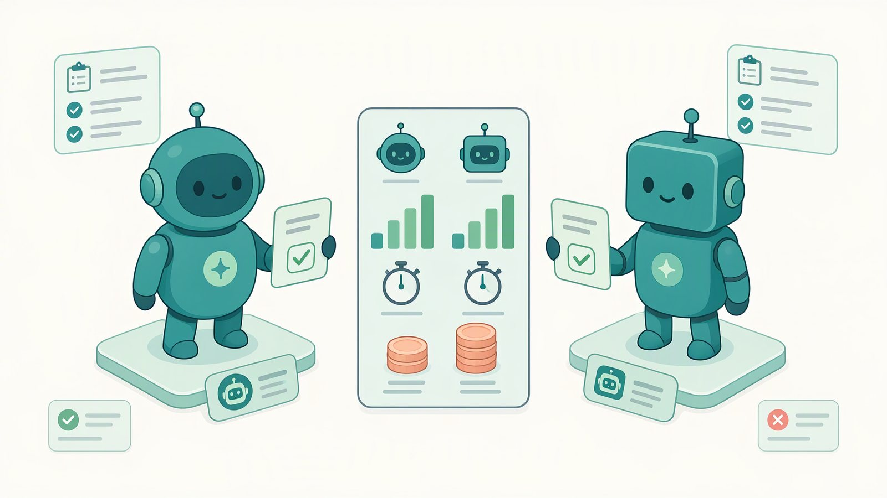

import { Steps } from '@astrojs/starlight/components';
import LabMeta from '../../../components/LabMeta.astro';
import EvalMap from '../../../components/EvalMap.astro';
import Pieces from '../../../components/Pieces.astro';

<LabMeta time="20 minutes, self-paced" cost="6 Copilot runs; part B uses your own endpoint" uses="experiments/models.experiment.yaml" />

<figure class="illustration">
  
  <figcaption>The same task and the same checks, two models: compare quality, speed and cost.</figcaption>
</figure>

A new model comes out. Is it better *for your agent*? Benchmarks can't tell you; your evals can. In this lab you run the release-notes eval on two models with an experiment that changes only the model.

**Before you start:** you need the eval from Lab 3 and the fixed skill from Lab 4. If you skipped them, run `scripts/catch-up.sh 4`.

<EvalMap
  doing="Run the same eval on two models with an experiment, and compare pass rate, tokens, time and answers."
  testing="Two models as the agent, with the same skill and the same eval"
  checking="The five code checks from Lab 3"
  task={{ text: 'Write the release notes from <code>backlog.json</code>' }}
  agent={{ text: 'Model A vs model B', state: 'changed' }}
  environment={{ text: 'The fixed skill and <code>backlog.json</code>' }}
  trials={{ text: '3 per model' }}
  checks={{ text: 'Answer, transcript and workspace, as in Lab 3' }}
  results={{ text: 'Experiment comparison, dashboard' }}
/>

## The pieces you'll work with

<Pieces
  items={[
    { term: 'Model as the variable', def: 'The experiment varies <code>/defaults/model</code>: same eval, same skill, two models.', analogy: 'an A/B test', where: '<code>vary: [/defaults/model]</code>', isNew: true },
    { term: 'Model ID', def: 'The name Copilot uses for a model, such as <code>claude-sonnet-5.5</code>. Which models you have depends on your plan and organization.', analogy: 'a product SKU', where: '<code>/model</code> in Copilot CLI', isNew: true },
    { term: 'Executor provider (part B)', def: 'Bring your own key for the agent itself: the same Copilot harness, but the model calls go to your endpoint.', analogy: 'the same car with another engine', where: '<code>executor.config.provider</code>', isNew: true },
  ]}
/>

## Part A: two Copilot models

<Steps>

1. See which models your plan offers: start `copilot`, type `/model`, note two model IDs, then `/exit`.

2. Open `experiments/models.experiment.yaml` and put your two model IDs into `model-a` and `model-b`:

   ```yaml title="experiments/models.experiment.yaml"
   name: release-notes-models
   evals:
     - ../evals/release-notes.eval.yaml
   vary: [/defaults/model]
   baseline: model-a
   variants:
     model-a:
       overrides:
         model: claude-sonnet-5.5   # example; replace with a model from /model
     model-b:
       overrides:
         model: gpt-5.6-luna        # example; replace with a model from /model
   ```

3. Check the plan, then run it:

   ```bash
   vally experiment run experiments/models.experiment.yaml --dry-run
   vally experiment run experiments/models.experiment.yaml
   ```

   The end of our run, with `claude-sonnet-5.5` and `gpt-5.6-luna`:

   ```text
   Experiment  release-notes-models   varying /defaults/model · baseline model-a

     → No variant beat baseline. Same pass rate (1/1) for both.
       model-b used −42% tokens, +1% trial time.

     eval                          model-a (baseline)         model-b                    Δ
     release-notes-completed-only  ✓ 1/1 (score 100% ≥ 100%)  ✓ 1/1 (score 100% ≥ 100%)  ±0
     ────────────────────────────  ─────────────────────────  ─────────────────────────  ────
     stimuli                       1/1                        1/1                        ±0
     tokens                        186.3k                     108.4k                     −42%
     trial time                    25.4s                      25.6s                      +1%
   ```

   Both models passed every trial, so neither "beat" the other on quality. But one needed 42% fewer tokens for the same result.

4. Compare the details in the dashboard, as in Lab 4. In its terminal, press Ctrl+C, then point it at the newest experiment:

   ```bash
   EXP=$(ls -d vally-experiment-results/*/ | tail -1)
   vally serve "$EXP" --port 3200 --allowed-host "${CODESPACE_NAME}-3200.${GITHUB_CODESPACES_PORT_FORWARDING_DOMAIN}"
   ```

   Reload the page, scroll down to **Model comparison**, tick both runs and select **Compare Selected**. This time, the columns carry the model names:

   

   Same pass rate, same number of turns and tool calls, but different speed and very different token counts. The deltas are relative to the first column.

5. Read a few answers from each model with `./scripts/answers.sh`. Both pass every check, but do they read the same? Style, length and tone can differ in ways your checks don't cover; that's where a judge from Lab 5 helps.

</Steps>

Two models can both pass every check and still differ in cost, speed and style. With three trials each, a one-trial difference in pass rate can be luck; for a real decision, use more trials and more tasks.

## Part B: a model on your own endpoint as the agent

If you have your own model endpoint, as described in [Model access and costs](../../start/model-access/#your-own-model-endpoint-optional), you can make one of its models the agent under test. Copilot's harness still runs the agent, but every model call goes to your endpoint, so no Copilot request is used.

<Steps>

1. Copy the eval made for this, and read its `defaults`:

   ```bash
   cp lab-files/lab-8/release-notes-endpoint.eval.yaml evals/
   ```

   ```yaml
   defaults:
     model: ${AGENT_MODEL=set-your-deployment-name}   # the deployment name on your endpoint
     runs: 3
     timeout: 180s
     executor:
       name: copilot-sdk                 # the same agent harness as before ...
       config:
         provider:                       # ... but its model calls go to your endpoint
           type: azure
           baseUrl: ${AGENT_BASE_URL=https://set-your-endpoint.invalid/openai/v1/}   # replaced by --param
           wireApi: responses
           apiKeyEnv: LLM_API_KEY
   ```

2. Run it:

   ```bash
   vally eval -e evals/release-notes-endpoint.eval.yaml \
     --param AGENT_BASE_URL="$LLM_BASE_URL" \
     --param AGENT_MODEL="$LLM_MODEL"
   ```

   It needs `LLM_BASE_URL`, `LLM_API_KEY` and `LLM_MODEL` in your environment; `./scripts/check-setup.sh --ping` tests them. In our run with a GPT-5-family deployment, all three trials passed, with about 31,000 tokens each.

3. Compare its `eval-results.md` with part A's results: pass rate, tokens, duration and tool calls. Then look at the tool calls with `./scripts/answers.sh --tools`: did the model on your endpoint use the skill the same way?

</Steps>

:::note[Why not an experiment for part B?]
You could make part B an experiment too: `vally experiment run` accepts `--param`, and you'd declare `/defaults/executor` and `/defaults/model` in `vary`. A separate run keeps this lab short, and you compare the results side by side.
:::

## Check yourself

<details>
<summary>Model B passes 3 of 3 and model A 2 of 3. Is model B better?</summary>

Not proven. With three trials each, one trial's difference is easily chance. It's a lead worth a bigger run: more trials, more tasks, and a look at the failing transcript.

</details>

## Stuck?

- **A model isn't available:** pick another from `/model`.
- **Part B fails with a 400 error:** the deployment must support tool calls with the Responses API, such as a GPT-5-family model.

**Next:** [Lab 9: Your own agent](../lab-9-your-own/)
