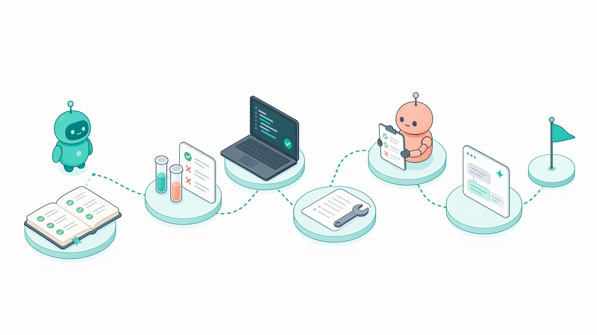

import { LinkCard, Steps } from '@astrojs/starlight/components';
import Flow from '../../../components/Flow.astro';

<figure class="illustration">
  
  <figcaption>The route: define good, check the checks, run, fix, judge, and let Copilot help.</figcaption>
</figure>

This workshop teaches you to **measure** an AI agent instead of guessing. You start with the basics, then write and run evals by hand with Vally, Microsoft's eval runner, so that you see every part of an eval. Then you let GitHub Copilot Evals help you create, review, run and compare evals, and you'll know how to judge what it drafts.

It's for developers who build or use AI agents, skills, prompts or MCP tools. You need no eval experience. You should be comfortable with a terminal, Git and YAML.

## The running example

You work on one small example the whole time: a **skill** for GitHub Copilot that drafts release notes. A skill is a folder with a `SKILL.md` file: instructions that an agent loads when a request matches the skill's description. This one reads `backlog.json`:

```json title="backlog.json"
[
  { "id": "CT-101", "title": "Search across all projects", "status": "done" },
  { "id": "CT-102", "title": "Export reports to CSV", "status": "in-progress" },
  { "id": "CT-103", "title": "Dark mode for the dashboard", "status": "done" }
]
```

And it has a bug. Its first rule tells the agent to announce **every** backlog item, including CT-102, which isn't finished:

```markdown title=".github/skills/release-notes/SKILL.md" {3}
Read `backlog.json` in the project root and draft the release notes for the next release.

- List every backlog item as a feature of this release, one bullet per item, formatted as `- ID: title`.
- Start with one short sentence that summarizes the release.
- Keep the tone friendly and short. Do not edit any files.
```

Announcing an unfinished feature is a real-world mistake with real consequences: customers look for a feature that isn't there. You'll catch the bug with an eval, measure how often it happens, fix it, and prove the fix.

## Agenda

The guided part takes about two hours. Each lab builds on the one before, and `scripts/catch-up.sh` lets you skip ahead if you fall behind.

| Time | Block | What you do | Model use |
| --- | --- | --- | --- |
| 0:00 | Welcome | Goals and how the site works | None |
| 0:05 | [Lab 0: Set up and check](../../labs/lab-0-setup/) | Open your Codespace, sign in, run one tiny eval | 1 Copilot run |
| 0:15 | Primer | [What is an eval?](../../concepts/what-is-an-eval/) and [Anatomy of an eval](../../concepts/anatomy/) | None |
| 0:30 | [Lab 1: Define good](../../labs/lab-1-define-good/) | Turn "a good answer" into checks you can run | None |
| 0:40 | [Lab 2: Check your checks](../../labs/lab-2-check-your-checks/) | Prove your checks catch a wrong answer, with the free mock executor | None |
| 0:55 | [Lab 3: Run the agent](../../labs/lab-3-run-the-agent/) | Run three trials, read results and transcripts | 3 Copilot runs |
| 1:15 | [Lab 4: Fix it and prove it](../../labs/lab-4-fix-and-prove/) | Fix the skill, prove it with a controlled experiment | 6 to 9 Copilot runs |
| 1:30 | [Lab 5: Add an LLM judge](../../labs/lab-5-llm-judge/) | Write a rubric, calibrate an LLM judge | 3 Copilot runs, about 11 judge calls |
| 1:45 | [Lab 6: GitHub Copilot Evals](../../labs/lab-6-copilot-evals/) | Review, create and run an eval with Copilot | A few Copilot prompts and runs |
| 2:00 | Wrap-up | What to do next | None |

**Self-paced, at home:** [Lab 7: Evals in CI](../../labs/lab-7-ci/), [Lab 8: Compare models](../../labs/lab-8-compare-models/) and [Lab 9: Your own agent](../../labs/lab-9-your-own/). Take as long as you need.

<Flow
  label="How the labs build on each other"
  steps={[
    { label: 'Define good', detail: 'Lab 1', tone: 'input' },
    { label: 'Check the checks', detail: 'Lab 2, no model', tone: 'grader' },
    { label: 'Run and read', detail: 'Lab 3', tone: 'agent' },
    { label: 'Fix and prove', detail: 'Lab 4', tone: 'agent' },
    { label: 'Judge quality', detail: 'Lab 5', tone: 'grader' },
    { label: 'Let Copilot help', detail: 'Lab 6', tone: 'result' },
  ]}
/>

## Before the workshop

Do these at home if you can. They take about 5 minutes and save time in the session.

<Steps>

1. **Check your Copilot plan.** You need GitHub Copilot Pro, Pro+, Business or Enterprise. On a Business or Enterprise plan, your organization must allow Copilot CLI.

2. **Copy the starter repository and open your copy** in a [Codespace](../codespaces/) (recommended) or [on your computer](../local/). Either way, run `./scripts/check-setup.sh` once.

</Steps>

That's all you need: no token to create, and no other account or API key. A Codespace signs the eval runner in to Copilot by itself; on your computer, you sign in once with the GitHub CLI. If you'd rather run the LLM judge on your own model endpoint, for example an Azure OpenAI or Microsoft Foundry deployment, see [Model access and costs](../model-access/). It's optional.

## How a lab page works

Every lab has the same parts, so you always know where to look:

- **The facts line** under the title: time, model use, and what the lab uses.
- **The pieces you'll work with:** each new term in the lab, explained in plain words, with where you see it in the YAML or the output. Read it first; it's the "what" behind every step.
- **Why this matters:** the idea behind the lab.
- **Steps:** exact commands, what to look for, and the output we got.
- **What just happened:** the output, explained.
- **Check yourself:** two or three questions, with answers to unfold.
- **Solution:** in the labs where you write or change files, the finished files, folded away so you can try first.
- **Stuck?** The catch-up command and the most common errors.
- **Go further:** optional extras.

## Where you work

Every lab assumes that you have your copy of the [starter repository](https://github.com/jeffrey-groneberg/agent-evals-workshop-starter) open in VS Code: in a Codespace, or as a clone on your computer. Your copy holds the files you work with; this site lives in a separate repository, and you only read it. When a step says **open** a file, open it in the editor by its path, from the Explorer or with Quick Open (<kbd>Ctrl</kbd>+<kbd>P</kbd>, or <kbd>Cmd</kbd>+<kbd>P</kbd> on macOS). When a step shows a command, run it in VS Code's terminal (**Terminal** > **New Terminal**), which starts in the root folder of your copy.

Vally saves its results as Markdown files. To read one as a formatted table, right-click it in the Explorer and select **Open Preview**.

:::tip[Two languages]
Every page exists in English and Simplified Chinese. Switch with the language menu at the top. Commands, file names and output stay in English in both.
:::

## Next

<LinkCard title="Set up in a Codespace" description="Recommended: nothing to install." href="../codespaces/" />
<LinkCard title="Set up on your computer" description="macOS, Linux, or Windows with WSL." href="../local/" />
