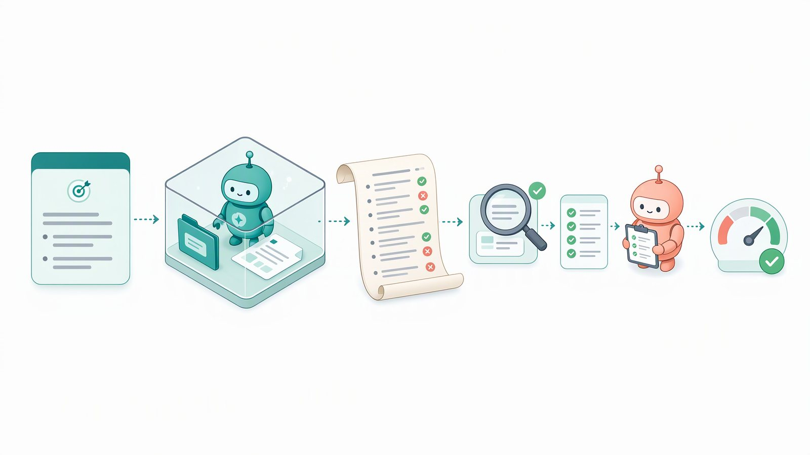

import { LinkCard } from '@astrojs/starlight/components';
import Flow from '../../../../components/Flow.astro';
import Pieces from '../../../../components/Pieces.astro';

<figure class="illustration">
  
  <figcaption>一次试验：从任务到分数。</figcaption>
</figure>

无论用什么工具运行，每个评估（eval）都由相同的部分组成。只要学会一次，无论是 Vally 的 YAML、GitHub Copilot Evals 的界面，还是其他评估工具，读起来就都是一个道理。各个练习都会回过头来参考本页。

## 一次试验的每一步

**试验**（trial）是一个任务的一次运行。每次试验都会经历以下步骤：

<Flow
  label="一次试验中发生了什么"
  steps={[
    { label: '任务', detail: '提示词及其输入（在 Vally 中叫 stimulus）', tone: 'input' },
    { label: '环境', detail: '包含技能（skill）和文件的全新工作区', tone: 'input' },
    { label: '智能体工作', detail: '执行器运行被测智能体', tone: 'agent' },
    { label: '运行记录和产出结果', detail: '它做了什么，留下了什么', tone: 'agent' },
    { label: '评分器', detail: '每个检查项返回通过或失败、分数和证据', tone: 'grader' },
    { label: '判定结果', detail: '将分数与阈值比较：通过或失败', tone: 'result' },
  ]}
/>

然后，同一个任务会再运行几次，评估会报告**通过率**：有多少次试验通过了。

## 各个组成部分

### 你交给智能体的东西

<Pieces
  items={[
    { term: '评估（评估规范文件）', def: '描述一个完整测试的文件：任务、环境、检查项和设置。', analogy: '包含多个测试用例的测试文件', where: '<code>evals/</code> 中的 <code>*.eval.yaml</code> 文件' },
    { term: '任务（stimulus）', def: '发给智能体的一个请求：提示词，加上这个请求特有的所有内容。Vally 称之为 <strong>stimulus</strong>；其他工具则称为任务（task）或测试用例（test case）。', analogy: '一个测试用例', where: '<code>stimuli:</code>，每一项都有 <code>name</code> 和 <code>prompt</code>' },
    { term: '环境', def: '智能体启动时看到的一切：技能、文件、设置。Vally 会为每次试验构建一个全新的、隔离的工作区，因此一次试验不会影响下一次，你的存储库中的其他任何内容也不会传到智能体那里。', analogy: '干净的测试夹具', where: '<code>agent_environment:</code>，包含 <code>skills</code> 和 <code>files</code>' },
    { term: '被测智能体', def: '你要衡量其行为的 AI 智能体：一个模型，加上它的指令和工具。在练习中，它是带有 release-notes 技能的 GitHub Copilot。', analogy: '被测系统', where: '<code>defaults.model</code>，以及 <code>agent_environment.skills</code> 中的技能' },
    { term: '执行器（harness）', def: 'Vally 中负责启动和驱动智能体的部分。<code>copilot-sdk</code> 运行 GitHub Copilot。<code>mock</code> 完全不运行模型：它把提示词作为回答返回，用来测试检查项。', analogy: '测试运行器的驱动程序', where: '<code>defaults.executor</code>' },
  ]}
/>

### 一次试验产出的东西

<Pieces
  items={[
    { term: '试验', def: '一个任务的一次运行。智能体的表现会有变化，所以每个任务都要运行多次试验。', analogy: '掷一次骰子', where: '<code>defaults.runs</code>，或命令行中的 <code>--runs</code>' },
    { term: '运行记录（transcript，也称 trajectory）', def: '一次试验的完整记录：消息、工具调用及其结果、token 用量和耗时。它告诉你智能体是<em>如何</em>得出答案的。', analogy: '飞机上的黑匣子', where: '<code>results.jsonl</code>，以及 <code>vally-results/</code> 下的试验文件夹' },
    { term: '产出结果', def: '试验产出的东西：最终回答，加上试验结束后工作区的状态（例如某个文件是否被修改）。', analogy: '你要断言的最终状态', where: '运行记录中的回答；试验工作区中的文件' },
  ]}
/>

### 如何评判

<Pieces
  items={[
    { term: '评分器（检查项）', def: '对产出结果或运行记录的一项检验。它返回通过或失败、一个 0 到 1 之间的分数，以及<strong>证据</strong>：它做出这个判定的理由。Vally 称之为 grader；GitHub Copilot Evals 的界面称之为 check。', analogy: '一个断言', where: '每个任务下的 <code>graders:</code>；每个评分器都有 <code>type</code>、<code>name</code> 和 <code>config</code>' },
    { term: '代码评分器', def: '这种评分器不借助模型，而是精确地检查某项内容：回答是否包含某段文本，文件是否包含某个值，是否使用了某个技能。快速、免费，而且每次结果都一样。', analogy: 'assertEquals', where: '<code>output-contains</code>、<code>file-contains</code>、<code>skill-invocation</code>' },
    { term: 'LLM 评审', def: '这种评分器让第二个模型阅读回答，并依据书面标准做出判定。用于代码无法检查的质量，例如语气。速度较慢，会消耗 token，而且它本身也需要被检查。', analogy: '拿着检查清单的审阅者', where: '带 <code>type: prompt</code> 的评分器' },
    { term: '评分标准（rubric）', def: 'LLM 评审所依据的书面标准，每行一条。它是评审的规范：标准含糊，判定就会前后不一。', analogy: '审阅者的检查清单', where: '任务下的 <code>rubric:</code>' },
    { term: '分数和阈值', def: '试验的分数是其所有评分器分数的平均值。阈值是试验通过所需的分数。设置 <code>threshold: 1</code> 时，每个检查项都必须通过。', analogy: '考试的及格线', where: '<code>scoring.threshold</code>' },
    { term: '通过率', def: '有多少次试验通过，例如 3 次中有 2 次。有多次试验时，Vally 还会报告 pass@k 和 pass^k。', analogy: '投篮命中率', where: '<code>eval-results.md</code> 中的 <strong>Pass Rate</strong> 列' },
  ]}
/>

### 如何组织和比较

<Pieces
  items={[
    { term: '套件', def: '一组有名称、会一起运行的评估，例如所有带 CI 标签的评估。', analogy: '测试套件', where: '<code>.vally.yaml</code> 中的 <code>suites:</code>；用 <code>--suite</code> 运行' },
    { term: '基线和变体', def: '要比较一项改动，就把同一个评估运行两次：基线（改动前）和变体（改动后），两者之间只有一处不同。', analogy: '对照组和实验组', where: '<code>experiments/</code> 中的实验文件' },
  ]}
/>

## 真实文件中的各个部分

下面是你将在练习 3 中运行的评估，每个部分都做了标注：

```yaml title="evals/release-notes.eval.yaml"
name: release-notes-completed-only                    # the eval
description: The release-notes skill announces completed work only and leaves the in-progress status in backlog.json alone.
type: capability                                      # intent: "can the agent do this yet?"
defaults:
  executor: copilot-sdk                               # executor: runs GitHub Copilot
  model: claude-sonnet-5.5                            # the agent's model
  runs: 3                                             # trials per task
  timeout: 120s
agent_environment:                                    # environment, rebuilt for every trial
  skills:
    - ../.github/skills/release-notes                 # the skill under test
  files:
    - src: ../backlog.json
      dest: backlog.json
scoring:
  threshold: 1                                        # every check must pass
stimuli:
  - name: completed-work-only                         # the task (stimulus)
    prompt: Write the release notes for this release from backlog.json.
    graders:                                          # the checks
      - type: output-contains                         # code grader on the answer
        name: leaves-out-unfinished-export
        config: { substring: CT-102, negate: true }
      - type: output-contains
        name: includes-done-search
        config: { substring: CT-101 }
      - type: output-contains
        name: includes-done-dark-mode
        config: { substring: CT-103 }
      - type: skill-invocation                        # code grader on the transcript
        name: release-notes-skill-used
        config:
          required:
            - release-notes
      - type: file-contains                           # code grader on the workspace
        name: backlog-still-in-progress
        config:
          path: backlog.json
          value: '"status": "in-progress"'
```

注意评分器检查的三样东西：**回答**（`output-contains`）、**运行记录**（`skill-invocation`：智能体是否使用了技能？）和**工作区**（`file-contains`）。完整的评估会在有必要的地方把这三样都检查到。

:::note[检查项能证明什么，不能证明什么]
`backlog-still-in-progress` 检查项只能证明 `backlog.json` 中仍然包含文本 `"status": "in-progress"`。在这个待办事项列表中，只有 CT-102 处于这个状态，所以如果智能体把 CT-102 标记为已完成，这个检查项就能发现。但它不能证明是哪一项处于这个状态，也不能证明智能体完全没有编辑任何文件：要确认这一点，请查看该试验的 `workspace.patch`，其中记录了智能体所做的每一处改动。当智能体写下“I didn't edit any files”时，那只是它的说法，而不是证据。请像这个检查项一样，严格按照每个检查项实际检验的内容为它命名。
:::

## 其他工具中的相同部分

| 本工作坊 | Vally YAML | GitHub Copilot Evals 界面 | 其他工具的常见叫法 |
| --- | --- | --- | --- |
| 任务 | `stimuli` | Task, case | Test case, sample |
| 评分器 | `graders` | Check | Evaluator, metric, scorer |
| 运行记录 | Trajectory | Transcript, evidence | Trace, log |
| 试验 | Run (`runs`) | Attempt | Epoch, repetition |

<LinkCard title="下一篇：评分器" description="代码检查、LLM 评审和人工审阅，以及如何检查你的检查项。" href="../graders/" />
