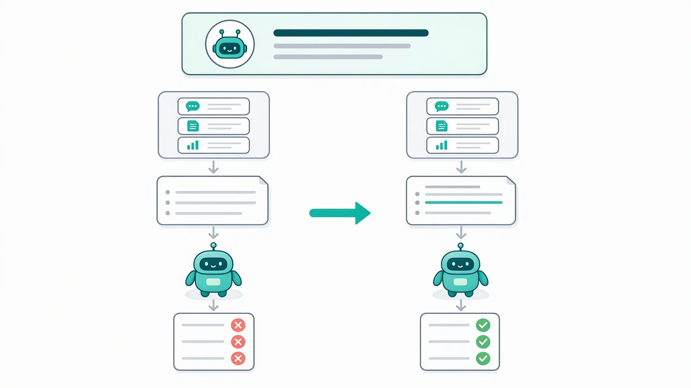

import { LinkCard } from '@astrojs/starlight/components';
import Flow from '../../../../components/Flow.astro';

<figure class="illustration">
  
  <figcaption>同一个评估（eval），同一个模型，只有一处变更：这就是受控比较。</figcaption>
</figure>

你修改了一个技能（skill），现在评估通过了。这是你的修改起了作用，还是运气使然，又或者是同时发生变化的其他因素，比如模型？要弄清楚这一点，就要把**基线**和一个**变体**进行比较，而两者之间**只有一处不同**。

## 基线和变体

- **基线**是“之前”的版本：你用来对比的那个版本。
- **变体**是“之后”的版本：同一个评估，只做了一处有意的修改，比如修复后的技能、换用另一个模型，或者改写过的提示词。
- 其他一切都保持完全相同：任务、评分器、模型、设置以及试验次数。

<Flow
  label="一次受控实验"
  steps={[
    { label: '同一个评估', detail: '相同的任务、评分器和设置', tone: 'input' },
    { label: '基线', detail: '原来的技能', tone: 'muted' },
    { label: '变体', detail: '修复后的技能：唯一的差异', tone: 'agent' },
    { label: '报告', detail: '并排列出通过率，并给出差值', tone: 'result' },
  ]}
/>

## Vally 中的实验

Vally 的**实验文件**声明了要做的比较。下面就是你将在练习 4 中运行的实验文件：

```yaml title="experiments/skill-fix.experiment.yaml"
name: release-notes-skill-fix
evals:
  - ../evals/release-notes.eval.yaml        # the eval to run for every variant
vary: [/environment/skills]                 # the ONLY setting allowed to differ
baseline: before                            # which variant is the "before"
variants:
  before:
    environment:
      skills: ["../skill-versions/before/release-notes"]   # the original skill
  after:
    environment:
      skills: ["../.github/skills/release-notes"]          # your fixed skill
```

- **`vary`** 列出变体之间允许不同的内容，写成指向评估设置的路径。这里是技能。如果变体之间还有*其他*差异，Vally 会拒绝运行：结果不能来自你没有声明的变更。
- **`variants`** 说明每个变体改变了什么。每个变体都可以覆盖环境（技能、文件）以及 `model`、`executor` 或 `runs` 等设置。
- **`baseline`** 指定基线变体，其他变体都与它进行比较。

使用 `vally experiment run <file>` 运行实验。如果只想查看执行计划、不调用任何模型，可以加上 `--dry-run` 进行试运行。两个变体在同一个实验中并排运行，因此模型更新或服务变慢会对两者产生同样的影响。

## 解读报告

实验结束时会输出类似下面的摘要，这是我们测试运行时得到的：

```text
Experiment  release-notes-skill-fix   varying /environment/skills · baseline before

  → after beat baseline — 1/1 vs 0/1 stimuli.
    after used ±0% tokens, −7% trial time.

  eval                          before (baseline)         after                      Δ
  release-notes-completed-only  ✘ 0/1 (score 80% < 100%)  ✓ 1/1 (score 100% ≥ 100%)  +1
  stimuli                       0/1                       1/1                        +1
  tokens                        186.8k                    186.3k                     ±0%
  trial time                    27.4s                     25.4s                      −7%
```

- **任务（stimuli）0/1 → 1/1**：唯一的那个任务在基线中失败，在变体中通过。
- **分数 80% → 100%**：修改前，每次试验的五个检查项中有四个通过；修改后，五个全部通过。
- **token 数和试验时间**：这些反映的是成本。如果一项修复让 token 用量翻倍，它可能并不值得。
- 输出文件夹中的 **`report.md`** 包含每个变体的详细信息，其中有每个检查项的通过率，以及 pass@k 和 pass^k。

## 用评审进行比较：`vally compare`

通过率比较的是*判定结果*。有时你想知道哪些答案*更好*，即使两边都通过了。`vally compare` 会请 LLM 评审逐对比较基线和变体的答案，并报告差异及其 95% 置信区间。加上 `--fail-on-regression` 后，如果变体明显更差，它会以错误状态退出，因此很适合在 CI 中使用。它会在评审上消耗 token，所以你会在练习 4 的**更进一步**部分找到它。

## 在 GitHub Copilot Evals 中比较

GitHub Copilot Evals 可以在不调用任何模型的情况下比较已保存的运行，并把差异分为已修复、持续存在和新出现的失败。在 VS Code 中，这个功能叫 **Compare saved runs (no AI calls)**（比较已保存的运行，不调用 AI）。你将在[练习 6](../../labs/lab-6-copilot-evals/) 中尝试用 Copilot 进行比较。

<LinkCard title="下一篇：Vally 和 GitHub Copilot Evals" description="每个工具分别做什么，以及它们如何配合。" href="../tools/" />
