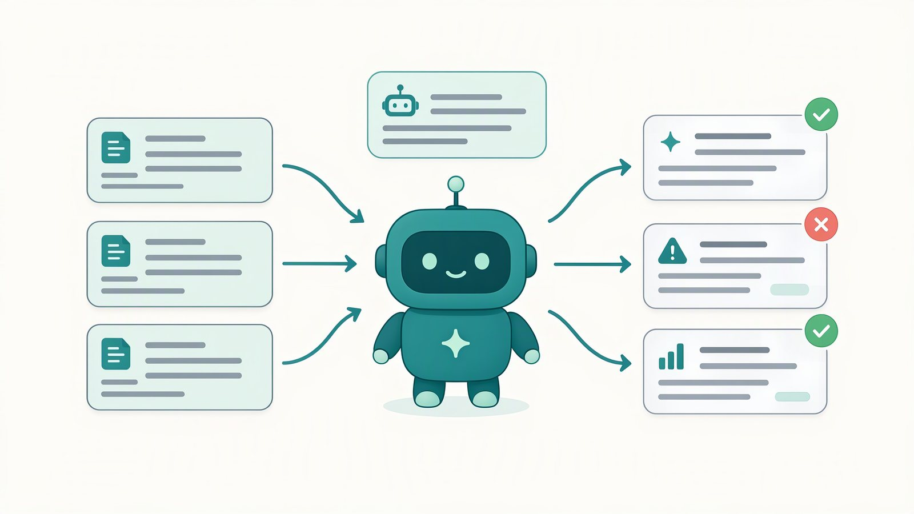

import { LinkCard } from '@astrojs/starlight/components';
import Flow from '../../../../components/Flow.astro';
import RunDiagram from '../../../../components/RunDiagram.astro';

<figure class="illustration">
  
  <figcaption>同样的请求，不同的回答：这正是智能体需要评估的原因。</figcaption>
</figure>

**评估把“看起来不错”变成一项可以重复执行的检查。**

**评估**（eval，*evaluation* 的缩写）是一种可重复的测试，用来检验可能变化的输出。你在已知的初始状态下给 AI 智能体布置一个任务，让它去完成，然后对照你事先写下的标准，检查它做了什么、产出了什么。由于智能体的输出每次运行都可能不同，你要把同一个任务运行多次，并报告它**成功的频率**。

<RunDiagram
  actors={[
    { id: 'you', name: '你', icon: 'pencil', tone: 'you' },
    { id: 'runner', name: '评估运行器', icon: 'setting', tone: 'runner', note: '练习中用的是 Vally' },
    { id: 'agent', name: '智能体', icon: 'laptop', tone: 'agent', note: '模型、指令、工具' },
    { id: 'checks', name: '评分器', icon: 'approve-check', tone: 'check', note: '代码检查项或 LLM 评审' },
  ]}
  steps={[
    { from: 'you', to: 'runner', text: '启动评估', detail: '一个任务、一个起始情境，以及“好”的标准。' },
    { from: 'runner', to: 'agent', text: '把任务交给它', detail: '每次都在起始情境的一个全新副本中。' },
    { from: 'agent', to: 'runner', text: '回答', detail: '可能与上一次试验的答案不同。' },
    { from: 'runner', to: 'checks', text: '交出证据', detail: '答案、智能体做了什么，以及它改动了什么。' },
    { from: 'checks', to: 'runner', text: '通过或失败', detail: '并附上判定结果的证据。' },
    { from: 'runner', to: 'you', text: '报告通过率', detail: '不是单一的判定结果，而是智能体成功的频率。' },
  ]}
  repeat={{ first: 2, last: 5, label: '同一个任务的多次试验' }}
/>

## 为什么智能体需要评估

传统代码是确定性的：相同的输入总是产生相同的输出，所以一次测试通过就能说明问题。AI 智能体则不同：

- **它不是确定性的**。同一个提示词可能产生不同的回答、不同的工具调用和不同的结果。一次好的回答只能证明好的回答*有可能*出现。
- **影响它的环节很多**。模型、它的指令（比如某个技能）、它的工具以及它能看到的文件，都会影响它的行为。改动其中任何一项，它的行为都可能在你没留意的地方发生变化。
- **“我看着没问题”无法规模化**。手动试几次提示词，能发现明显的问题，却发现不了那种五次里出现一次、最终落到客户手里的失败。
- **模型会更新换代**。新模型发布时，评估能在几分钟内告诉你，它在*你的任务上*是否表现更好，而不是在别人的基准测试上。

## 评估与单元测试

评估借用了测试的思路，但细节有所不同：

| | 单元测试 | 评估 |
| --- | --- | --- |
| **运行的是什么** | 你的代码 | AI 智能体：带有指令和工具的模型 |
| **同一输入运行两次** | 输出相同 | 输出往往不同 |
| **运行次数** | 一次 | 多次**试验**（trial），然后得出通过率 |
| **检查什么** | 精确的值 | 回答、智能体做了什么、改动了什么，有时需要主观判断 |
| **结果** | 通过或失败 | 通过率，外加每次试验的证据 |
| **失败时** | 你的代码有错 | 可能是智能体、它的指令、任务或检查项有问题；你要阅读运行记录（transcript）才能找出是哪一个 |

所以，评估并不是“AI 的单元测试”，而是针对可能变化的输出的测试。

## 可以评估什么

凡是会左右智能体行为的东西，都可以评估：

- **技能（skill）**：智能体处理某类任务时加载的 `SKILL.md` 指令。练习中你要评估的就是技能。
- **智能体指令和提示词**：自定义指令、系统提示词和提示词文件。
- **工具**：例如 MCP 服务器。智能体是否选对了工具，参数是否正确？
- **模型**：在两个模型上运行相同的任务，以便从中做出选择。
- **完整的智能体**：带有全部指令和工具的智能体。

## 评估循环

评估不是一次性的工作。在各个练习中，你会遵循这个循环：

<Flow
  label="评估循环"
  steps={[
    { label: '定义“好”', detail: '在任何运行之前写下标准', tone: 'input' },
    { label: '检查这些检查项', detail: '使用已知答案，不调用模型', tone: 'grader' },
    { label: '运行试验', detail: '每个任务运行多次', tone: 'agent' },
    { label: '阅读运行记录', detail: '找出失败的原因', tone: 'agent' },
    { label: '只改一处', detail: '然后与基线比较', tone: 'grader' },
    { label: '持续守护', detail: '每次改动都运行评估', tone: 'result' },
  ]}
/>

1. 在运行任何东西之前，先**定义“好”**。如果两个人无法就某个回答是否通过达成一致，说明任务或标准还不够清楚。（[练习 1](../../labs/lab-1-define-good/)）
2. 用你已经知道好坏的答案来**检查这些检查项**。（[练习 2](../../labs/lab-2-check-your-checks/)）
3. **运行试验**，看通过率，而不是只看一次运行。（[练习 3](../../labs/lab-3-run-the-agent/)）
4. **阅读运行记录**。通过率只告诉你*有*失败，运行记录才告诉你*为什么*失败。
5. **只改一处**，然后与基线比较，这样你才知道是什么带来了差别。（[练习 4](../../labs/lab-4-fix-and-prove/)）
6. **持续守护**：智能体通过之后，每次改动都运行评估，确保它一直通过。（[练习 7](../../labs/lab-7-ci/)）

## 能力评估与回归评估

评估有两种用途，同一个评估可以从一种用途转为另一种：

- **能力评估**问的是：“智能体现在能做到这件事了吗？”它的通过率一开始可能很低，你要努力把它提高。release-notes 评估就从这里起步：技能有一个缺陷，所以评估会失败。
- **回归评估**问的是：“智能体还能做到它以前能做的事吗？”它的通过率应该接近 100%，一旦下降，就说明有东西出了问题。修复技能之后，release-notes 评估就变成了这一类：你会在每个拉取请求上运行它。

<LinkCard title="下一篇：评估的构成" description="每个评估都有的组成部分，以及它们在 Vally 中的名称。" href="../anatomy/" />
