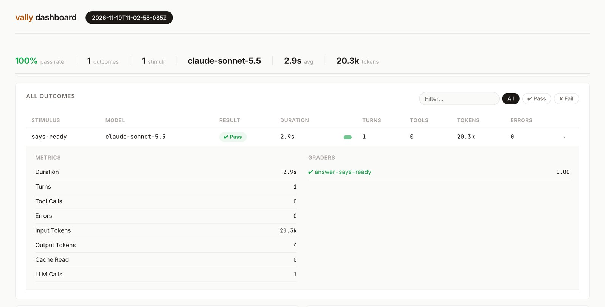

import { Steps } from '@astrojs/starlight/components';
import LabMeta from '../../../../components/LabMeta.astro';
import EvalMap from '../../../../components/EvalMap.astro';
import Pieces from '../../../../components/Pieces.astro';
import RunDiagram from '../../../../components/RunDiagram.astro';

<LabMeta time="20 分钟" cost="1 次 Copilot 运行" uses="你的 Codespace 或本地终端" />

<figure class="illustration">
  
  <figcaption>首先，确认整条链路都能正常工作：你的工具、你的登录，以及一次很小的真实运行。</figcaption>
</figure>

在编写真正的评估（eval）之前，先确认整条链路都能正常工作：你的终端、各个工具、你的 Copilot 登录，以及一次真实的运行。现在发现问题，只需花一分钟；等到练习 3 才发现，就会打乱你的节奏。然后，初步看看一次运行会留下哪些内容。每个练习都需要阅读结果，而趁运行还很小的时候熟悉它们最容易。

<EvalMap
  doing="检查你的工具和登录状态，运行一次很小的真实评估，并熟悉它的结果。"
  testing="你的环境设置：Vally 能否用你的登录访问 GitHub Copilot？"
  checking="一项代码检查：答案是否包含 <code>READY</code>？"
  task={{ text: '只回复一个单词 READY' }}
  agent={{ text: 'GitHub Copilot，<code>claude-sonnet-5.5</code>' }}
  environment={{ text: '一个全新的空工作区' }}
  trials={{ text: '1' }}
  checks={{ text: '对答案使用 <code>output-contains</code>' }}
  results={{ text: '运行文件夹、试验记录、仪表板' }}
/>

<RunDiagram
  command="vally eval -e lab-files/lab-0/setup-check.eval.yaml"
  actors={[
    { id: 'you', name: '你', icon: 'pencil', tone: 'you' },
    { id: 'vally', name: 'Vally', icon: 'setting', tone: 'runner', note: '评估运行器' },
    { id: 'agent', name: 'GitHub Copilot', icon: 'laptop', tone: 'agent', note: '<code>claude-sonnet-5.5</code>' },
    { id: 'checks', name: '检查项', icon: 'approve-check', tone: 'check', note: '<code>answer-says-ready</code>' },
    { id: 'results', name: '结果', icon: 'analytics', tone: 'files', note: '<code>vally-results/</code>' },
  ]}
  steps={[
    { from: 'you', to: 'vally', text: '启动运行', detail: 'Vally 读取评估文件：一个任务，一次试验。' },
    { from: 'vally', text: '创建一个全新的空工作区', detail: '并在其中用你的登录凭据启动 GitHub Copilot。' },
    { from: 'vally', to: 'agent', text: '发送提示词', detail: '“Reply with the single word READY and nothing else. Do not use any tools.”' },
    { from: 'agent', to: 'vally', text: '回答 <code>READY</code>', detail: '不需要任何工具：一个回合，约 20,000 个 token。' },
    { from: 'vally', to: 'checks', text: '交出答案', detail: '检查项在其中查找 <code>READY</code>。' },
    { from: 'checks', to: 'vally', text: '通过，并附上证据', detail: '如果出现的是错误，说明运行本身失败了，例如登录失败。' },
    { from: 'vally', to: 'results', text: '写入结果', detail: '<code>eval-results.md</code>、<code>results.jsonl</code> 和这次试验的文件夹。' },
  ]}
/>

## 你将用到的要素

<Pieces
  items={[
    { term: 'Vally CLI', def: '运行评估的命令行工具：<code>vally lint</code> 检查评估文件，<code>vally eval</code> 运行评估，<code>vally serve</code> 在浏览器中显示结果。', analogy: '测试运行器', where: '每一条 <code>vally …</code> 命令', isNew: true },
    { term: '评估文件', def: '描述一个评估的 YAML 文件：要问什么、运行哪个智能体，以及如何检查答案。', analogy: '测试文件', where: '<code>lab-files/lab-0/setup-check.eval.yaml</code>', isNew: true },
    { term: '执行器', def: 'Vally 中负责运行智能体的部分。<code>copilot-sdk</code> 把 GitHub Copilot 作为被测智能体来运行。', analogy: '负责启动被测程序的驱动程序', where: '<code>executor: copilot-sdk</code>', isNew: true },
    { term: 'Copilot 登录', def: '让 Vally 能代你向 Copilot 发送请求的令牌：你的 Codespace 自带的 <code>GITHUB_TOKEN</code>；在你的计算机上，则是 <code>.env</code> 从你的 GitHub CLI 登录中读取的 <code>COPILOT_GITHUB_TOKEN</code>。', analogy: '测试运行器在门口出示的工牌', where: '<code>check-setup.sh</code> 输出中 <strong>GitHub Copilot sign-in</strong> 下的几行', isNew: true },
    { term: '运行文件夹', def: '一次 <code>vally eval</code> 保存的全部内容：一张摘要表、每次试验一条记录，以及每次试验一个文件夹。', analogy: '测试报告', where: '<code>vally-results/&lt;date-and-time&gt;/</code>', isNew: true },
    { term: '试验记录', def: '<code>results.jsonl</code> 中每次试验占一行：智能体的最终答案、它的运行记录（transcript）、各项指标，以及每个检查项的判定结果和证据。', analogy: '一次运行的“黑匣子”', where: '运行文件夹中的 <code>results.jsonl</code>', isNew: true },
    { term: '仪表板', def: 'Vally 在浏览器中的结果查看器：并排显示每次运行的通过率、检查项和指标。', analogy: '网页版的测试报告', where: '<code>vally serve</code>，端口 3200', isNew: true },
  ]}
/>

## 步骤

<Steps>

1. 在 VS Code 中打开你的起始存储库副本：你的 Codespace（参见[在 Codespace 中搭建环境](../../start/codespaces/)），或者你电脑上的克隆。通过 **Terminal** > **New Terminal**（终端 > 新建终端）打开一个终端。练习中的每条命令都在这个终端里运行，位置是存储库的根文件夹。如果在你自己的电脑上操作，请先把你的设置加载到新终端中：`set -a; source .env; set +a`。

2. 检查你的工具和设置：

   ```bash
   ./scripts/check-setup.sh
   ```

   这个脚本会询问每个工具的版本，查找你的 Copilot 登录（但不会显示令牌），并从评估文件中读取模型名称。它不会向任何地方发送任何内容；打开 `scripts/check-setup.sh` 就能看到它是怎么做的。

   **Tools** 和 **GitHub Copilot sign-in** 下的每一行都需要有绿色对勾。**Your own model endpoint** 下显示“Not set, and not needed”也没关系：除非你设置了自己的终结点，否则练习 5 中的 LLM 评审会使用你的 Copilot 计划运行。如果有内容显示为红色，对应的那一行会告诉你该怎么做。

3. 打开你即将运行的评估 `lab-files/lab-0/setup-check.eval.yaml`：

   ```yaml title="lab-files/lab-0/setup-check.eval.yaml"
   # Lab 0: one tiny real run. It proves that Vally can reach GitHub Copilot with your sign-in.
   # It uses one Copilot request. Run it with:
   #   vally eval -e lab-files/lab-0/setup-check.eval.yaml
   name: setup-check
   description: One small real run that checks that the agent under test (GitHub Copilot) answers.
   defaults:
     executor: copilot-sdk     # the agent under test: GitHub Copilot, driven through the Copilot SDK
     model: claude-sonnet-5.5  # pinned, so results are comparable (scripts/use-model.sh changes it)
     runs: 1                   # one trial is enough for a connection check
     timeout: 120s
   stimuli:
     - name: says-ready
       prompt: Reply with the single word READY and nothing else. Do not use any tools.
       graders:
         - type: output-contains
           name: answer-says-ready
           config: { substring: READY }
   ```

   它要求 Copilot 只用一个单词作答，并用一个检查项来判断：答案包含 `READY` 就通过。你会在接下来的练习中了解其中的每一行。

4. 运行它：

   ```bash
   vally eval -e lab-files/lab-0/setup-check.eval.yaml
   ```

   20 到 40 秒后，你会看到：

   ```text
   Loaded 1 stimulus from setup-check

   Summary
     PASS  setup-check

   Saved  /workspaces/agent-evals-workshop-starter/vally-results/2026-11-19T07-11-30-365Z/
   Run ID  5c8e4af2-5b94-4a6c-a945-217eb8ae243a
   ```

   你的文件夹名称和运行 ID 会有所不同：它们分别是你这次运行的日期和时间，以及一个随机 ID。在你自己的电脑上，路径以你的克隆所在的文件夹开头。第一次运行 Vally 时，它还会打印一段关于使用情况遥测的简短说明，并告诉你如何选择退出（`VALLY_TELEMETRY_OPTOUT=1`）。

</Steps>

## 熟悉运行结果

`PASS` 只是一个总的结论。要自己评判一次运行，你需要了解它背后的细节：智能体回答了什么、做了什么，以及每个检查项为什么做出这样的判定。Vally 把这些全都保存在了运行文件夹中。

<Steps>

1. 在 Explorer（资源管理器）中，展开 `vally-results`，再展开你这次运行的文件夹，以及其中的各个文件夹：

   ```text
   vally-results/
   └── 2026-11-19T07-11-30-365Z/           one folder per run, named after its start time
       ├── eval-results.md                 the summary table, for people
       ├── results.jsonl                   one record per trial: answer, transcript, metrics, verdicts
       ├── otel-spans.jsonl                timing data for tracing tools; you can ignore it
       └── setup-check/                    the eval
           └── says-ready/                 the stimulus, that is, the task
               └── claude-sonnet-5.5/      the model
                   └── 0/                  the trial; trial folders count from 0
                       ├── events.jsonl    Copilot's own, complete event log of the trial
                       ├── metadata.json   the trial's settings and status
                       └── workspace.patch every change the agent made to its files
   ```

2. **摘要**。右键单击 `eval-results.md`，然后选择 **Open Preview**（打开预览）。每个任务（stimulus）占一行：各个检查项以及通过它的试验数、通过率、耗时、token 数、轮次、工具调用次数和判定结果。本例中是：`answer-says-ready 1/1`，约 20,000 个 token，1 轮，0 次工具调用。

3. **试验记录**。在终端中，把最新一次运行的路径存入一个变量：

   ```bash
   RUN=$(ls -d vally-results/*/ | tail -1)
   ```

   运行文件夹以开始时间命名，所以列表中的最后一个就是最新的。接下来的命令都会用到 `$RUN`；在新终端中需要重新设置它。

   `results.jsonl` 中每次试验占一行，其中带有 `"type": "trial-result"`；最后一行则是整次运行的汇总。每一行都是一个 JSON 对象；`jq` 会选出试验那一行，并显示其中的几个字段：

   ```bash
   jq 'select(.type == "trial-result") | {stimulus, answer: .trajectory.output, passed: .gradeResult.passed, score: .gradeResult.score}' "$RUN/results.jsonl"
   ```

   ```json
   {
     "stimulus": "says-ready",
     "answer": "READY",
     "passed": true,
     "score": 1
   }
   ```

   `.trajectory` 保存的是智能体做了什么；`.gradeResult` 保存的是检查项做出了什么判定。

4. **运行记录**。试验期间发生的一切，都以事件列表的形式保存在 `.trajectory.events` 中。按顺序列出这些事件的类型：

   ```bash
   jq -r 'select(.type == "trial-result") | .trajectory.events[].type' "$RUN/results.jsonl"
   ```

   ```text
   user_message
   turn_start
   token_usage
   assistant_message
   turn_end
   ```

   先是你的提示词（`user_message`），然后是智能体的一个轮次：这一轮用掉的 token，以及智能体的消息。这里没有 `tool_call` 事件：正如提示词所要求的，智能体没有使用任何工具就作答了。

5. **token 用量**。查看 `token_usage` 事件：

   ```bash
   jq -c 'select(.type == "trial-result") | .trajectory.events[] | select(.type == "token_usage") | .data | {inputTokens, outputTokens}' "$RUN/results.jsonl"
   ```

   ```json
   {"inputTokens":20292,"outputTokens":4}
   ```

   只为了回答一个单词 READY，就输入了约 20,000 个 token，输出了 4 个 token。输入的大部分是智能体的标准指令和它的工具说明，每个请求都会附带这些内容。估算评估的成本时，请记住这一点。

6. **判定结果及其证据**。每个检查项都会报告自己是否通过，以及原因：

   ```bash
   jq 'select(.type == "trial-result") | .gradeResult.details[] | {name, passed, evidence}' "$RUN/results.jsonl"
   ```

   ```json
   {
     "name": "answer-says-ready",
     "passed": true,
     "evidence": "'READY' found in output"
   }
   ```

7. **试验文件夹**。在 Explorer 中，打开这次试验的 `workspace.patch`：它是空的，因为智能体没有修改任何文件。打开 `metadata.json`：`"status": "success"` 表示试验完整地运行到了最后。如果试验中途中断（例如因为连接问题），这里会显示 `"error"`。

</Steps>

现在你已经看到了每个练习都会用到的三个层级：**摘要**（结果好不好？）、**试验记录**（智能体回答了什么、做了什么，每个检查项为什么这样判定？）和**试验文件夹**（工作区里有什么变化？）。试验文件夹中的 `events.jsonl` 是 Copilot 自己记录的、关于同一次试验的更详细的日志；你很少会用到它。

## 仪表板

仪表板会在浏览器中显示同样的结果，而且一次就能显示你的所有运行。现在就启动它，并在每个练习结束后回来看看。

<Steps>

1. 使用终端面板中的 **+** 打开第二个终端，让仪表板在那里持续运行。启动它：

   ```bash
   vally serve vally-results --port 3200 --allowed-host "${CODESPACE_NAME}-3200.${GITHUB_CODESPACES_PORT_FORWARDING_DOMAIN}"
   ```

   `--allowed-host` 让你的 Codespace 转发端口的地址能够访问仪表板。在你自己的电脑上，这两个变量为空，这个选项不起任何作用。

2. 打开仪表板。在 Codespace 中，会弹出一条通知，为端口 3200 提供 **Open in Browser**（在浏览器中打开）；你也可以在 **Ports**（端口）面板中找到这个端口。在你自己的电脑上，打开 `http://localhost:3200`。

3. 四处看看。顶部每次运行对应一个按钮，按钮名称与运行文件夹相同；选择你的那一个。下方是通过率、产出结果（即试验）的数量和 token 数。向下滚动到 **All outcomes**，用 **▾** 展开你的试验：可以看到它的耗时、轮次、工具调用和 token 数，以及每个检查项及其分数。

   

</Steps>

仪表板在启动时读取结果文件夹。**每个练习结束后，请重启仪表板**，才能看到新的运行：选中它所在的终端，按 Ctrl+C，然后按向上箭头键和 Enter 键。

仪表板显示的是发生了*什么*：一次或多次运行的判定结果、分数和指标。而答案、运行记录和证据，也就是*为什么*，都在 `results.jsonl` 中。这两者你都会用到。

## 刚才发生了什么

Vally 读取了评估文件，创建了一个全新的空工作区，用你的令牌在其中启动了 GitHub Copilot，并发送了提示词。Copilot 没有使用任何工具，直接回答了 `READY`。随后，Vally 运行了唯一的检查项，在答案中找到了 `READY`，并把所有内容保存到一个新的运行文件夹中：摘要表、一条试验记录，以及这次试验的文件夹。

## 自我检查

<details>
<summary>如果你的令牌有误，会发生什么？</summary>

运行会以 `ERROR` 和 `Not authenticated. Please authenticate first.` 结束，而不是 PASS 或 FAIL。Vally 会区分这两种情况：FAIL 表示智能体运行了，但有检查项未通过；错误则表示运行本身无法进行。出现错误时，`vally eval` 会以退出代码 1 退出，试验的 `metadata.json` 中会显示 `"status": "error"`。

</details>

<details>
<summary>为什么只有 4 个 token 的答案会用掉约 20,000 个 token？</summary>

发给智能体的每个请求都包含它的标准指令和它所有工具的说明。你的提示词只占其中很小一部分。任务更长时，还会加上智能体读取的文件、它的工具调用和它的回答。运行记录中的 `token_usage` 事件显示了每一轮的 token 数。

</details>

<details>
<summary>要知道智能体回答了什么，应该去哪里看？</summary>

在试验记录中：`results.jsonl` 里该试验那一行的 `.trajectory.output`。摘要表和仪表板只显示判定结果和数字。

</details>

## 遇到问题了？

- **`check-setup.sh` 显示 `No sign-in found`，或者 `vally eval` 报告 `Not authenticated. Please authenticate first.`**：在 Codespace 中，打开一个新终端后重试。在你自己的电脑上，运行 `gh auth login`，然后再次运行 `set -a; source .env; set +a`。仍然失败？给 Vally 一个专用的令牌：请参阅[在 Codespace 中搭建环境](../../start/codespaces/#如果练习-0-无法登录)或[在你的计算机上搭建环境](../../start/local/#如果练习-0-无法登录)中的**如果练习 0 无法登录**一节。
- **你的计划无法使用该模型**：启动 `copilot`，输入 `/model` 查看你可以使用的模型，然后输入 `/exit` 退出。智能体使用的模型就是每个评估文件中的 `model:` 行。`./scripts/use-model.sh <model-id>`（例如 `./scripts/use-model.sh gpt-5.6-luna`）会修改本工作坊所有评估文件中的这一行，这样后面的练习也会使用新模型。然后再次运行评估。
- **仪表板显示 `No runs found`**：请在完成至少一次运行之后，从存储库的根文件夹启动仪表板，并保持文件夹名称 `vally-results` 不变。
- 更多内容请参阅[故障排除](../../reference/troubleshooting/)。

**下一步**：[练习 1：定义“好”](../lab-1-define-good/)
