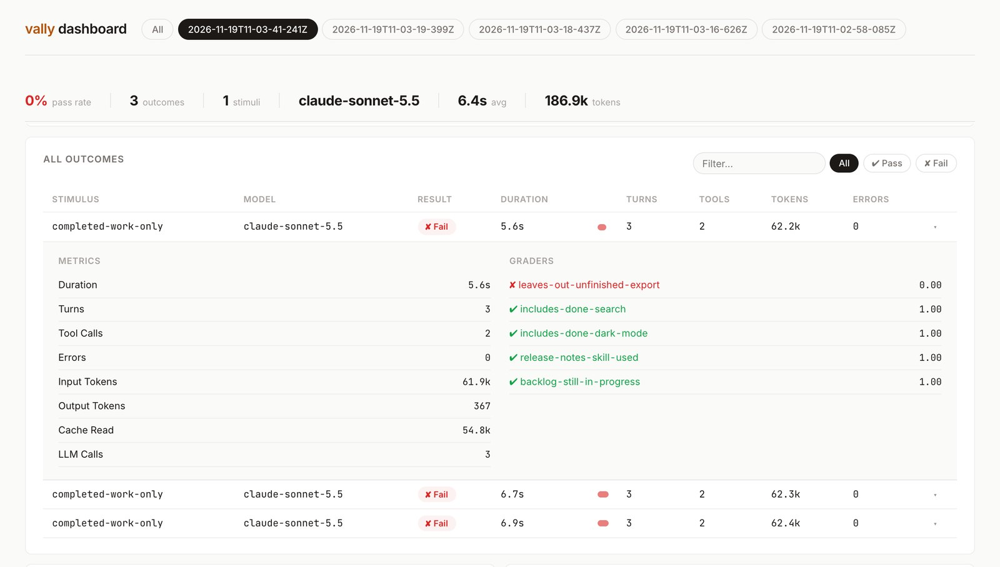

import { Steps } from '@astrojs/starlight/components';
import LabMeta from '../../../../components/LabMeta.astro';
import Pieces from '../../../../components/Pieces.astro';
import EvalMap from '../../../../components/EvalMap.astro';

<LabMeta time="30 分钟" cost="3 次 Copilot 运行" uses="evals/release-notes.eval.yaml" />

<figure class="illustration">
  
  <figcaption>对真实智能体进行 3 次相互隔离的试验，然后调查试验中发生了什么。</figcaption>
</figure>

你的检查项已经能正常工作了。现在让它们面对真正的智能体：带有 release-notes 技能（skill）的 GitHub Copilot，在一个放有待办事项列表（`backlog.json`）的全新工作区中工作。你将运行 3 次试验，看看智能体失败的频率有多高。然后像手握飞行记录仪的侦探一样展开调查：智能体看到了什么、做了什么、想了什么？失败又该归咎于谁？

<EvalMap
  doing="运行真实的智能体 3 次，然后调查失败原因：它的答案、运行记录和推理过程。"
  testing="带有 release-notes 技能的 GitHub Copilot"
  checking="5 个代码检查项：3 个检查答案，1 个检查运行记录，1 个检查工作区"
  task={{ text: '根据 <code>backlog.json</code> 编写发布说明' }}
  agent={{ text: 'GitHub Copilot，<code>claude-sonnet-5.5</code>' }}
  environment={{ text: '技能和 <code>backlog.json</code>，每次试验都重新准备', state: 'new' }}
  trials={{ text: '3 次，并行运行', state: 'new' }}
  checks={{ text: '答案、运行记录和工作区', state: 'new' }}
  results={{ text: '仪表板、试验记录、Copilot 的日志', state: 'new' }}
/>

## 你将用到的要素

<Pieces
  items={[
    { term: '被测智能体', def: '带有 release-notes 技能的 GitHub Copilot：你要衡量的正是它的行为。', analogy: '被测系统', where: '<code>executor: copilot-sdk</code>、<code>model: claude-sonnet-5.5</code>', isNew: true },
    { term: '环境', def: '智能体在工作区中能找到的内容：技能和一份 <code>backlog.json</code> 副本。Vally 会为每次试验创建一个全新的、相互隔离的工作区。', analogy: '干净的测试夹具', where: '<code>agent_environment:</code> 下的 <code>skills</code> 和 <code>files</code>', isNew: true },
    { term: '试验', def: '任务的一次运行。<code>runs: 3</code> 表示 3 次试验，Vally 会并行运行它们。', analogy: '同一颗骰子掷三次', where: '<code>defaults.runs</code>；<code>--runs</code> 可以覆盖它', isNew: true },
    { term: '运行记录（transcript，也称 trajectory）', def: '一次试验所做的一切，以事件列表的形式记录下来：你的提示词、智能体的每一轮（turn）、每次工具调用及其参数和结果、它激活的每个技能，以及每一轮的 token 用量。', analogy: '飞行记录仪', where: '<code>results.jsonl</code> 中的 <code>.trajectory.events</code>', isNew: true },
    { term: '工具调用和工具结果', def: '智能体通过工具来行动，例如用 <code>bash</code> 运行命令，或用 <code>skill</code> 加载技能。每次调用及其返回的内容都是运行记录中的事件。', analogy: '函数调用及其返回值', where: '<code>tool_call</code> 和 <code>tool_result</code> 事件', isNew: true },
    { term: '评分器 <code>skill-invocation</code>', def: '针对运行记录的检查项：如果智能体调用了指定的技能，就通过。', analogy: '检查某个函数是否被调用过', where: '<code>type: skill-invocation</code>', isNew: true },
    { term: '评分器 <code>file-contains</code>', def: '试验结束后针对工作区的检查项：如果某个文件包含指定的值，就通过。这里检查的是 <code>backlog.json</code> 是否仍然包含文本 <code>"status": "in-progress"</code>。', analogy: '检查副作用', where: '<code>type: file-contains</code>', isNew: true },
    { term: '通过率', def: '有多少次试验通过，例如 3 次中通过 0 次。对于多次试验，Vally 还会显示 pass@k 和 pass^k。', analogy: '投篮命中率', where: '<strong>Pass Rate</strong> 列', isNew: true },
  ]}
/>

## 为什么这很重要

智能体只运行一次，结果只是个例。运行 3 次，规律就开始显现，而运行记录能揭示原因。在本练习中，这两点你都会看到：评估（eval）在每次试验中都抓住了这个 bug，但智能体以两种不同的方式失败，只有答案和运行记录才能告诉你原因。判定结果“3 次中 0 次通过”只能告诉你**出了问题**；要修复它，还得知道**为什么**。

## 步骤

<Steps>

1. 把真实的评估复制到你的 `evals/` 文件夹中：

   ```bash
   cp lab-files/lab-3/release-notes.eval.yaml evals/
   ```

   打开 `evals/release-notes.eval.yaml`，从头到尾读一遍。其中 3 个检查输出的检查项，你在练习 2 中已经认识了。新出现的是：执行器（`copilot-sdk`：真实的智能体）、环境（技能和待办事项列表，会复制到每次试验的工作区中）、3 次试验，以及两种新的检查项：`skill-invocation` 检查运行记录，`file-contains` 检查工作区。[评估的构成](../../concepts/anatomy/#真实文件中的各个部分)一文标出了文件中的每个部分。

2. 对它运行 lint 检查：

   ```bash
   vally lint -e evals/release-notes.eval.yaml --strict
   ```

   ```text
   ✔ evals/release-notes.eval.yaml is valid
   ```

3. **预测**：技能要求智能体列出待办事项列表中的每一项。3 次试验中会有几次通过？然后运行：

   ```bash
   vally eval -e evals/release-notes.eval.yaml
   ```

   这 3 次试验并行运行，大约需要 15 到 60 秒。我们的运行结果：

   ```text
   Loaded 1 stimulus from release-notes-completed-only · 3 workers

   release-notes-completed-only

     FAIL  completed-work-only  0/3
      ✘ leaves-out-unfinished-export  0 passed · 3 failed · 'CT-102' found in output  trials 1–3
      · score 80.0% < threshold 100.0% · trials 1–3

   ────────────────────────────────────────────────────────

   Summary
     release-notes-completed-only  ✘ 0/1 (score 80% < 100%)
       ✘ completed-work-only   0/3 passed   leaves-out-unfinished-export · 'CT-102' found in output
       · score 80.0% < threshold 100.0% · trials 1–3

   Saved  /workspaces/agent-evals-workshop-starter/vally-results/2026-11-19T09-56-12-704Z/
   Run ID  6dd92f74-887e-44b2-bae8-2bc8d99c834e
   ```

   **3 次试验中通过了 0 次**。在每次试验中，5 个检查项都有 4 个通过（分数为 80%）；只有针对 CT-102 的检查项失败了，而且 3 次都失败了。

4. 先看总体情况。重启仪表板（在仪表板的终端中按 Ctrl+C，然后按向上箭头键和 Enter 键），重新加载页面，然后选择最新的运行。通过率为 0%，共 3 个产出结果。在 **All outcomes** 下展开每次试验：5 个检查项中有 4 个通过，共 3 轮、2 次工具调用，约 62,000 个 token。**Tool calls by tool** 显示了智能体用过哪些工具：`skill` 和 `bash`。

   

   这次运行的 `eval-results.md` 用一行列出了同样的数字，另外还有 **pass@k** 和 **pass^k**（都是 0%）：在最新的运行文件夹中右键单击它，然后选择 **Open Preview**（打开预览）。

</Steps>

## 调查失败原因

仪表板告诉你**什么**失败了。现在要从试验记录中找出**为什么**。每一步都回答一个问题；把这些答案放在一起，你就能判断失败该归咎于谁。

<Steps>

1. 像练习 0 中那样，把最新的运行文件夹存入一个变量：

   ```bash
   RUN=$(ls -d vally-results/*/ | tail -1)
   ```

2. **智能体回答了什么**？把 3 个答案依次打印出来：

   ```bash
   jq -r 'select(.type == "trial-result") | "── trial \(.trialIndex + 1)", .trajectory.output' "$RUN/results.jsonl"
   ```

   3 个答案都读一读。我们得到了两类答案。有 2 次试验遵循了技能中的规则，列出了 CT-102，并附上了一条备注：

   ```text
   ── trial 1
   This release brings easier searching and a fresh look to your dashboard.

   - CT-101: Search across all projects
   - CT-102: Export reports to CSV
   - CT-103: Dark mode for the dashboard

   Note: `backlog.json` lists CT-102 as "in-progress", not "done". I included it because the skill says to list every item. If it won't ship in this release, I can remove it.
   ```

   有 1 次试验没有把 CT-102 列入清单，但仍然写到了它：

   ```text
   ── trial 2
   Here's a short release summary with the two shipped features.

   **Release notes**

   This release makes it easier to find things and easier on the eyes.

   - CT-101: Search across all projects
   - CT-103: Dark mode for the dashboard

   I left out CT-102 ("Export reports to CSV") because `backlog.json` marks it as in-progress, so it isn't shipped yet. The skill says to list every backlog item, so I can add it as a third bullet if you want. That would announce a feature that isn't finished.
   ```

   你得到的答案在措辞上会有所不同，每类答案出现的次数也可能不同。运行多次试验，正是为了看到这种差异。试验按完成的先后顺序显示。

3. **智能体做了什么**？挑一次试验，按顺序列出其运行记录中的事件。`.trialIndex` 和试验文件夹一样从 0 开始计数，所以试验 1 对应 `.trialIndex == 0`：

   ```bash
   jq -r 'select(.type == "trial-result" and .trialIndex == 0) | .trajectory.events[].type' "$RUN/results.jsonl"
   ```

   ```text
   user_message
   turn_start
   token_usage
   assistant_message
   tool_call
   tool_result
   skill_activation
   turn_end
   turn_start
   token_usage
   assistant_message
   tool_call
   tool_result
   turn_end
   turn_start
   token_usage
   assistant_message
   turn_end
   ```

   共 3 轮：在第一轮中，智能体调用了一个工具，并有一个技能被激活；在第二轮中，它调用了另一个工具；在第三轮中，它写出了答案。调用的是哪些工具？用了哪些参数？

   ```bash
   jq -r 'select(.type == "trial-result" and .trialIndex == 0) | .trajectory.events[] | select(.type == "tool_call") | "\(.data.toolName): \(.data.arguments)"' "$RUN/results.jsonl"
   ```

   ```text
   skill: {"skill":"release-notes"}
   bash: {"command":"cat backlog.json","description":"Read backlog"}
   ```

   它先调用了 release-notes 技能，然后用一条 shell 命令读取了待办事项列表。检查项 `release-notes-skill-used` 找到的正是这次 `skill` 调用。

4. **智能体看到了什么**？技能给它的指令原文就在 `skill_activation` 事件中：

   ```bash
   jq -r 'select(.type == "trial-result" and .trialIndex == 0) | .trajectory.events[] | select(.type == "skill_activation") | .data.content' "$RUN/results.jsonl"
   ```

   ```text
   # Release notes

   Read `backlog.json` in the project root and draft the release notes for the next release.

   - List every backlog item as a feature of this release, one bullet per item, formatted as `- ID: title`.
   - Start with one short sentence that summarizes the release.
   - Keep the tone friendly and short. Do not edit any files.
   ```

   而它的 shell 命令返回的内容在 `tool_result` 事件中：

   ```bash
   jq -r 'select(.type == "trial-result" and .trialIndex == 0) | .trajectory.events[] | select(.type == "tool_result" and .data.toolName == "bash") | .data.result.content' "$RUN/results.jsonl"
   ```

   ```text
   [
     { "id": "CT-101", "title": "Search across all projects", "status": "done" },
     { "id": "CT-102", "title": "Export reports to CSV", "status": "in-progress" },
     { "id": "CT-103", "title": "Dark mode for the dashboard", "status": "done" }
   ]
   ```

   所以智能体同时掌握了两个事实：规则“列出待办事项列表中的每一项”，以及 CT-102 的状态是 `in-progress`。

5. **智能体想了什么**？Copilot 自己记录的试验日志，也就是试验文件夹中的 `events.jsonl`，还会保存模型对其推理过程的摘要（前提是模型提供了摘要）：

   ```bash
   jq -r 'select(.type == "assistant.message") | .data.reasoningText // empty' "$RUN"*/*/*/0/events.jsonl
   ```

   ```text
   The skill says to list every item as a feature, but CT-102 is still in progress and hasn't shipped, so listing it as done would misrepresent things. I'll follow the skill's format and include all items, while noting that CT-102 is in progress.
   ```

   这次试验遵循了技能中的规则。没有把 CT-102 列入清单的试验，推理过程则不同；在另一次运行中，我们得到的是：“I'll list the two completed items and leave CT-102 out, noting that it's still in progress and offering to add it once it lands.”要查看另一次试验的推理过程，把 `0` 换成它的文件夹名 `1` 或 `2` 即可。

   路径 `"$RUN"*/*/*/0/` 就是试验 1 的试验文件夹，各级依次是评估、任务（stimulus）、模型和试验。如果命令没有任何输出，说明你的模型没有提供推理过程；跳过这一步即可。

6. **智能体改动了什么吗**？在 Explorer（资源管理器）中，打开每个试验文件夹里的 `workspace.patch`：3 个文件都是空的。智能体根本没有修改任何文件，这比检查项 `backlog-still-in-progress` 提供的证据更有力，因为后者只能证明 `backlog.json` 中仍然有某一段文本。

7. **你的判断**。在打开我们的解读之前，先自己判断：这次失败是智能体的错、技能的错，还是检查项的错？哪些证据支持你的判断？

   <details>
   <summary>我们的解读</summary>

   **是技能的错**。智能体照着指示做了：它调用了技能，读取了待办事项列表，而且它的推理过程表明，它注意到了规则“列出待办事项列表中的每一项”与 CT-102 的状态之间的冲突。遵循规则的试验列出了 CT-102，并附上了一条备注。没有遵循规则的试验没有把 CT-102 列入清单，但仍然在备注中提到了它，而你在练习 1 中已经决定，答案中根本不能提到 CT-102。无论哪种情况，冲突都来自技能的规则。检查项没有问题：它报告的正是你关心的那个 bug。所以应该修复的是技能：这就是练习 4 的内容。

   </details>

</Steps>

## 捷径：`answers.sh`

你刚才手动查看了一次试验的答案、工具调用和检查项。从现在开始，可以用一个脚本一次性对某次运行的所有试验完成这些工作。`scripts/answers.sh` 会对最新运行的 `results.jsonl` 执行和你刚才类似的 `jq` 查询，并为每次试验打印：判定结果和分数、答案、工具调用（加上 `--tools` 时），以及每个检查项（失败的检查项会附上证据）。在编辑器中打开 `scripts/answers.sh` 看看：它就是一个 `jq` 程序，其中的字段你都认得。

```bash
./scripts/answers.sh --tools
```

```text
Run: vally-results/2026-11-19T09-56-12-704Z

════ release-notes-completed-only › completed-work-only · trial 3 · claude-sonnet-5.5 · FAIL (score 80%)
── answer ──
This release brings cross-project search, CSV exports, and a dark dashboard.

- CT-101: Search across all projects
- CT-102: Export reports to CSV
- CT-103: Dark mode for the dashboard

Note: CT-102 is still "in-progress" in `backlog.json`. I listed it because the skill says to include every item, but you may want to drop it if it won't ship.
── tool calls ──
1. skill: {"skill":"release-notes"}
2. bash: {"command":"cat backlog.json","description":"Read backlog"}
── checks ──
✘ leaves-out-unfinished-export [output-contains]
    'CT-102' found in output
✔ includes-done-search [output-contains]
✔ includes-done-dark-mode [output-contains]
✔ release-notes-skill-used [skill-invocation]
✔ backlog-still-in-progress [file-contains]
…
```

在后面的练习中，你可以任选一种方式：想快速浏览每次试验时用脚本，想查看某个细节时用 `jq`。

## 刚才发生了什么

你衡量了一个真实的智能体，发现了一个真实的 bug，并亲自追查到了它的原因：

- **通过率为 0/3**。这个 bug 在全部 3 次试验中都出现了：它不是偶然的失误。
- **原因在于技能的规则**。智能体逐字收到了这条规则，读取了待办事项列表，而它的推理过程和备注都引用了这条规则：“I included it because the skill says to list every item.”
- **有些试验没有遵循这条规则，但仍然失败了**，因为备注中提到了 CT-102。按照你在练习 1 中写下的定义，这就是失败：答案中的任何内容都可能被发布出去。
- **其他检查项都通过了**：CT-101 和 CT-103 每次都包含在内，`backlog.json` 仍然包含 in-progress 状态，而且每个 `workspace.patch` 都是空的。

你用到了三个层次的证据：用**仪表板和摘要**看规律，用**试验记录**看答案和运行记录，用 **Copilot 自己的日志**看推理过程。所以应该修复的是技能，而不是检查项。这就是练习 4 的内容。

## 自我检查

<details>
<summary>分数是 80%，可每次试验都失败了。为什么？</summary>

分数是 5 个检查项的平均值：4 个通过，1 个失败，所以是 80%。但阈值是 1：只有所有检查项都通过，试验才算通过。分数高但判定结果为失败，意味着“几乎全对，但有一处重要的错误”。

</details>

<details>
<summary>pass@3 = 0% 和 pass^3 = 0% 说明了什么？</summary>

pass@3 = 0% 表示 3 次试验中没有一次通过。这并不能证明智能体永远不可能成功，但在使用这个技能时，我们每次让它做，它都失败了。pass^3 可以由通过率推算出来（0<sup>3</sup> = 0）。

</details>

<details>
<summary>哪些证据表明智能体知道 CT-102 尚未完成？</summary>

有三条证据：`cat backlog.json` 的 `tool_result` 表明它读到了 `"status": "in-progress"`；它的推理过程写着“CT-102 is still in progress and hasn't shipped”；它在答案中的备注也是这么说的。它明明知道，却仍然遵循了技能中的规则。

</details>

<details>
<summary>有一次试验没有把 CT-102 列入清单，为什么仍然失败了？</summary>

因为它的备注中提到了 CT-102，而这个检查项是有意这样设计的：只要提到就会失败。你在练习 1 中已经决定，CT-102 不能出现在答案的任何地方。如果你当初认为加一条备注没问题，就需要换一个检查项，或者使用 LLM 评审，你会在练习 5 中认识它。

</details>

## 遇到问题？

- **进度落后了**？`scripts/catch-up.sh 3` 会像第 1 步那样，把练习 3 的评估复制到 `evals/` 中。
- **出现身份验证错误**：请参阅[练习 0](../lab-0-setup/#遇到问题了) 和[故障排除](../../reference/troubleshooting/)。
- **某次试验显示 `ERROR`**，例如 `Session disconnected while waiting for a response`：说明这次试验没有完成，通常是由临时的连接问题引起的。Vally 会把它计为错误，既不算通过，也不算失败，而且也没有答案可看。重新运行评估即可。
- **某次试验超时**：再运行一次即可，智能体有时需要更长时间。你也可以调高 `timeout`。
- **`jq` 没有任何输出**：检查 `$RUN` 是否已设置（`echo "$RUN"`）；如果打开了新的终端，请重新设置它。
- **你的答案和旁边的人不一样**：这很正常；比较一下哪些检查项失败了，以及失败的原因。真正会改变测量结果的差异有：换了模型（`scripts/use-model.sh`）、设置了 `EVALUATE_USE_HOST_COPILOT_HOME=1`，或者你已经修改过技能。

## 更进一步

### Copilot 自己的日志

试验文件夹中的 `events.jsonl` 是 Copilot 对这次试验的完整记录，比 `results.jsonl` 中的运行记录更详细。用 `jq -r '.type' "$RUN"*/*/*/0/events.jsonl` 列出其中的事件类型。其中一种事件 `system.message` 包含智能体的标准指令：约 24,000 个字符，每次请求都会发送。一次试验的大部分 token 都花在这里。另一种事件 `session.usage_checkpoint` 记录了这次试验计入了多少次 Copilot 请求。

### 为什么干净的环境很重要

Vally 会为每次试验提供一个全新的临时文件夹，其中只包含 `agent_environment` 列出的内容：技能和 `backlog.json`。`skill_activation` 事件中的 `path` 可以证明这一点：

```bash
jq -r 'select(.type == "trial-result" and .trialIndex == 0) | .trajectory.events[] | select(.type == "skill_activation") | .data.path' "$RUN/results.jsonl"
```

你存储库中的其他内容都不会传给智能体。除了你的技能之外，试验的 `metadata.skillsLoaded` 还列出了 Copilot 自带的 3 个技能；它们对每个人都一样。但仍有一样东西可能混进来：你自己的 Copilot 主目录。

在制作这个工作坊时，我们在一台 Copilot 主目录中装有约 70 个个人技能的机器上，使用 `EVALUATE_USE_HOST_COPILOT_HOME=1` 运行了同一个评估。通过率仍然是 0/3，但多了一个原因：`release-notes-skill-used` 在每次试验中都失败了。工具调用揭示了原因：

```text
glob: {"pattern":"**/backlog.json"}
view: {"path":"./backlog.json"}
glob: {"pattern":"*"}
view: {"path":"./release-notes/SKILL.md"}
```

周围有 70 个其他技能时，智能体没有调用 release-notes 技能，而是自己去找文件，直接读取了 `SKILL.md`。环境改变了智能体的行为，这个评估衡量的不仅是技能，同样也是环境。这就是 Vally 默认隔离每次运行的原因，也是本工作坊推荐使用令牌而不是 `EVALUATE_USE_HOST_COPILOT_HOME=1` 的原因：**环境本身也是你所衡量的内容的一部分**。

### 更多试验

无需修改文件，就能把试验次数从 3 次改为 5 次：

```bash
vally eval -e evals/release-notes.eval.yaml --runs 5
```

两类答案的比例会变化吗？

**下一步：**[练习 4：修复并证明](../lab-4-fix-and-prove/)
