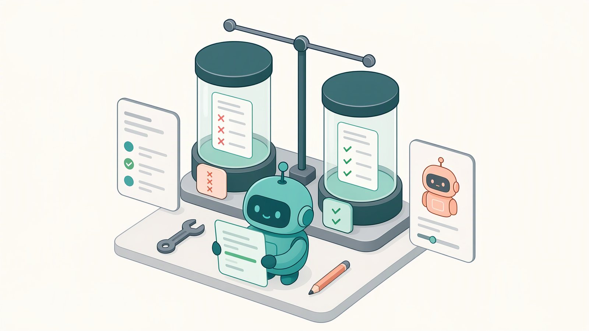
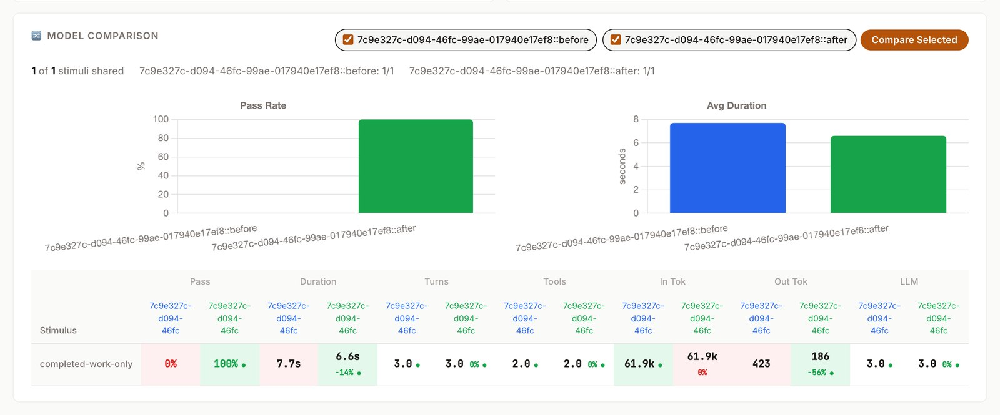

import { Steps } from '@astrojs/starlight/components';
import LabMeta from '../../../../components/LabMeta.astro';
import EvalMap from '../../../../components/EvalMap.astro';
import Pieces from '../../../../components/Pieces.astro';
import RunDiagram from '../../../../components/RunDiagram.astro';

<LabMeta time="15 分钟" cost="6 次 Copilot 运行；如果重新运行评估（eval），再加 3 次" uses=".github/skills/release-notes/SKILL.md, experiments/skill-fix.experiment.yaml" />

<figure class="illustration">
  
  <figcaption>只改变一件事，其他一切保持不变，然后证明正是你的改动带来了差别。</figcaption>
</figure>

你已经知道原因了：技能（skill）的第一条规则。现在你来修复它，然后证明让智能体通过的正是**你的修复**，而不是别的什么。这个证明就是一个受控实验：同一个评估运行两次，一次使用原始技能，一次使用你的技能，其他所有设置完全相同。

<EvalMap
  doing="修复技能，然后用实验证明修复有效：同一个评估，分别用旧技能和新技能运行。"
  testing="你的修复：让智能体通过的，是否正是修复后的技能，而非其他因素？"
  checking="两个变体都使用练习 3 中的五个代码检查项，原样不变"
  task={{ text: '根据 <code>backlog.json</code> 撰写发布说明' }}
  agent={{ text: 'GitHub Copilot，两个变体使用同一个模型' }}
  environment={{ text: '技能：<code>before</code> 对比 <code>after</code>', state: 'changed' }}
  trials={{ text: '每个变体 3 次，共 6 次' }}
  checks={{ text: '答案、运行记录（transcript）和工作区，与练习 3 相同' }}
  results={{ text: '实验对比、<code>report.md</code>、仪表板', state: 'new' }}
/>

<RunDiagram
  command="vally experiment run experiments/skill-fix.experiment.yaml"
  actors={[
    { id: 'you', name: '你', icon: 'pencil', tone: 'you' },
    { id: 'vally', name: 'Vally', icon: 'setting', tone: 'runner', note: '评估运行器' },
    { id: 'before', name: '基线：before', icon: 'puzzle', tone: 'muted', note: '原来的技能' },
    { id: 'after', name: '变体：after', icon: 'puzzle', tone: 'agent', note: '你修复后的技能' },
    { id: 'report', name: '报告', icon: 'analytics', tone: 'files', note: '<code>report.md</code>' },
  ]}
  steps={[
    { from: 'you', to: 'vally', text: '启动实验', detail: '一个评估，两个只在技能上不同的变体。', state: 'new' },
    { from: 'vally', to: 'before', text: '用原来的技能运行评估', detail: '三次试验，每次都在全新的工作区中，与练习 3 相同。' },
    { from: 'before', to: 'vally', text: '判定结果、token 和耗时', detail: '基线：原来的技能表现如何。' },
    { from: 'vally', to: 'after', text: '用你的修复运行同一个评估', detail: '同样的模型、同样的检查项、同样的三次试验。', state: 'changed' },
    { from: 'after', to: 'vally', text: '判定结果、token 和耗时', detail: '变体：你的这一处改动带来了什么。' },
    { from: 'vally', to: 'report', text: '写出对比', detail: '通过率、token 和耗时并排列出，保存在 <code>report.md</code> 中。', state: 'new' },
  ]}
/>

## 你将用到的要素

<Pieces
  items={[
    { term: '基线', def: '你用来对比的“之前”版本：这里就是原始技能。', analogy: '对照组', where: '<code>baseline: before</code>', isNew: true },
    { term: '变体', def: '评估的一个版本，带有一处有意为之的改动：这里就是你修复后的技能。', analogy: '实验组', where: '<code>variants:</code> 下的 <code>before</code> 和 <code>after</code>', isNew: true },
    { term: '实验文件', def: '声明这次比较：用哪个评估、哪些变体，以及变体之间允许有哪些不同。', analogy: '实验室里的实验方案', where: '<code>experiments/skill-fix.experiment.yaml</code>', isNew: true },
    { term: '<code>vary</code>', def: '允许在变体之间不同的设置。只要还有其他任何不同，Vally 就会拒绝运行，因此结果只可能来自声明过的那处改动。', analogy: '你有意改变的那一个变量', where: '<code>vary: [/environment/skills]</code>', isNew: true },
    { term: '冻结副本', def: '原始技能的一份副本，让两个版本能在同一个实验中并存。', analogy: '参照样品', where: '<code>skill-versions/before/release-notes/</code>', isNew: true },
  ]}
/>

## 为什么这很重要

“我改了技能，现在它通过了”并不是证明。智能体每次运行的表现都不同；它背后的模型可能会变；你也可能同时改了两处。受控实验可以排除这些可能：同一个评估、同一个模型、同样的设置、同样的试验次数，只有一处声明过的差异。

## 步骤

<Steps>

1. 修复技能。打开 `.github/skills/release-notes/SKILL.md`，找到它的第一条规则：

   ```markdown
   - List every backlog item as a feature of this release, one bullet per item, formatted as `- ID: title`.
   ```

   把这一整行替换为下面两行：

   ```markdown
   - Include only items whose `status` is `done`. Leave every other item out and do not mention it anywhere in the notes.
   - List each included item as one bullet formatted as `- ID: title`.
   ```

   保存文件。其他规则保持不变。

2. 可选：重新运行练习 3 中的评估，立即看看效果：

   ```bash
   vally eval -e evals/release-notes.eval.yaml
   ```

   在我们的运行中，3 次试验全部通过。但仅仅重新运行一次，并不能证明是修复带来了改变；实验才能证明。

3. 阅读实验文件：

   ```yaml title="experiments/skill-fix.experiment.yaml"
   name: release-notes-skill-fix
   evals:
     - ../evals/release-notes.eval.yaml
   # The only setting allowed to differ between variants. Any other difference is an error,
   # so a result can't come from a change you didn't mean to make.
   vary: [/environment/skills]
   baseline: before
   variants:
     before:
       environment:
         skills: ["../skill-versions/before/release-notes"]
     after:
       environment:
         skills: ["../.github/skills/release-notes"]
   ```

   两个变体运行的是同一个评估。`before` 加载原始技能的冻结副本，`after` 加载你修复后的技能。路径相对于实验文件。

4. 在不调用任何模型的情况下检查运行计划：

   ```bash
   vally experiment run experiments/skill-fix.experiment.yaml --dry-run
   ```

   ```text
   Experiment: release-notes-skill-fix
   Baseline:   before
   Plans:      2

   ── before (baseline) ──
     Eval:        release-notes-completed-only
     File:        ../evals/release-notes.eval.yaml
     Model:       claude-sonnet-5.5
     Config hash: 48df94cc2d6ebe75
     Eval hash:   4c5c9c7166d5db5d

   ── after ──
     Eval:        release-notes-completed-only
     File:        ../evals/release-notes.eval.yaml
     Model:       claude-sonnet-5.5
     Config hash: e032d16ce416ef24
     Eval hash:   4c5c9c7166d5db5d
   ```

   **评估哈希**（Eval hash）相同，所以两个变体运行的是完全相同的评估。**配置哈希**（Config hash）不同，因为技能不同。如果你没有改动评估文件或模型，你的哈希值很可能和我们的一样：它们是根据设置计算出来的。重要的是哪些相同、哪些不同。

5. 运行实验。每个变体运行 3 次试验，共 6 次：

   ```bash
   vally experiment run experiments/skill-fix.experiment.yaml
   ```

   ```text
   Loaded 2 stimuli from release-notes-completed-only · 5 workers

   release-notes-completed-only

   before
     FAIL  completed-work-only  0/3
      ✘ leaves-out-unfinished-export  0 passed · 3 failed · 'CT-102' found in output  trials 1–3
      · score 80.0% < threshold 100.0% · trials 1–3

   ────────────────────────────────────────────────────────

   Experiment  release-notes-skill-fix   varying /environment/skills · baseline before

     → after beat baseline — 1/1 vs 0/1 stimuli.
       after used ±0% tokens, −8% trial time.

     eval                          before (baseline)         after                      Δ
     release-notes-completed-only  ✘ 0/1 (score 80% < 100%)  ✓ 1/1 (score 100% ≥ 100%)  +1
     ────────────────────────────  ────────────────────────  ─────────────────────────  ───
     stimuli                       0/1                       1/1                        +1
     tokens                        186.9k                    186.3k                     ±0%
     trial time                    29.5s                     27.1s                      −8%

   Run ID: 7c9e327c-d094-46fc-99ae-017940e17ef8
   Output: /workspaces/agent-evals-workshop-starter/vally-experiment-results/2026-11-19T11-11-29-203Z
   ```

   Vally 先按变体列出失败项：只有 `before` 失败了。然后是对比：`before` 失败的地方，`after` 通过了，token 用量相同，用时略短。

6. 查看详细结果。实验会把它的运行保存在自己的文件夹 `vally-experiment-results/<date-and-time>/` 中，每个变体一个子文件夹：`before/` 和 `after/`，每个子文件夹里都有你熟悉的 `results.jsonl` 和试验文件夹。

   在 Explorer（资源管理器）中，右键单击最新实验文件夹中的 `report.md`，然后选择 **Open Preview**（打开预览）：每个变体各有一张表。在我们的结果中，`before` 的 3 次试验通过了 0 次，pass@k 和 pass^k 都是 0%；`after` 的 3 次试验全部通过，这两项都是 100%。

   用练习 3 中的快捷脚本按变体查看答案；它会选取最新的运行，这里就是这个实验：

   ```bash
   ./scripts/answers.sh
   ```

   ```text
   ════ release-notes-completed-only › completed-work-only · variant after · trial 1 · claude-sonnet-5.5 · PASS (score 100%)
   …
   ════ release-notes-completed-only › completed-work-only · variant before · trial 1 · claude-sonnet-5.5 · FAIL (score 80%)
   ```

   `after` 的答案是否仍然包含一句摘要和两个已完成的条目？如果一个修复通过了检查项，却破坏了检查项没有关注的东西，那就不算修复。

7. 在仪表板中比较这两个变体。仪表板一次只显示一个结果文件夹，所以要让它指向这个实验：在仪表板的终端中按 Ctrl+C，然后运行：

   ```bash
   EXP=$(ls -d vally-experiment-results/*/ | tail -1)
   vally serve "$EXP" --port 3200 --allowed-host "${CODESPACE_NAME}-3200.${GITHUB_CODESPACES_PORT_FORWARDING_DOMAIN}"
   ```

   重新加载页面。两个变体显示为两次运行，名称是实验的运行 ID 加上 `::before` 和 `::after`。向下滚动到 **Model comparison**，勾选这两次运行，然后选择 **Compare Selected**：

   

   蓝色是 `before`，绿色是 `after`：两列的表头显示的是同一个缩短后的运行 ID。通过率从 0% 升到了 100%，而轮次、工具调用和输入 token 都保持不变：智能体做了同样的工作，却得到了不同的结果。到练习 5 时，请用练习 0 中的命令，重新针对 `vally-results` 启动仪表板。

</Steps>

## 刚才发生了什么

你证明了这次修复：

- **同一个评估、同一个模型、同样的设置**：试运行显示评估哈希完全相同，模型也相同。
- **一处声明过的差异**：技能，也就是 `vary` 中唯一的路径。
- **清晰的结果**：修复前 3 次试验通过 0 次，修复后 3 次全部通过。修复后每个检查项都通过了，包括针对 CT-102 的那一项。
- **没有隐藏成本**：token 用量保持不变，试验还略快了一些。

修复后的技能给出的答案类似这样：

```text
This release makes it easier to find things and gives the dashboard a darker look.

- CT-101: Search across all projects
- CT-103: Dark mode for the dashboard
```

## 自我检查

<details>
<summary>为什么要保留旧技能的冻结副本，而不是使用 Git 历史记录？</summary>

一次实验运行需要同时用到两个版本，而且它们位于两个不同的路径。Git 历史记录里虽然有旧版本，但它不是一个 Vally 能与新版本并排加载的文件夹。

</details>

<details>
<summary>如果 after 变体还改了模型，Vally 会怎么做？</summary>

拒绝运行。模型不在 `vary` 中，所以换了模型就是一处未声明的差异。Vally 在规划实验时就会把它报告为错误，因此你不会误把模型变化带来的效果算到技能头上。

</details>

<details>
<summary>修复前 3 次通过 0 次，修复后 3 次全部通过。这个修复就此一劳永逸地得到证明了吗？</summary>

对于这个任务和这个模型来说，这是来自 6 次试验的有力证据。但它并不能证明用户可能输入的每一个请求都没问题，也不能证明对未来的模型同样有效。所以在练习 7 中，你会在 CI 中对每次变更持续运行这个评估。

</details>

## 遇到问题了？

- **进度落后了？**`scripts/catch-up.sh 4` 会把修复后的技能放到位。
- **某次试验显示 `ERROR` 和 `Session disconnected while waiting for a response`**，或出现其他连接问题：说明这次试验没有完成。它既不算通过也不算失败，还会让 token 和用时的对比失真，因为该变体完成的试验更少。请重新运行实验。`./scripts/answers.sh` 会把这样的试验显示为 `ERROR`，并附上错误消息。
- **某个变体失败，错误信息中提到某个路径或显示 `not found`**：说明某个技能路径写错了。实验文件中的路径是相对于 `experiments/` 文件夹的。
- **你的 `after` 变体仍然失败**：对照 `solutions/lab-4/SKILL.md` 检查你的修改，并用 `scripts/answers.sh` 查看失败的答案。

## 更进一步

`vally compare` 不只看通过率：它让 LLM 评审逐对比较 before 和 after 的答案，估算哪个变体更好，并给出置信区间。在实验命令中加上 `--compare`，即可在试验结束后立即运行它。它会在 LLM 评审上消耗 token；你可以用 `--judge-model` 选择评审模型。参见 Vally 文档中的 [vally compare](https://microsoft.github.io/vally/reference/cli/compare/)。

**下一步：**[练习 5：添加 LLM 评审](../lab-5-llm-judge/)
