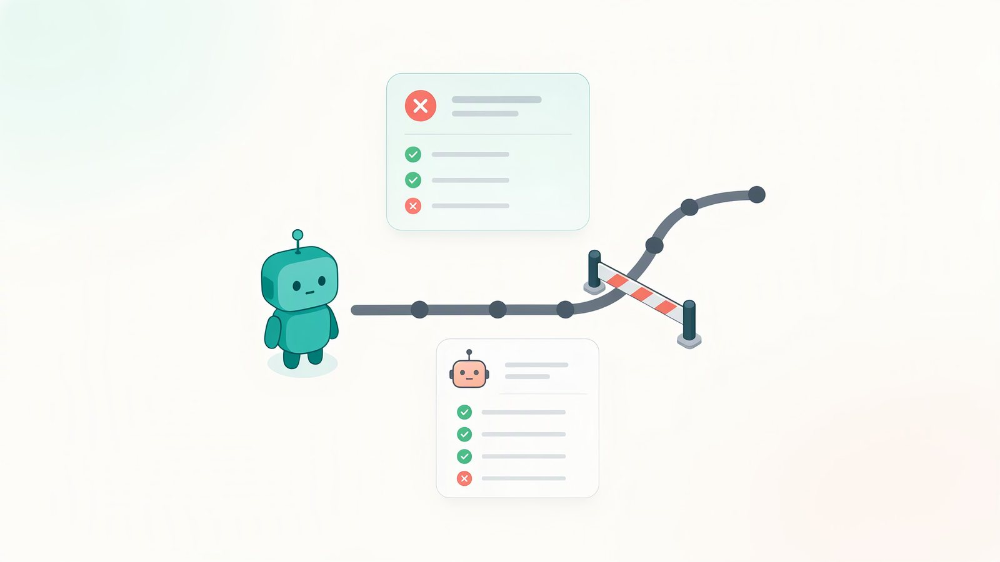

import { Steps } from '@astrojs/starlight/components';
import LabMeta from '../../../../components/LabMeta.astro';
import EvalMap from '../../../../components/EvalMap.astro';
import Pieces from '../../../../components/Pieces.astro';
import RunDiagram from '../../../../components/RunDiagram.astro';

<LabMeta time="30 分钟，自定进度" cost="每个拉取请求在 GitHub Actions 中进行 3 次 Copilot 运行" uses="你自己的存储库副本" />

<figure class="illustration">
  
  <figcaption>评估（eval）会在每个拉取请求上运行，并标记出重新引入 bug 的更改。</figcaption>
</figure>

你的技能（skill）现在已经能通过评估了。评估的职责也随之改变：从“智能体已经能做到这件事了吗？”变成“它是否**仍然**能做到？”在本练习中，GitHub Actions 会在每个改动技能的拉取请求上运行评估，并把结果以评论的形式发布出来。然后，你会尝试重新引入 bug，看评估如何发现它。

<EvalMap
  doing="用 GitHub Actions 在每个拉取请求上运行评估，然后重新引入 bug，观察 CI 如何标记它。"
  testing="技能的每一次更改，自动测试"
  checking="smoke 套件：练习 3 中的代码检查项"
  task={{ text: '根据 <code>backlog.json</code> 编写发布说明' }}
  agent={{ text: 'GitHub Copilot，在 GitHub Actions 中运行', state: 'changed' }}
  environment={{ text: '拉取请求中的技能', state: 'changed' }}
  trials={{ text: '每个拉取请求 3 次' }}
  checks={{ text: '答案、运行记录（transcript）和工作区，与练习 3 相同' }}
  results={{ text: '拉取请求上的一项检查和一条评论', state: 'changed' }}
/>

<RunDiagram
  command="gh pr create --fill"
  actors={[
    { id: 'you', name: '你', icon: 'pencil', tone: 'you' },
    { id: 'pr', name: '拉取请求', icon: 'code-branch', tone: 'you', note: '在 GitHub 上' },
    { id: 'actions', name: 'GitHub Actions', icon: 'server', tone: 'runner', note: 'Evals 工作流' },
    { id: 'vally', name: 'Vally', icon: 'setting', tone: 'runner', note: '运行 GitHub Copilot' },
  ]}
  steps={[
    { from: 'you', to: 'pr', text: '创建拉取请求', detail: '它修改了技能，因此符合工作流的路径条件。' },
    { from: 'pr', to: 'actions', text: '启动 Evals 工作流', detail: '每个修改了技能或评估的拉取请求都会触发它。' },
    { from: 'actions', text: '登录并安装 Vally', detail: '使用作业自己的令牌和 <code>copilot-requests: write</code>：不需要机密。', state: 'new' },
    { from: 'actions', to: 'vally', text: '运行 smoke 套件', detail: '先运行 lint，再运行所有带 <code>lane: ci</code> 标签的评估，并使用 <code>--require-pass</code>。', state: 'new' },
    { from: 'vally', text: '运行试验和检查项', detail: '智能体运行三次试验，每次五项检查，与练习 3 相同。' },
    { from: 'vally', to: 'actions', text: '判定结果和证据', detail: '评估失败，作业就会失败。' },
    { from: 'actions', to: 'pr', text: '发布检查结果和一条评论', detail: '评论中列出分数、阈值和 token 用量。', state: 'new' },
    { from: 'pr', to: 'you', text: '显示结果', detail: '通过时就合并；否则阅读证据并修复。' },
  ]}
/>

## 你会用到的要素

<Pieces
  items={[
    { term: '回归评估', def: '守护已经正常工作的行为的评估。它的通过率应接近 100%；一旦失败，就说明有东西坏了。', analogy: '回归测试套件', where: '你的发布说明评估，现在在 CI 中运行', isNew: true },
    { term: '标签（tag）', def: '评估上的键值对标记，用于为套件挑选评估。', analogy: '测试分类', where: '<code>tags: { lane: ci }</code>', isNew: true },
    { term: '套件', def: '一组有名称的评估。<code>smoke</code> 套件会运行所有带有 <code>lane: ci</code> 标签的评估。', analogy: '测试套件', where: '<code>.vally.yaml</code>；<code>vally eval --suite smoke</code>', isNew: true },
    { term: '<code>github/evals-action</code>', def: '一个 GitHub Action：它会安装 Vally，对你的项目执行 lint 检查，运行一个套件，并在拉取请求上发布一条包含结果的评论（之后的运行会更新这同一条评论，而不是新增评论）。', analogy: 'CI 中的测试运行器', where: '<code>.github/workflows/evals.yml</code>', isNew: true },
    { term: '<code>copilot-requests: write</code>', def: '一项工作流权限，允许作业自身的令牌把 Copilot 作为被测智能体来运行。不需要任何机密或个人令牌。', analogy: '发给作业的通行证', where: '工作流中的 <code>permissions:</code>', isNew: true },
  ]}
/>

## 开始之前

- 你需要一份由起始存储库创建的**你自己的副本**（[Use this template](../../start/codespaces/#1-创建你自己的存储库副本)），其中已启用 GitHub Actions；还需要它的 Codespace 或克隆。
- 你需要 **GitHub CLI**（`gh`），并已登录你的帐户。Codespace 中已经准备好了它。在你自己的计算机上，你已在搭建环境时登录；`gh auth status` 会显示你的帐户。
- **由谁付费**：在个人存储库中，运行使用的是存储库所有者的 Copilot 计划。在组织的存储库中，组织所有者必须允许 **Copilot CLI billed to the organization**，并且存储库内部发起的每个拉取请求都可能启动由组织付费的运行。
- 你应该已经完成了练习 3 和练习 4；如果还没有，请运行 `scripts/catch-up.sh 4`。

## 步骤

<Steps>

1. 给评估打上 CI 套件的标签。在 `evals/release-notes.eval.yaml` 中，于 `type: capability` 这一行的下方添加以下两行，缩进与 `type` 相同：

   ```yaml
   tags:
     lane: ci                  # selected by the smoke suite in .vally.yaml
   ```

   存储库根目录中的 `.vally.yaml` 定义了这个套件：`smoke` 会运行所有带有 `lane: ci` 标签的评估。

2. 先在本地运行这个套件，这样你就知道 CI 会看到什么：

   ```bash
   vally eval --suite smoke
   ```

   只有带标签的评估会运行：3 次试验，使用修复后的技能全部通过。

3. 添加工作流：

   ```bash
   mkdir -p .github/workflows
   cp lab-files/lab-7/evals.yml .github/workflows/evals.yml
   ```

   读一读这个文件。重要的部分如下：

   ```yaml title=".github/workflows/evals.yml (excerpt)"
   on:
     pull_request:
       paths:
         - .github/skills/**      # run when the skill changes …
         - evals/**               # … or an eval, the data, the config, the workflow
   jobs:
     evals:
       permissions:
         contents: read
         copilot-requests: write   # the job's token runs the agent under test with Copilot
         pull-requests: write      # the action posts one sticky comment
       steps:
         - uses: actions/checkout@v7
         - uses: github/evals-action@v0
           with:
             working-directory: evals
             suite: smoke
             vally-version: '0.21.0'
   ```

   `working-directory: evals` 把这个 Action 限定在 `evals/` 文件夹中：它会对工作目录中的每个评估文件执行 lint 检查，而 `lab-files/` 和 `solutions/` 中的起始文件只有复制到 `evals/` 之后才能正常工作。Vally 会自己在存储库根目录中找到 `.vally.yaml`。

4. 提交你的工作，并推送到 `main`：

   ```bash
   git add -A
   git commit -m "Run the release-notes eval on pull requests"
   git push
   ```

   `.gitignore` 会把你的运行结果、`.env` 和参数文件排除在提交之外。

5. 现在，在一个拉取请求中重新引入这个 bug：

   ```bash
   git switch -c try-the-old-skill
   cp skill-versions/before/release-notes/SKILL.md .github/skills/release-notes/SKILL.md
   git commit -am "Try the original release-notes skill"
   git push -u origin try-the-old-skill
   gh pr create --fill
   ```

6. 观察这项检查：

   ```bash
   gh pr checks --watch
   ```

   几分钟后，**Evals** 检查会失败。这个 Action 会替你带上 `--require-pass` 运行 `vally eval`，所以评估失败会导致作业失败，就像你在练习 2 中看到的那样。在浏览器中打开拉取请求（`gh pr view --web`）。下面是这个 Action 发布的评论（已缩短）：

   ```text
   Evals: failed

   Suite: smoke
   Lint: validated (no model execution) - Evidence
   Run: failed - 3 trials - Evidence

   | Eval                         | Trials | Result |
   | release-notes-completed-only |      3 | failed |

   | Eval                         | Verdict | Score                 | Duration | Tokens        |
   | release-notes-completed-only | failed  | 0.80 (threshold 1.00) | 14487ms  | 152347 tokens |
   ```

   评论中列出的是评估的名称，而不是检查项的名称。但这个分数你很熟悉：0.80 表示 5 个检查项中有 4 个通过，和练习 3 中一样。要查看是哪个检查项失败以及失败的原因，请自己在这个分支上运行套件（`vally eval --suite smoke`），然后像练习 3 中那样查看结果：失败的是 `leaves-out-unfinished-export`，因为答案又宣布了 CT-102。GitHub 仍然允许你合并这个拉取请求：只有在你把这项检查设为必需之后，失败的检查才会阻止合并；请参阅[更进一步](#更进一步)。

7. 关闭拉取请求（不合并），然后回到 `main`：

   ```bash
   gh pr close --delete-branch
   git switch main
   ```

</Steps>

## 刚才发生了什么

你的评估从能力评估“毕业”了，成为一项回归检查。现在，任何人修改技能，都会在审阅者查看之前，就在自己的拉取请求上看到评估的判定结果和证据。而且，这个 Action 使用的是作业自身的令牌，并带有 `copilot-requests: write` 权限：不需要个人令牌，也不需要存储机密。

:::note[为什么 `type` 仍然是 `capability`]
Vally 的 `type: regression` 还需要一个基线配置；没有基线时，`vally lint` 会警告：没有基线的回归评估只不过是能力评估。在本练习中，是标签和 CI 工作流让这个评估成为回归检查，`type` 保持不变。
:::

## 自我检查

<details>
<summary>为什么要在推送工作流之前先在本地运行套件？</summary>

为了知道 CI 会看到什么：如果评估在本地失败或出错，它在 CI 中也会失败，而且要经过更慢的一轮往返才能发现。先在本地运行，等结果变绿后再推送。

</details>

<details>
<summary>为什么来自复刻的拉取请求不会运行这个工作流？</summary>

作业条件 `github.event.pull_request.head.repo.full_name == github.repository` 会跳过它们。来自复刻的拉取请求可能会修改评估或技能，借助作业的 Copilot 访问权限做任何事情，而费用由你承担。

</details>

## 参考答案

把你的文件和我们的对照一下。在评估中，高亮的行就是你在第 1 步中添加的标签。工作流就是你在第 3 步中复制的文件，这里是完整内容。

<details>
<summary>加了 CI 标签的评估</summary>

```yaml title="solutions/lab-7/release-notes.eval.yaml" ins={6-7}
# Lab 7 solution: the Lab 3 eval, tagged for the CI suite. It now guards behavior that works,
# so every pull request runs it: a passing capability eval graduates into a regression check.
name: release-notes-completed-only
description: The release-notes skill announces completed work only and leaves the in-progress status in backlog.json alone.
type: capability            # intent: "can the agent do this yet?" (a regression eval guards what already works)
tags:
  lane: ci                  # selected by the smoke suite in .vally.yaml
defaults:
  executor: copilot-sdk     # the agent under test: GitHub Copilot, driven through the Copilot SDK
  model: claude-sonnet-5.5  # pinned, so results are comparable (scripts/use-model.sh changes it)
  runs: 3                   # trials per stimulus: agents aren't deterministic, so one run proves little
  timeout: 120s             # per trial
agent_environment:          # what the agent finds in its workspace, rebuilt for every trial
  skills:
    - ../.github/skills/release-notes   # the skill under test (paths are relative to this file)
  files:
    - src: ../backlog.json              # copied into the workspace as backlog.json
      dest: backlog.json
scoring:
  threshold: 1              # a trial passes only when every check passes
stimuli:
  - name: completed-work-only
    prompt: Write the release notes for this release from backlog.json.
    graders:
      # Code checks on the final answer (the outcome you can see)
      - type: output-contains
        name: leaves-out-unfinished-export
        config: { substring: CT-102, negate: true }   # passes when CT-102 is NOT in the answer
      - type: output-contains
        name: includes-done-search
        config: { substring: CT-101 }
      - type: output-contains
        name: includes-done-dark-mode
        config: { substring: CT-103 }
      # A check on the transcript (how the agent got there)
      - type: skill-invocation
        name: release-notes-skill-used
        config:
          required:
            - release-notes
      # A check on the workspace (side effects): backlog.json still contains the in-progress status
      - type: file-contains
        name: backlog-still-in-progress
        config:
          path: backlog.json
          value: '"status": "in-progress"'
```

[在 GitHub 上打开](https://github.com/jeffrey-groneberg/agent-evals-workshop-starter/blob/main/solutions/lab-7/release-notes.eval.yaml)

</details>

<details>
<summary>工作流</summary>

```yaml title=".github/workflows/evals.yml"
# Lab 7: run the smoke suite on every pull request and post the result as a PR comment.
# Copy it into place:  mkdir -p .github/workflows && cp lab-files/lab-7/evals.yml .github/workflows/evals.yml
#
# Billing: in a personal repository, the runs use the repository owner's Copilot seat. In an
# organization repository, an admin must allow "Copilot CLI billed to the organization".
name: Evals

on:
  pull_request:
    paths:
      - .github/skills/**
      - evals/**
      - backlog.json
      - .vally.yaml
      - .github/workflows/evals.yml
  workflow_dispatch:

permissions:
  contents: read

jobs:
  evals:
    # Run for manual starts and for pull requests from this repository (not from forks).
    if: github.event_name == 'workflow_dispatch' || github.event.pull_request.head.repo.full_name == github.repository
    runs-on: ubuntu-latest
    timeout-minutes: 15
    permissions:
      contents: read
      copilot-requests: write   # lets the job's own token run the agent under test with Copilot
      pull-requests: write      # lets the action post and update one sticky PR comment
    concurrency:
      group: evals-${{ github.workflow_ref }}
      cancel-in-progress: false
    steps:
      - uses: actions/checkout@v7
        with:
          persist-credentials: false
      - uses: github/evals-action@v0
        with:
          # Lint and run only evals/. lab-files/ and solutions/ hold starters that work only once
          # copied into evals/. Vally finds .vally.yaml in the repository root by itself.
          working-directory: evals
          suite: smoke           # runs the evals tagged lane: ci
          vally-version: '0.21.0'
```

[在 GitHub 上打开](https://github.com/jeffrey-groneberg/agent-evals-workshop-starter/blob/main/lab-files/lab-7/evals.yml)

</details>

## 卡住了？

- **工作流没有启动**：拉取请求必须更改 `paths` 中某个路径下的文件，并且必须在存储库的设置中启用 Actions。
- **作业在运行评估之前就失败了**：查看 lint 步骤的日志。只要有一个评估存在 lint 错误，整个套件就会停止；在本地运行 `vally lint -e evals --strict` 找出它。
- **Actions 中不允许使用 Copilot**（组织存储库）：请组织所有者允许由组织支付 Copilot CLI 的费用（Copilot CLI billed to the organization）。
- **`gh pr create` 向你提问**：回答这些问题，或者加上 `--title "Try the original skill" --body "Lab 7"`。

## 更进一步

- 让这项检查阻止合并：在存储库的 **Settings** > **Rules** > **Rulesets** 中，为 `main` 创建一个分支规则集，启用 **Require status checks to pass**，并添加 **Evals** 检查。同时删除工作流中的 `paths` 筛选器：如果某个拉取请求没有改动这些路径，必需的检查就永远不会运行，它会一直处于等待状态，并阻止该拉取请求合并。
- 像对待生产环境的工作流那样，把这些 Action 固定到提交 SHA，而不是标签。
- 把练习 2 中已知正确的对照用例添加为第二个套件，并用 `--require-pass` 把关。
- 阅读 GitHub Copilot Evals 的 [CI 设置指南](https://github.github.io/evals/journeys/ci-setup/)和 [`github/evals-action` README](https://github.com/github/evals-action)。

**下一步**：[练习 8：比较模型](../lab-8-compare-models/)
