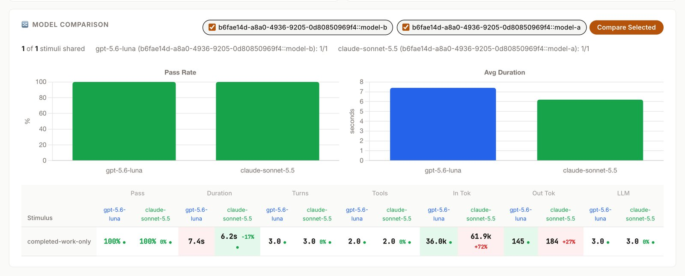

import { Steps } from '@astrojs/starlight/components';
import LabMeta from '../../../../components/LabMeta.astro';
import EvalMap from '../../../../components/EvalMap.astro';
import Pieces from '../../../../components/Pieces.astro';

<LabMeta time="20 分钟，自定进度" cost="6 次 Copilot 运行；B 部分使用你自己的终结点" uses="experiments/models.experiment.yaml" />

<figure class="illustration">
  
  <figcaption>同样的任务、同样的检查项、两个模型：比较质量、速度和成本。</figcaption>
</figure>

新模型发布了。它**对你的智能体来说**更好吗？基准测试回答不了这个问题，你的评估（eval）可以。在本练习中，你将用一个只改变模型的实验，在两个模型上运行 release-notes 评估。

**开始之前**：你需要练习 3 中的评估和练习 4 中修复后的技能（skill）。如果你跳过了这两个练习，请运行 `scripts/catch-up.sh 4`。

<EvalMap
  doing="用实验在两个模型上运行同一个评估，并比较通过率、token 用量、用时和答案。"
  testing="作为智能体的两个模型，使用相同的技能和相同的评估"
  checking="练习 3 中的 5 个代码检查项"
  task={{ text: '根据 <code>backlog.json</code> 编写发布说明' }}
  agent={{ text: '模型 A 对比模型 B', state: 'changed' }}
  environment={{ text: '修复后的技能和 <code>backlog.json</code>' }}
  trials={{ text: '每个模型 3 次' }}
  checks={{ text: '答案、运行记录和工作区，与练习 3 相同' }}
  results={{ text: '实验对比、仪表板' }}
/>

## 你将用到的要素

<Pieces
  items={[
    { term: '以模型为变量', def: '实验改变的是 <code>/defaults/model</code>：同一个评估、同一个技能、两个模型。', analogy: 'A/B 测试', where: '<code>vary: [/defaults/model]</code>', isNew: true },
    { term: '模型 ID', def: 'Copilot 用来指代某个模型的名称，例如 <code>claude-sonnet-5.5</code>。你能使用哪些模型，取决于你的 Copilot 计划和组织。', analogy: '商品的 SKU', where: 'Copilot CLI 中的 <code>/model</code>', isNew: true },
    { term: '执行器的模型提供方（B 部分）', def: '为智能体本身自带密钥：仍是同一个 Copilot 运行框架，但模型调用会发送到你的终结点。', analogy: '同一辆车换了一台发动机', where: '<code>executor.config.provider</code>', isNew: true },
  ]}
/>

## A 部分：两个 Copilot 模型

<Steps>

1. 查看你的 Copilot 计划提供哪些模型：启动 `copilot`，输入 `/model`，记下两个模型 ID，然后输入 `/exit`。

2. 打开 `experiments/models.experiment.yaml`，把你的两个模型 ID 分别填入 `model-a` 和 `model-b`：

   ```yaml title="experiments/models.experiment.yaml"
   name: release-notes-models
   evals:
     - ../evals/release-notes.eval.yaml
   vary: [/defaults/model]
   baseline: model-a
   variants:
     model-a:
       overrides:
         model: claude-sonnet-5.5   # example; replace with a model from /model
     model-b:
       overrides:
         model: gpt-5.6-luna        # example; replace with a model from /model
   ```

3. 先检查执行计划，再运行实验：

   ```bash
   vally experiment run experiments/models.experiment.yaml --dry-run
   vally experiment run experiments/models.experiment.yaml
   ```

   以下是我们使用 `claude-sonnet-5.5` 和 `gpt-5.6-luna` 运行时输出的末尾部分：

   ```text
   Experiment  release-notes-models   varying /defaults/model · baseline model-a

     → No variant beat baseline. Same pass rate (1/1) for both.
       model-b used −42% tokens, +1% trial time.

     eval                          model-a (baseline)         model-b                    Δ
     release-notes-completed-only  ✓ 1/1 (score 100% ≥ 100%)  ✓ 1/1 (score 100% ≥ 100%)  ±0
     ────────────────────────────  ─────────────────────────  ─────────────────────────  ────
     stimuli                       1/1                        1/1                        ±0
     tokens                        186.3k                     108.4k                     −42%
     trial time                    25.4s                      25.6s                      +1%
   ```

   两个模型的每次试验都通过了，所以在质量上谁也没有“胜过”谁。但其中一个模型取得同样的结果，所用的 token 少了 42%。

4. 像练习 4 中那样，在仪表板中比较细节。在仪表板的终端中按 Ctrl+C，然后让它指向最新的实验：

   ```bash
   EXP=$(ls -d vally-experiment-results/*/ | tail -1)
   vally serve "$EXP" --port 3200 --allowed-host "${CODESPACE_NAME}-3200.${GITHUB_CODESPACES_PORT_FORWARDING_DOMAIN}"
   ```

   重新加载页面，向下滚动到 **Model comparison**，勾选这两次运行，然后选择 **Compare Selected**。这一次，各列显示的是模型名称：

   

   通过率相同，轮数和工具调用次数也相同，但速度不同，token 数更是相差很大。差值是相对于第一列计算的。

5. 用 `./scripts/answers.sh` 读一读每个模型的几个答案。两个模型都通过了所有检查项，但它们读起来一样吗？风格、长度和语气上的差异，你的检查项可能覆盖不到；这时，练习 5 中的 LLM 评审就能派上用场。

</Steps>

两个模型可能都通过了所有检查项，但在成本、速度和风格上仍有差别。每个模型只有 3 次试验时，通过率相差一次试验可能只是运气；要做出真正的决定，请使用更多试验和更多任务。

## B 部分：把你自己终结点上的模型用作智能体

如果你有自己的模型终结点（如[模型访问与费用](../../start/model-access/#你自己的模型终结点可选)中所述），就可以把其中的某个模型作为被测智能体。智能体仍由 Copilot 的运行框架运行，但每次模型调用都会发送到你的终结点，因此不会消耗任何 Copilot 请求。

<Steps>

1. 复制专门为此准备的评估，并阅读其中的 `defaults`：

   ```bash
   cp lab-files/lab-8/release-notes-endpoint.eval.yaml evals/
   ```

   ```yaml
   defaults:
     model: ${AGENT_MODEL=set-your-deployment-name}   # the deployment name on your endpoint
     runs: 3
     timeout: 180s
     executor:
       name: copilot-sdk                 # the same agent harness as before ...
       config:
         provider:                       # ... but its model calls go to your endpoint
           type: azure
           baseUrl: ${AGENT_BASE_URL=https://set-your-endpoint.invalid/openai/v1/}   # replaced by --param
           wireApi: responses
           apiKeyEnv: LLM_API_KEY
   ```

2. 运行它：

   ```bash
   vally eval -e evals/release-notes-endpoint.eval.yaml \
     --param AGENT_BASE_URL="$LLM_BASE_URL" \
     --param AGENT_MODEL="$LLM_MODEL"
   ```

   运行前，需要在环境中设置 `LLM_BASE_URL`、`LLM_API_KEY` 和 `LLM_MODEL`；`./scripts/check-setup.sh --ping` 可以测试它们。在我们使用 GPT-5 系列部署的运行中，3 次试验全部通过，每次约用 31,000 个 token。

3. 把它的 `eval-results.md` 与 A 部分的结果进行比较：通过率、token 用量、用时和工具调用。然后用 `./scripts/answers.sh --tools` 查看工具调用：你终结点上的模型使用技能的方式一样吗？

</Steps>

:::note[为什么 B 部分不用实验？]
B 部分也可以做成实验：`vally experiment run` 接受 `--param`，你需要在 `vary` 中声明 `/defaults/executor` 和 `/defaults/model`。单独运行可以让本练习保持简短，你只需把结果并排比较即可。
:::

## 自我检查

<details>
<summary>模型 B 的 3 次试验全部通过，模型 A 通过了 2 次。模型 B 更好吗？</summary>

还不能证明。每个模型只有 3 次试验时，相差一次试验很可能只是偶然。这是一条值得用更大规模的运行去验证的线索：更多试验、更多任务，并查看失败试验的运行记录（transcript）。

</details>

## 遇到问题？

- **某个模型不可用**：从 `/model` 中另选一个。
- **B 部分出现 400 错误**：部署必须支持通过 Responses API 进行工具调用，例如 GPT-5 系列模型。

**下一步：**[练习 9：你自己的智能体](../lab-9-your-own/)
