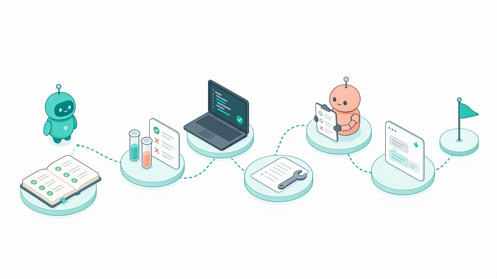

import { LinkCard, Steps } from '@astrojs/starlight/components';
import Flow from '../../../../components/Flow.astro';

<figure class="illustration">
  
  <figcaption>路线：定义“好”、检查你的检查项、运行、修复、评审，再让 Copilot 来帮忙。</figcaption>
</figure>

这个工作坊教你**衡量** AI 智能体，而不是靠猜。你会先学习基础知识，然后用 Microsoft 的评估（eval）运行器 Vally 手动编写并运行评估，从而看清评估的每个组成部分。接着，你会让 GitHub Copilot Evals 帮你创建、审查、运行和比较评估，并且懂得如何评判它起草的内容。

本工作坊面向构建或使用 AI 智能体、技能（skill）、提示词或 MCP 工具的开发者。你不需要任何评估经验，但应该能熟练使用终端、Git 和 YAML。

## 贯穿始终的示例

整个工作坊中，你都会使用同一个小示例：一个为 GitHub Copilot 编写的**技能**，用来起草发布说明。技能是一个包含 `SKILL.md` 文件的文件夹，文件里是一组指令：当某个请求与技能的描述相匹配时，智能体就会加载这些指令。这个技能会读取 `backlog.json`：

```json title="backlog.json"
[
  { "id": "CT-101", "title": "Search across all projects", "status": "done" },
  { "id": "CT-102", "title": "Export reports to CSV", "status": "in-progress" },
  { "id": "CT-103", "title": "Dark mode for the dashboard", "status": "done" }
]
```

而且它有一个 bug。它的第一条规则要求智能体公布待办事项列表中的**每一个**条目，包括尚未完成的 CT-102：

```markdown title=".github/skills/release-notes/SKILL.md" {3}
Read `backlog.json` in the project root and draft the release notes for the next release.

- List every backlog item as a feature of this release, one bullet per item, formatted as `- ID: title`.
- Start with one short sentence that summarizes the release.
- Keep the tone friendly and short. Do not edit any files.
```

公布一个尚未完成的功能，是现实中确实会发生的错误，而且会带来实际后果：客户会去寻找一个根本不存在的功能。你将用评估发现这个 bug，衡量它出现的频率，修复它，并证明修复有效。

## 日程安排

引导部分大约需要 2 小时。每个练习都建立在前一个练习的基础上；如果你进度落后，可以用 `scripts/catch-up.sh` 直接跳到后面的进度。

| 时间 | 环节 | 你要做什么 | 模型用量 |
| --- | --- | --- | --- |
| 0:00 | 欢迎 | 目标，以及如何使用本网站 | 无 |
| 0:05 | [练习 0：设置与检查](../../labs/lab-0-setup/) | 打开你的 Codespace，登录，运行一个很小的评估 | 1 次 Copilot 运行 |
| 0:15 | 入门讲解 | [什么是评估？](../../concepts/what-is-an-eval/)和[评估的构成](../../concepts/anatomy/) | 无 |
| 0:30 | [练习 1：定义“好”](../../labs/lab-1-define-good/) | 把“好答案”变成可以运行的检查项 | 无 |
| 0:40 | [练习 2：检查你的检查项](../../labs/lab-2-check-your-checks/) | 借助免费的模拟执行器（mock），证明你的检查项能发现错误答案 | 无 |
| 0:55 | [练习 3：运行智能体](../../labs/lab-3-run-the-agent/) | 运行 3 次试验，阅读结果和运行记录（transcript） | 3 次 Copilot 运行 |
| 1:15 | [练习 4：修复并证明](../../labs/lab-4-fix-and-prove/) | 修复技能，并用受控实验证明修复有效 | 6 到 9 次 Copilot 运行 |
| 1:30 | [练习 5：添加 LLM 评审](../../labs/lab-5-llm-judge/) | 编写评分标准（rubric），校准 LLM 评审 | 3 次 Copilot 运行，约 11 次评审调用 |
| 1:45 | [练习 6：GitHub Copilot Evals](../../labs/lab-6-copilot-evals/) | 借助 Copilot 审查、创建并运行评估 | 几条 Copilot 提示词和几次运行 |
| 2:00 | 总结 | 接下来可以做什么 | 无 |

**自定进度，回家完成**：[练习 7：在 CI 中运行评估](../../labs/lab-7-ci/)、[练习 8：比较模型](../../labs/lab-8-compare-models/)和[练习 9：你自己的智能体](../../labs/lab-9-your-own/)。按你自己的节奏来，需要多久就花多久。

<Flow
  label="各个练习如何层层递进"
  steps={[
    { label: '定义“好”', detail: '练习 1', tone: 'input' },
    { label: '检查你的检查项', detail: '练习 2，无需模型', tone: 'grader' },
    { label: '运行并阅读', detail: '练习 3', tone: 'agent' },
    { label: '修复并证明', detail: '练习 4', tone: 'agent' },
    { label: '评判质量', detail: '练习 5', tone: 'grader' },
    { label: '让 Copilot 帮忙', detail: '练习 6', tone: 'result' },
  ]}
/>

## 工作坊开始之前

如果可以，请在家里提前完成以下步骤。大约需要 5 分钟，可以为现场环节节省时间。

<Steps>

1. **检查你的 Copilot 计划**。你需要 GitHub Copilot Pro、Pro+、Business 或 Enterprise。如果使用 Business 或 Enterprise 计划，你的组织必须允许使用 Copilot CLI。

2. **复制起始存储库，然后打开你的副本**：可以[在 Codespace 中](../codespaces/)打开（推荐），也可以[在你的计算机上](../local/)打开。无论哪种方式，都要运行一次 `./scripts/check-setup.sh`。

</Steps>

这就是你需要准备的全部内容：不需要创建令牌，也不需要其他帐户或 API 密钥。Codespace 会自行把评估运行器登录到 Copilot；在你的计算机上，你只需使用 GitHub CLI 登录一次。如果你更希望让 LLM 评审在自己的模型终结点上运行（例如 Azure OpenAI 或 Microsoft Foundry 部署），请参阅[模型访问与费用](../model-access/)。这是可选的。

## 练习页面的结构

每个练习都由相同的几个部分组成，所以你总能知道该看哪里：

- **信息行**位于标题下方：时长、模型用量，以及练习会用到的内容。
- **你将用到的要素**：本练习中的每个新术语都用通俗的语言解释，并注明你会在 YAML 或输出中的哪里看到它。请先读这一部分；它说明了每个步骤背后的“是什么”。
- **为什么这很重要**：本练习背后的理念。
- **步骤**：确切的命令、需要关注的地方，以及我们得到的输出。
- **刚才发生了什么**：对输出的解释。
- **自我检查**：两三个问题，答案可以展开查看。
- **遇到问题**？追赶进度的命令，以及最常见的错误。
- **更进一步**：可选的扩展内容。

## 在哪里操作

每个练习都假定你已经在 VS Code 中打开了自己的[起始存储库](https://github.com/jeffrey-groneberg/agent-evals-workshop-starter)副本：可以是在 Codespace 中，也可以是克隆到你计算机上的副本。你的副本中存放着你要操作的文件；本网站位于另一个单独的存储库中，你只需要阅读它。当某个步骤让你**打开**一个文件时，请在编辑器中按路径打开它：可以从 Explorer（资源管理器）中打开，也可以使用 Quick Open（快速打开），即按 <kbd>Ctrl</kbd>+<kbd>P</kbd>（在 macOS 上按 <kbd>Cmd</kbd>+<kbd>P</kbd>）。当某个步骤给出一条命令时，请在 VS Code 的终端（**Terminal** > **New Terminal**）中运行它；终端会在你副本的根文件夹中启动。

Vally 会把结果保存为 Markdown 文件。要以格式化表格的形式阅读某个结果文件，请在 Explorer 中右键单击它，然后选择 **Open Preview**（打开预览）。

:::tip[两种语言]
每个页面都有英文版和简体中文版，你可以通过顶部的语言菜单切换。在两种语言的页面中，命令、文件名和输出都保持英文。
:::

## 下一步

<LinkCard title="在 Codespace 中搭建环境" description="推荐：无需安装任何东西。" href="../codespaces/" />
<LinkCard title="在你的计算机上搭建环境" description="macOS、Linux，或带 WSL 的 Windows。" href="../local/" />
